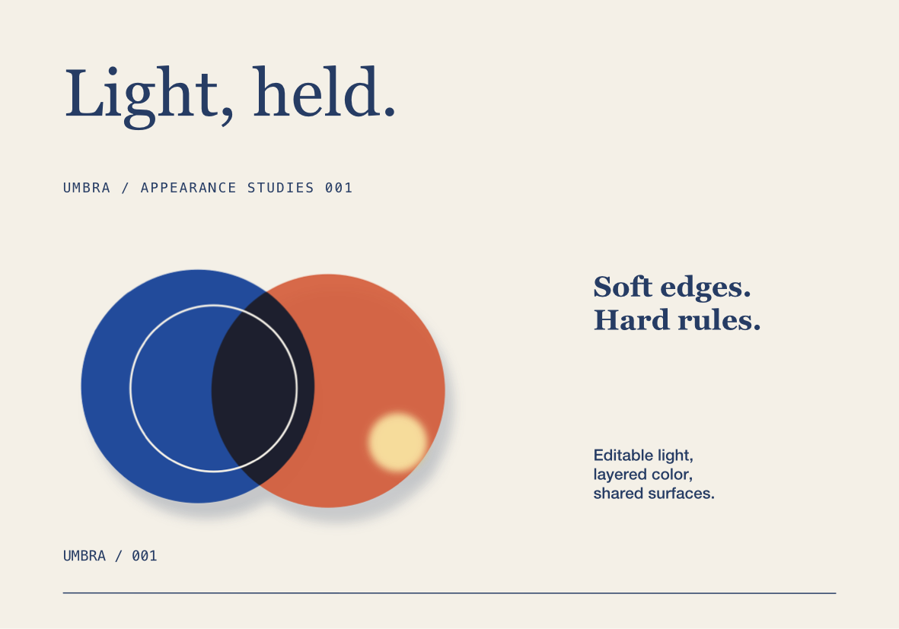
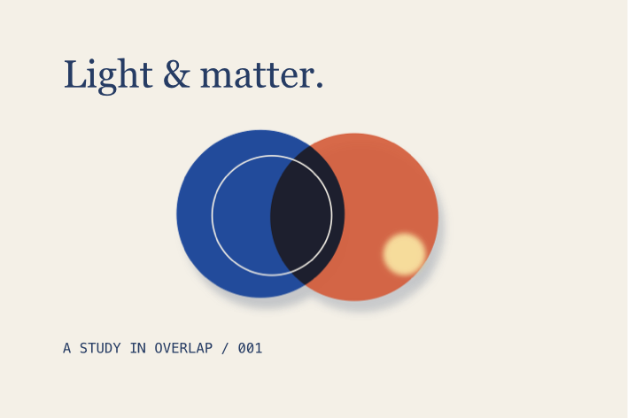

# Editable appearance and the UMBRA study

Artwork layers now support editable opacity, Gaussian blur, drop shadows, and sixteen blend modes. The native inspector and `form_appearance` use the same validated commands, Undo history, linked sources, and physical previews.



## Native workflow

Select a layer in Artwork. **Blend** chooses Normal, Multiply, Screen, Overlay, Darken, Lighten, Color Dodge, Color Burn, Hard Light, Soft Light, Difference, Exclusion, Hue, Saturation, Color, or Luminosity. The existing Opacity field controls the complete layer, including its fill, stroke, and effects.

Open **Effects** to enable Blur or Drop shadow. Blur radius, shadow offsets, and shadow blur use physical units; fields accept the current document unit or an explicit suffix. Positive shadow Y moves down the artwork. Shadow color accepts a local color or a named project swatch. Disabling an effect preserves its settings. **Reset appearance** restores full opacity, Normal blending, no explicit isolation, and no effects on the selected roots; children keep their own settings.

Ordinary groups pass child blending through to their surroundings. **Isolate blending** makes children blend against their own group before compositing it. A group's opacity, effects, or non-Normal blend mode also require isolation. Group opacity applies once to the complete group, rather than independently to each child. Effects apply before clipping. Geometry, selection handles, and manufacturing paths remain editable and independent of the visible shadow or blur.

An effect-bearing group cannot be ungrouped while that would discard its combined appearance. Reset its appearance first, or keep the group and edit its children. Converting shaped text to outlines preserves the combined appearance and retains a hidden editable text source, including separate character colors.

## MCP

There are **45 tools**. `form_appearance` patches selected root layers on an artwork frame or linked physical product:

```json
{"name":"form_appearance","arguments":{"object_id":"<frame UUID>","element_ids":["<group UUID>"],"values":{"shadow":{"x":2,"y":3.5,"blur":1.2,"opacity":0.23,"color":"#263C64"}}}}
{"name":"form_appearance","arguments":{"object_id":"<frame UUID>","element_ids":["<layer UUID>"],"values":{"blend_mode":"multiply","opacity":0.9,"blur":{"enabled":true,"radius":0.8}}}}
{"name":"form_appearance","arguments":{"object_id":"<frame UUID>","element_ids":["<group UUID>"],"values":{"isolate":true}}}
{"name":"form_swatch","arguments":{"command":"assign","object_id":"<frame UUID>","element_ids":["<group UUID>"],"target":"shadow","swatch_id":"<swatch UUID>"}}
{"name":"form_appearance","arguments":{"object_id":"<frame UUID>","element_ids":["<layer UUID>"],"values":{"blur":{"enabled":false}}}}
{"name":"form_appearance","arguments":{"command":"reset","object_id":"<frame UUID>","element_ids":["<layer UUID>"]}}
```

`command` defaults to `update`. Omitted properties retain their values; `blur: null` or `shadow: null` removes that effect. `opacity` and shadow opacity range from 0 to 1. Blur values range from 0 to 50 mm, and shadow offsets from −100 to 100 mm. `isolate` accepts a boolean on groups. Locked artwork and clipping-mask geometry reject appearance edits. Invalid edits and failed batches preserve the project. All mutations support shared Undo/Redo and `form_batch`.

A literal shadow color detaches its swatch link. `form_swatch target: shadow` assigns or detaches that link; deleting a swatch freezes its resolved color, including on disabled effects. Detaching a missing shadow is a no-op. Read raw definitions with `form_get_artwork`; `resolved: true` expands components and resolves shared colors for inspection.

## Rendering, persistence, and output

Appearance fields require **schema 8**; schemas 1–7 still load. Definitions retain editable geometry and effect settings. Editing a shared component's effect changes only its source resource while every linked layout and physical face updates.

Native drawing uses Core Image Gaussian filtering in sRGB and Core Graphics compositing. The effect cache has a 64 MB cost limit, excludes root placement and irrelevant metadata, and reuses filtered content across independently positioned instances. Preview density follows the actual affine scale, with a 16-million-pixel / 8192-pixel-edge limit per filtered layer. These limits bound each effect allocation; they are not a bound on the entire process's memory.

SVG exports retain live `feGaussianBlur`, `feDropShadow`, blend modes, isolation, and physically sized filter regions. Receiving software needs filter/compositing support. Importing arbitrary SVG filters remains outside the supported import subset. PDF keeps unaffected artwork vector-based and rasterizes filtered layers at the requested DPI, defaulting to 300 DPI. PNG/JPEG use the requested resolution. Raster/PDF exports reject filtered layers exceeding the effect allocation limits at that DPI, allowing the user to reduce resolution or simplify the layer rather than silently lowering output quality. Physical frame clipping still applies; selection export includes effect margins.

The implementation follows Apple's [Gaussian blur API](https://developer.apple.com/documentation/coreimage/ciimage/applyinggaussianblur(sigma:)) and [Core Image filter reference](https://developer.apple.com/library/archive/documentation/GraphicsImaging/Reference/CoreImageFilterReference/), alongside the W3C [Filter Effects](https://www.w3.org/TR/filter-effects/) and [Compositing and Blending](https://www.w3.org/TR/compositing-1/) specifications. Blur values represent Gaussian standard deviation in millimeters before the layer transform.

## UMBRA demonstration

The **200 × 140 mm** sheet and **120 × 80 mm** card share a layered mark: Cobalt and Vermilion overlap with Multiply, a small Screen highlight has soft blur, and the group casts an Ink-linked shadow. Clay and graphite physical products reference the layouts.



Run against an isolated library:

```sh
FORM_LIBRARY_PATH="$PWD/.local/AppearanceLibrary" build/FORM.app/Contents/MacOS/FORM
python3 scripts/smoke_appearance.py
```

The workflow verifies source-only resource updates, changed linked outputs, full Undo, atomic rollback, multi-color text outlines, physical SVG/PDF/PNG/JPEG exports, schema-8 reopen, and saved edits across 100 effect-bearing placements. Native computer use additionally checks the actual controls and visible results. See [validation evidence](validation.md) for measured performance and comparison details. Production color management, publication, broader SVG interchange, advanced effects, and the remaining professional editing requirements stay in the [active goal](implementation-goal.md).
