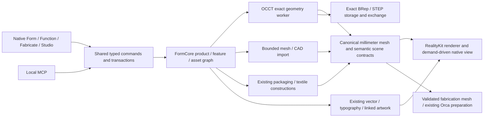

# LAB CAD foundation: audited starting point

Baseline: `e9b0faa` on `codex/form-v0.1`, October 26, 2026. The supplied [upgrade specification](cad-foundation-upgrade-spec.md) governs this work; its proposed systems are requirements, not implemented claims. LAB's current primary environments remain Form, Function and Fabricate, with secondary Studio.

## Reproducible baseline

The existing optimized suite passes **1,003 tests**, 646 core/graphics/IPC and 357 native, with no failures/skips. Commands use the repository's local Swift module/cache directories and `swift test --disable-sandbox -c release`; the frozen baseline rerun used `--skip-build` against the accepted release products. Private evidence under `.local/cad-foundation` includes 451 tracked source/resource/test hashes, six saved project packages and 184 original file hashes, current native project/status, and a real saved Studio render. User photos and source files are not published as new repository artwork.

Measured host: Apple M5, 10 physical/logical cores, 24 GiB unified RAM, macOS 26.6.2 (25G83), arm64. Baseline suite times: 28.63 s core + 42.79 s native. Current two-object MERIDIAN scene reports 2 geometry builds and last sync 3.40 ms; 60 is its preferred interaction frame rate, **not a measured sustained-fps claim**. Existing motion is demand driven. Additional scene/stress measurements must be recorded as actual observations.

Pinned preservation fixtures are the six ordinary packages: MERIDIAN/reference + exact user-edited masked dial, ORBITAL/NASA jacket, clock study, cyanotype/folding sleeve, lamp collection and mixed vessels/objects. Baseline copied assets/settings retain original bytes. The existing MERIDIAN saved shots and component STL exports are available for renderer/output comparisons.

## Exact SceneKit dependency inventory

There are **14 production Swift files with imports or actual SCN type use**, spanning FormApp and FormGraphics. FormCore has historical comments mentioning SceneKit but no SceneKit imports/types. Text matching only the word SceneKit overcounts comments/metadata and must not be used as a link-dependency gate.

| File | SCN identifier occurrences | Responsibility / migration surface |
| --- | ---: | --- |
| `Sources/FormApp/ArtworkViews.swift` | 0 | Native object inset return types use TableSCNView; migrates with the event host |
| `Sources/FormApp/ClothCoordinator.swift` | 0 | SceneKit import plus scene-node bounds crossing app cloth coordinator boundary |
| `Sources/FormApp/ClothSceneSurface.swift` | 12 | Runtime cloth node updates, assembly supports and hit-occlusion mapping |
| `Sources/FormApp/DeskClockGeometry.swift` | 34 | Sculpted clock buffers, component names, rolled rings, upright UVs and hand transforms |
| `Sources/FormApp/EmbroiderySceneSurface.swift` | 5 | Needle-derived appearance maps and scoped face-material refresh |
| `Sources/FormApp/MerchandiseGeometry.swift` | 37 | Tee/cap/tote/direct-decoration meshes, physical surface materials and placement |
| `Sources/FormApp/PrintMeshBuilder.swift` | 4 | GPU-backed primitive preparation and graph traversal into fabrication triangles |
| `Sources/FormApp/PrintViews.swift` | 31 | Native print-bed, model and actual toolpath-layer scene/controller |
| `Sources/FormApp/StudioShotRenderer.swift` | 13 | Synchronous offscreen SceneKit rendering, shot framing/lighting and resource provenance |
| `Sources/FormApp/TableScene.swift` | 114 | Table controller, procedural GeometryFactory/cache, material textures, grid/floor/selection, scene-unit transforms, native event host, project previews, unprojection/picking and snapshots |
| `Sources/FormApp/TextileGeometry.swift` | 25 | NASA bomber shaped meshes, trim, patches/labels and embroidery face ownership |
| `Sources/FormGraphics/AssemblyMaterialRenderer.swift` | 2 | PUBLIC SCNMaterial creation from physical assembly artwork in FormGraphics |
| `Sources/FormGraphics/ClothSurface.swift` | 22 | PUBLIC SCNNode/SCNMaterial dynamic cloth buffers in FormGraphics |
| `Sources/FormGraphics/SceneCamera.swift` | 2 | PUBLIC SCNNode camera adapter in FormGraphics |

The intended boundary already leaks: `SceneCamera.position` accepts SCNNode, `ClothSurface` publicly owns SCNNode/SCNMaterial, and `AssemblyMaterialRenderer.material` returns SCNMaterial. Print mesh generation prepares SCN primitives through SCNRenderer, so fabrication currently depends on the display engine. Saved Studio PNG and project/physical previews also invoke offscreen SCNRenderer. These must migrate, not merely the visible Table.

## Architecture and preservation contract

- Document physical dimensions remain Double millimeters, +Y up/right-handed. Renderer conversion to RealityKit meters occurs at its adapter. Existing persisted CameraState uses historical 100-mm scene coordinates; preserve those serialized values and map explicitly at the camera boundary instead of silently rescaling saved views.
- Keep source UUIDs, hierarchy/feature identities, local transforms, material slots, source bytes and units/provenance distinct from disposable display meshes. Revision-scoped CAD face/edge indices must never pretend to be persistent semantic anchors.
- Root owns Package.swift, existing geometry/consumers, library merge and feature/document integration. Parallel lanes own new RealityKit, OCCT and mesh-import modules. Shared full Swift builds are serialized; isolated SDK/C++ spikes may run concurrently.
- RealityKit public orthographic/offscreen APIs require macOS 15+. This alpha raises its minimum from 14 to 15; the measured host is 26.6.2. A demand-driven MTKView may present RealityRenderer output without becoming a separate custom rendering engine.
- Archive the accepted SceneKit branch before replacing it; keep a temporary explicit comparison path until parity gates pass. Shipping completion requires an actual executable linkage check with no SceneKit dependency and native behavior/output acceptance.
- Existing 2D/textile/library/printing systems stay in place. Exact CAD, imported visual meshes and construction recipes have distinct truthful editability states. No external model calls, printer transmission or hardware activation are added.

## Gates

1. Baseline and source/spec record (passed).
2. Integrate starter library `51d3694`, preserve LAB navigation/resources/physical artwork, and rerun acceptance.
3. Renderer-neutral contract and measured RealityKit capability spike with written nine-case decision.
4. Migrate every production consumer; validate actual camera, selection, live artwork, cloth/embroidery and Studio/print behavior, then verify SceneKit-free linkage.
5. Real OCCT solids, typed feature graph, transactional async evaluation, BRep/STEP persistence and failure/cancellation safety.
6. First-class bounded textured mesh/CAD interchange, semantic source/material hierarchy and explicit units.
7. Native/MCP end-to-end enclosure/vase/lamp/jacket/packaging/mixed-scene demonstrations, source-preserving restart, complete regression and measured performance evidence.

A UI button, parsed feature enum, successful compile, or mesh resembling a CAD solid does not pass a geometry or rendering gate. Keep this goal active until the required real workflows are implemented and verified.
