# Canvas interaction audit — October 30, 2026

Base: `origin/main` at `32aa53a`. Work branch: `codex/canvas-interaction-audit`.

This update concentrates on predictable direct manipulation in the native 2D Canvas. Changes are generic application capabilities; the inspection project is ordinary project data in the existing LAB library.

## Findings and changes

| Area | Reproduced or source-confirmed problem | Updated behavior |
| --- | --- | --- |
| Picking | Groups intercept clicks anywhere in their rectangular bounds, including empty gaps over other artwork. | Pick actual visible descendants; exact painted targets take priority over nearby outlines. |
| Picking | Scale/shear changes the apparent hit allowance; disabled strokes, clip-hidden content and boolean holes can intercept clicks. | Use a constant visual tolerance after transformation, rendered masks and actual stroke/dash/boolean geometry. |
| Small artwork | Resize handles overlap the usable grab area of small shapes and thin lines. | Hide crowded side handles and preserve the small object's interior for movement. |
| Dragging | Tiny click jitter triggers movement/snapping and consumes Undo/Redo. | Require three visual points of movement, while retaining the original grab offset. |
| Constraints | Snapping reintroduces motion on the axis locked by Shift. | Apply the axis lock to the snapped result and show only relevant snap guides. |
| Selection | Shift-deselecting an item can drag the remaining selection. | Deselecting completes a selection gesture without starting movement. |
| Immediate edits | A newly grouped source can be picked against the previous rendered hierarchy before SwiftUI refreshes the view. | Refresh pointer-facing source snapshots on revision changes; grouping and immediate grabbing use the same hierarchy. |
| Cancellation | Escape clears selection but leaves the active edit running. | Cancel the exact gesture, restoring source and prior Undo/Redo; late pointer events cannot overwrite a newer edit. |
| Frame controls | Resize, gradient, and Bézier controls outside a frame switch to the loose Canvas. | Resolve visible editing controls before changing the active source. |
| Focus | Hand/title drags can leave keyboard focus in an inspector; missing Space key-up leaves pan active. | Take Canvas focus for native drags and reset/cancel transient gestures on window deactivation. |
| Navigation | Zoom is center-only and native scrolling can rubber-band or favor one axis. | Pointer-anchored pinch/Command-scroll, free diagonal scrolling, and no edge rubber-banding. |
| Edge scrolling | Artwork cannot be dragged beyond the visible viewport. | Smooth bounded scrolling while holding a drag near an edge, in visual units independent of zoom. |
| Appearance | Canvas gray is hard-coded. | Persisted local background presets and a custom picker, with adaptive selection/guide/label contrast. |
| Hover feedback | Selection mode shows the same arrow over resize and rotation controls. | Directional and diagonal resize cursors, rotation cursor, active-handle highlight, grab feedback and a subtle hovered-target outline. Cached picking keeps pointer feedback independent of source edits and Undo. |

Background controls are available in the floating Canvas toolbar and Appearance settings. The preference does not modify artwork, frame backgrounds, physical output, or project history.

## Verification record

The original running app was inspected with computer use. Clicking the yellow rectangle between the two green group members selected the green group instead. The native capture records that incorrect selection:

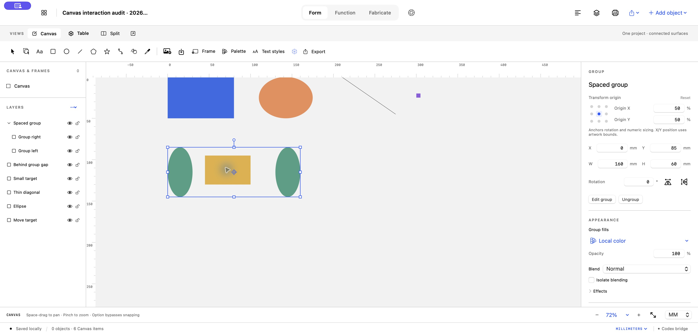

A second native reproduction selected the 5 × 5 mm purple rectangle and dragged from its center by approximately 100 screenshot pixels diagonally. The original app interpreted the grab as a resize and collapsed its height to 0.005 mm. Undo restored the audit source before verification continued.

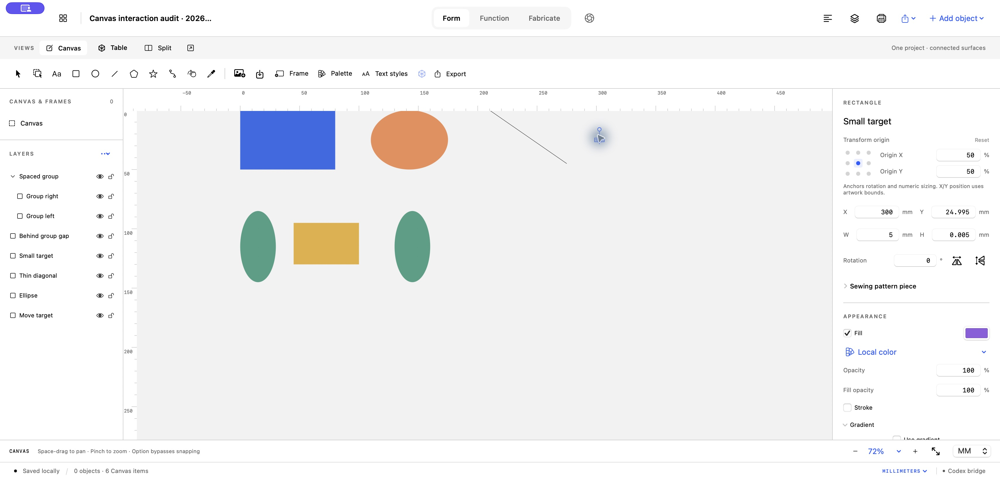

In the updated regular app, the yellow shape was selected as **Behind group gap**, and the purple shape moved by 7.3934 mm on each axis while retaining its 5 × 5 mm size. Native Undo restored its original position.

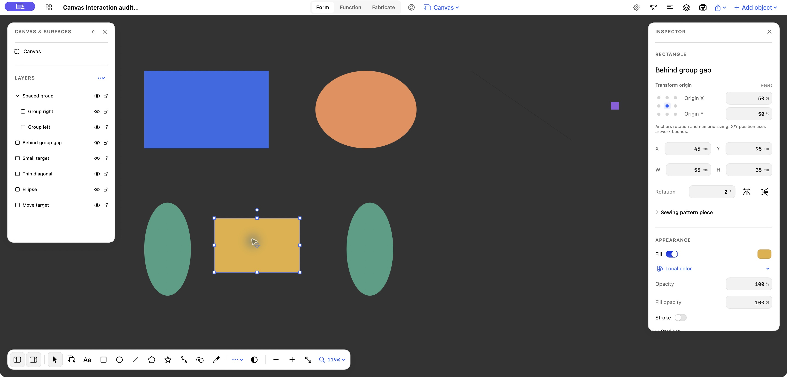

## Dense native editing loops

The small reproductions above are only isolation checks. Two complete editable designs were then authored as ordinary project packages and exercised with native computer use. Their definitions are project data, with no application branches or recipes for these designs.

- [Coastal Atlas](validation/canvas-interactions/designs/Coastal%20Atlas.form.zip): 782 elements, 134 groups, 192 paths and 140 text layers. The design includes a clipped map with 117 nested stations, nine overlapping routes, contour and street paths, a rotated compass emblem and a layered chart.
- [Night Frequency](validation/canvas-interactions/designs/Night%20Frequency.form.zip): 288 elements, including 96 multi-node wave paths, overlapping outline rings, clipping, a rotated ticket with typography and barcode, foreground orbit marks and a separate programme section.

The archives contain ordinary `.form` packages. Both designs are also saved in the ordinary LAB library as **Canvas dense interaction audit · 2026-10-30** and **Canvas layered poster audit · 2026-10-30**.

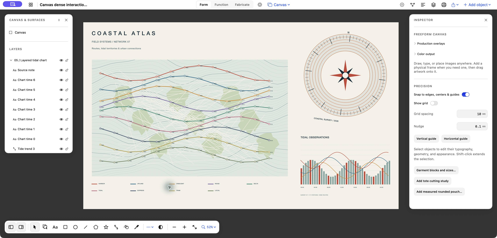

In the atlas, native clicks selected the rotated emblem, Shift-click added the chart, and Command-G grouped the two complete sections. Dragging the bottom-right handle resized every descendant together; dragging the result moved it without moving the map. Three native Undos restored the entire normalized artwork exactly, compared through the app's read API against the pre-edit source.

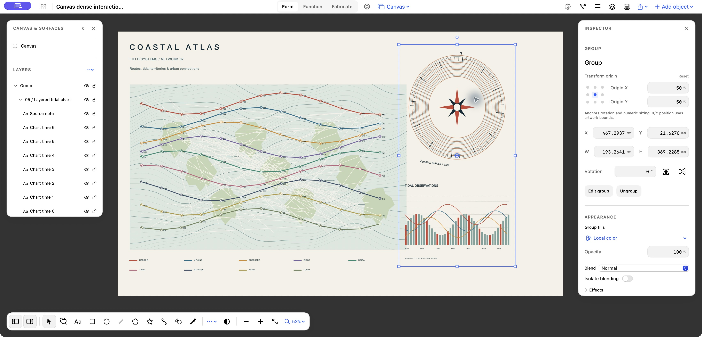

Double-clicking the map and then Route A entered two levels of group scope. Clicking the small A05 station selected **Station 1.5**, rather than the overlapping paths or adjacent text. Dragging moved that nested station group while retaining its dimensions. Undo again restored the entire artwork exactly.

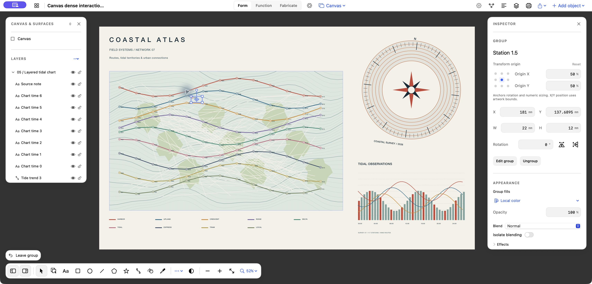

The poster checks a different overlap pattern: a foreground group spans most of the artwork but only paints sparse orbit marks. Clicking through its empty interior selected the underlying rotated ticket correctly. The ticket could then be dragged over dense rings and waves without changing selection or resizing. Undo and hand-pan preserved the complete artwork source.

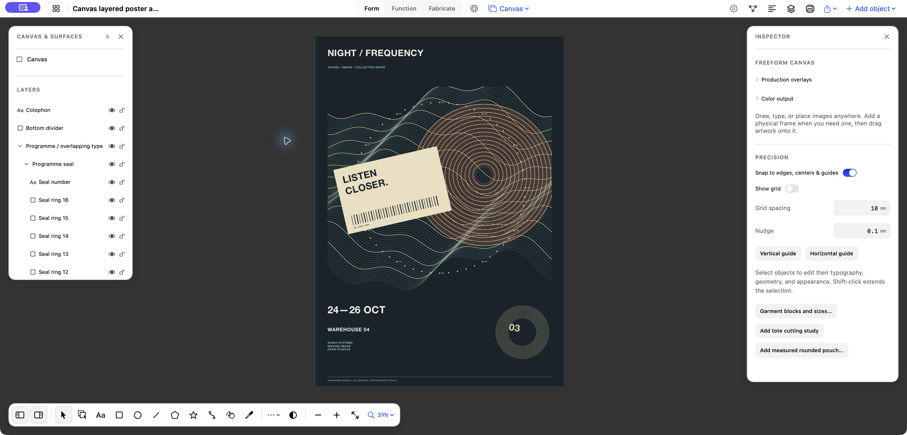

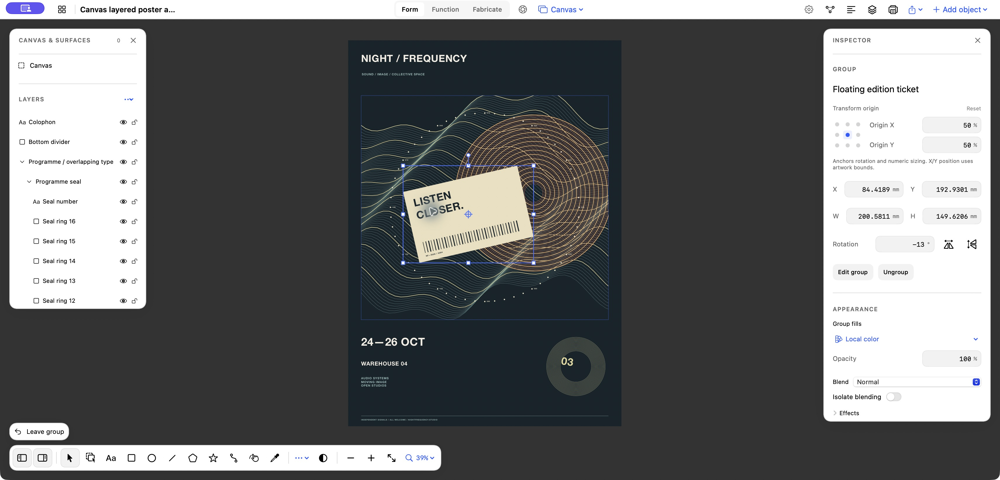

Native Charcoal preset selection changed the workspace to `#333333`, updated its selected checkmark and retained the artwork's own colors. Background preference is shared between the toolbar and Settings.

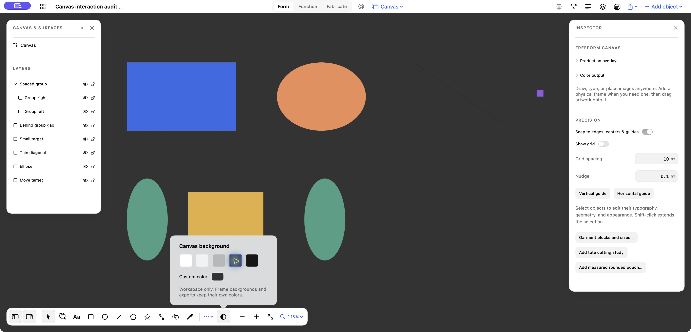

## Automated verification

The final focused release run passed **53 tests with zero failures** (19 Core, 34 App). It includes dense native-event tests with 675 elements: marquee-selecting 48 roots containing 336 nested elements, the actual Group command, compound movement, proportional corner scaling, exact Undo/Redo and untouched-layer checks. Picking is also exercised across 600 layers, transforms and clipping, with different zoom tolerances.

The dense grouping test initially exposed a real stale-rendered-hierarchy failure immediately after Group. Its hundreds of descendant-position assertions cascaded from one missed grab. The implementation was corrected; the same test now passes, together with an added immediate Group/Undo/Redo hover-and-click test that deliberately omits a layout refresh and verifies the viewport remains unchanged. The initial preset-control test also required a harness correction for calibrated RGB bitmap interpretation; the native live preset action was independently verified with computer use.

The final full release run executed **1,397 test methods: 1,394 passed, three failed**. All **61 new regression tests passed**. The remaining failures are independently reproduced on clean `origin/main` at the same base commit:

| Existing test | Baseline failure |
| --- | --- |
| `PatternAssemblyMoveTests.testMissedPanelAndOccludingObjectCannotJumpAnAttachedLabelOrChangeCamera` | Projected endpoint falls outside the test viewport. |
| `SewingTileEditingTests.testNativeFocusedSheetFieldUsesTheRealSaveButtonWithoutTabAndUndoIsExact` | Focused margin field is not committed by the test's Save action. |
| `TextileMoveTests.testEveryTextileZoneNormalAndFocusedBoundsMatchTheActualSceneTransform` | Twenty-four projected-bound assertions exceed the viewport. |

These three tests produce 27 assertion failures; they are outside the 2D interaction changes. A fourth inherited failure in Affinities' Canvas startup focus was fixed at its caller and passes in the final run. The full suite is therefore **not fully green**, and unrelated camera/sewing behavior was not changed to suppress those results. See [machine-readable results](validation/canvas-interactions/results.json).

The latest-main dependency `occt-8.0.1-form-gprop2` was installed with the repository's pinned installer. The regular LAB executable was quit before replacing its bundle; the candidate was built separately and code-signature verified. Existing user projects were preserved.

## Final installed-app check

The final release build was installed at the regular `build/LAB.app` path after quitting the first candidate. Its executable SHA-256 matches the verified candidate: `bf4f5f5c9c438ab83d93d802b6a809af9339a8e7c5f41ec8b10f58583f975f59`. The source base was re-fetched and remained `32aa53a`.

The final running app repeated native Shift selection → Group → immediate drag on the atlas. Two Undos restored all 782 source elements exactly. Charcoal remained selected after restarting the app, proving preference persistence; the original Light gray was restored for handoff. The atlas remains open and both dense source projects remain in the library.

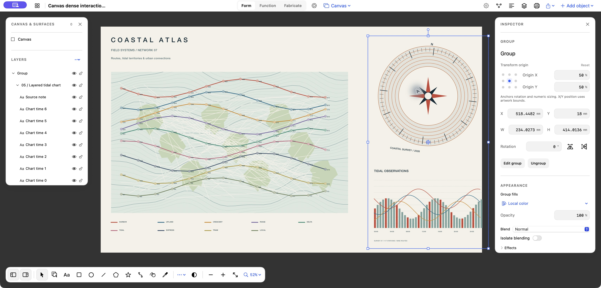

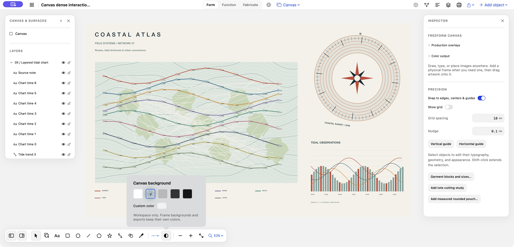

A sampled native hover lookup on the 782-element atlas took 4.11 ms and a sampled draw took 5.37 ms on this machine. These are individual diagnostic samples, not an end-to-end latency benchmark. Native-event tests verify all eight resize directions, rotation feedback, target preview, floating-control occlusion and window-exit cleanup; pinch anchoring and held edge scrolling are also covered by native-event tests.

## Follow-up: group recovery and expert arrangement

The user's subsequent five-click exploration exposed a gap in the initial acceptance coverage: the Atlas could remain isolated inside a group while outside artwork and blank-canvas clicks appeared unresponsive. The original native build reproduced this with blank-canvas and compass clicks; Leave group remained visible. The initial dense tests covered entering groups and manipulating children, but did not adequately exercise repeated entry and exit.

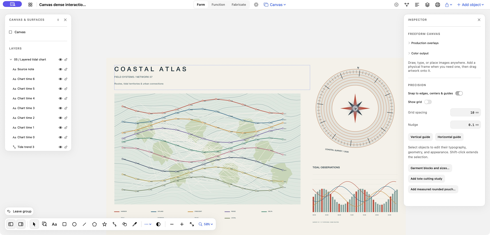

Source inspection identified three interacting issues: picking searched only the current scope, group entry recognized exactly click count 2 rather than successive double-click pairs, and the plain Leave group label had a small hit area inside a larger visible card. Group navigation now has a shared transaction-safe path, resolves outside siblings in the nearest enclosing scope, leaves one level on outside blank clicks or internal blank double-clicks, and restores Canvas focus. Shift retains the current scope for multi-selection. The full-size native Leave group button selects the exited group; Canvas exits all group levels. Hover uses the same outside-target resolver as clicks.

Right-click now targets the pointer location while preserving an existing multi-selection when appropriate. Select Layer probes actual painted descendants with hierarchy labels; Show Inspector, grouping, ungrouping, and layer order are directly available. The audit also caught sibling Forward/Backward operations silently failing when nested child records separated siblings in flat storage; ordering now walks sibling positions.

Alignment and distribution are exposed in the toolbar, inspector, and context menu. Six alignment actions and horizontal/vertical gap or center distribution operate in Canvas coordinates, including through transformed parents, and preserve group structure. The core's previous local-coordinate calculation was corrected for rotated, scaled, reflected, and sheared parents.

### Follow-up verification

The installed ordinary LAB app completed five repeated native cycles of entering the map, Route A, and Station 1.5, then selecting the outside compass with one click. Additional cycles verified blank-canvas exit, Escape, and a press near the enlarged Leave group button's corner. Every navigation cycle retained the viewport and all 782 source elements exactly.

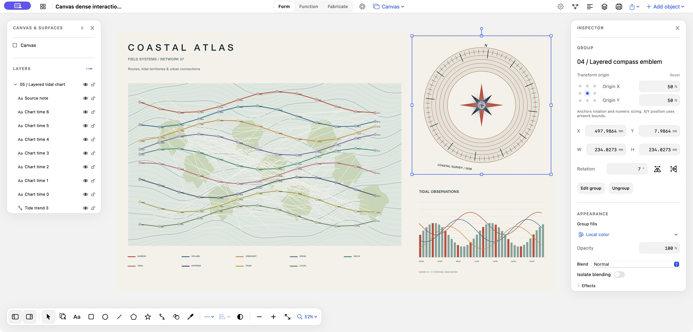

The native Select Layer submenu reached Station 1.5 directly from the root. Its subsequent drag retained size, and Undo restored the complete artwork. All six inspector alignment buttons and all four toolbar distribution actions were exercised on three complex sections, with Undo after each. A physical click near the Align left button's upper-left corner also performed the correct action. Group/ungroup, immediate context menus, Forward/Backward sibling changes, hidden-inspector restoration, and corner resizing were verified in the same dense document. The final source equals the pre-install snapshot, including existing user edits.

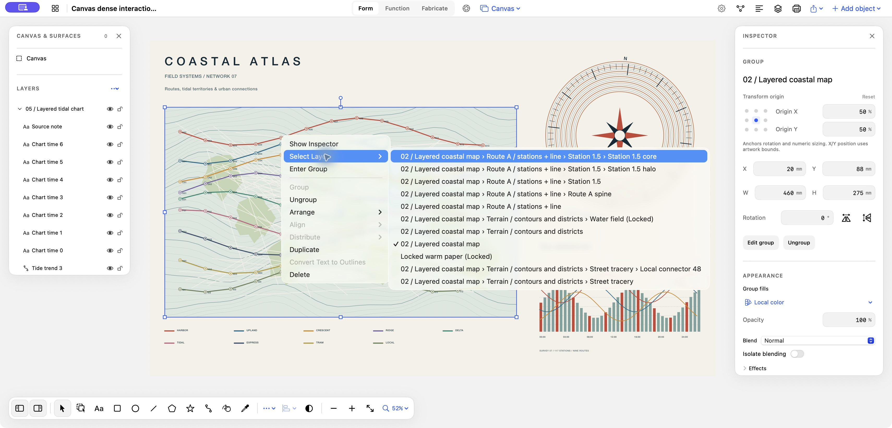

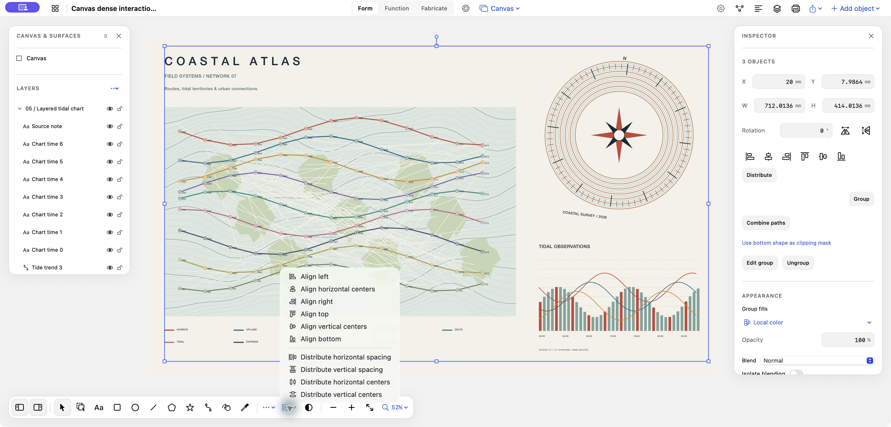

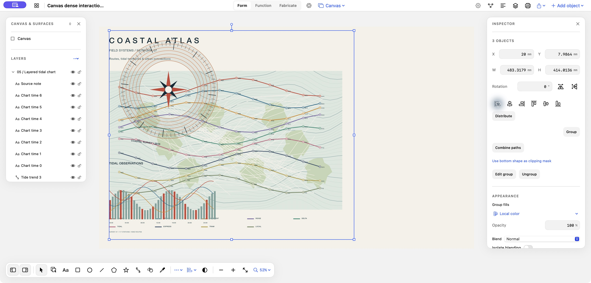

The final focused release run passed **94 tests with zero failures**, including all **27 regressions added in this round**. The full release run executed **1,424 methods: 1,420 passed and four failed**. One failure was an older test invoking menu item zero instead of finding **Find on Table** after the new commands were added. Its selector was corrected without weakening its camera/source/selection/inspector assertions, and all six related tests pass in the final focused run. The remaining three failures are the same main-baseline failures documented above. No production source changed after the candidate build.

The enabled-button corner-routing test was corrected to check active buttons after selecting three items; its disabled-state and 32-point size assertions remain separate. Native corner clicks independently confirmed the target in the installed app. This follow-up explicitly closes the repeated group-entry/exit gap in the first audit; it does not claim universal freedom from interaction bugs.

The running app's executable SHA-256 matches the signed candidate: `b57c664c0e1a689dc64c3f1f7bb5831d4ea034bd6c48be9a215db7d832db3de1`. The Atlas remains open with three sections selected so the arrangement controls are visible. [Native verification records](validation/canvas-interactions/followup-native-results.json) and the screenshots retain the actual test results.
