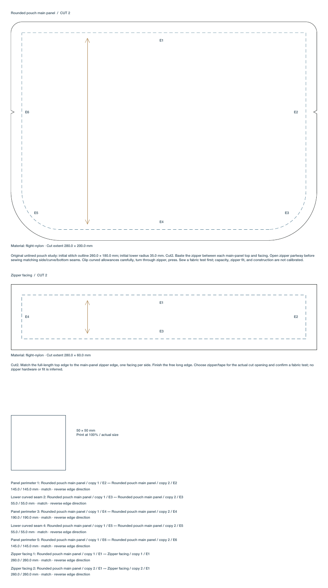

# Curved sewing patterns and the measured pouch

Canvas can annotate an editable closed Bezier path as a sewing piece. A piece supports one simple outer contour and up to 16 disjoint holes. Each contour needs at least three original anchor nodes. Concave outlines, cubic curves, mirrors, rotations, shears, and nonuniform transforms are supported. The source remains the finished stitch outline; physical cut paths are derived from it and never replace its editable curves.

General pieces use a uniform allowance, with round joins at outside corners. Allowances are zero or 0.05–100 mm. The original sharp convex rectangle/polygon/straight-path workflow keeps its exact per-edge allowances and mitered corners. General pieces reject per-edge overrides instead of substituting an average allowance. Masks, live components, appearance effects, self-intersections, touching/nested holes, and multiple material islands remain unsupported manufacturing inputs.

## Physical geometry and error bounds

Curves are transformed into physical world millimeters before sampling or offsetting. Adaptive cubic subdivision bounds contour deviation to 0.02 mm. A separate chord/control-polygon calculation bounds total source arc-length error to 0.005 mm per piece, distributing that budget across original edges. Seam diagnostics report their two measured edge-error bounds. A requested matching tolerance that cannot resolve the measured difference is marked uncertain; it is never reported as an exact match.

Offsets use the pinned [Clipper2 2.0.1 source release](https://github.com/AngusJohnson/Clipper2/releases/tag/Clipper2_2.0.1), a 0.001 mm integer grid, and an explicit 0.01 mm round-join arc tolerance. Together with source sampling, the nominal general cut boundary has a conservative 0.031 mm geometric approximation budget. The generated technical polylines are the exact cut geometry used by layout checks and exports. See [third-party geometry dependency](third-party-geometry.md) for provenance and license.

The offset must retain exactly one outer boundary and the same identifiable holes. A collapsed hole, newly enclosed island, or changed topology is an error requiring a source/allowance change. Source limits are 512 original edges, 8192 physical samples, and an 8 million pair topology-check budget; derived offsets also have bounded point/output limits. Large or difficult inputs can fail the work budget before those point limits. No input is silently simplified to make it pass. A bounded 32 MiB/128-entry cache stores successful derived geometry and invalidates source or world-transform changes; current ancestor restrictions are always checked.

## Edges, seams, notches, and folds

Source edge numbers enumerate the original anchor-to-next-anchor segments, outer contour first and then each hole. They do not enumerate tessellated points. New annotations and seam commands bind source edge UUIDs and endpoint UUIDs; annotated general contours also receive a stable contour UUID. Handle/measurement edits and rotations of the node array preserve these references. Splitting, reversing, or deleting a referenced edge rejects atomically until its affected manufacturing references are removed or reassigned. Legacy integer references remain supported.

A notch's position is a normalized fraction of the original edge's physical arc length. For a general piece its width is physical arc distance along the generated cut boundary; its depth follows the local outward normal back toward the stitch outline. Mouth points, tip, source distance, and requested cut-opening length are exposed in export metadata. Vertices created by offset/notch operations use the 0.001 mm grid; an untrimmed zero-allowance contour retains its physical source samples. Tight/merged offset regions, intersecting notches, and notches reaching the stitch line or its error margin are rejected. No corner notch or hidden stitch-material removal is substituted.

A fold must be one straight original outer edge, with no holes. All original cubic control points must stay on the material side of its exact line. The offset is clipped to that half-plane, and the fold boundary is omitted from cutting passes. Curved folds and holed folds are rejected. The [two-ply layout rules](cutting-layouts.md) continue to count complete physical pieces and respect grain. Grain guides choose an interior material interval and avoid holes.

Duplicate and complete Canvas transfers preserve manufacturing semantics while remapping source node UUIDs when necessary. Partial paired-source transfers still reject. Combining, releasing, or joining already annotated paths requires removing their manufacturing annotations/pairs first; compose the intended outer/holes before annotation. Grouping and normal source transforms remain editable and undoable.

## Original measured rounded pouch

Open **Canvas → Sewing pattern → Add measured rounded pouch…**. Choose stitch width, stitch height, lower corner radius, uniform allowance, facing height, and fabric. Creation adds a separate editable source frame as one Undo step and uses ordinary autosave. It never regenerates over an existing hand-edited pattern.

The lower corners use editable cubic quarter-circle approximations; the radius control defines their nominal construction radius. Physical lengths and error reports measure the actual source cubics.

Defaults are a 260 × 180 mm main-panel stitch outline, 35 mm lower corners, 10 mm allowance, and 40 mm facing height. Cut two main panels and two facings. Main-panel cut extent is 280 × 200 mm; facing cut extent is 280 × 60 mm. Curved edges, stable source references, midpoint side notches, seven numbered-copy seam pairs, grain, and construction notes are included. Notes record starting dimensions; actual cut extents and seam checks always derive from the current editable source.

The open-zipper turning step follows the sequence in [Brother’s zippered pouch instructions](https://support.brother.com/g/s/hf/pdf_pub/recipes/m2s/en/recipe_10_en.pdf); the rounded dimensions and facing block here are original. The construction study describes a zipper sandwich with one facing per panel, leaving the zipper partly open before sewing the matching side/curve/bottom perimeter and turning. It is an original reusable test block, with no calibrated capacity, zipper/hardware compatibility, garment fit, fabric shrinkage, or assembled-cloth claim. Confirm construction using a fabric test before production.



The proof is a vector 300 × 538 mm sheet. PDF/SVG preserve physical scale and the ordinary cut/stitch/guide roles. The SVG carries source edge/contour UUIDs, length errors, resolved notch measurements, and seam uncertainty metadata. Print at actual size and verify the calibration square. Technical outputs remain RGB and are never sent to equipment automatically.

## MCP

Append an independent measured source template with the existing artwork tool:

```python
call("form_edit_artwork", {
    "object_id": source_id,
    "command": "pattern_template",
    "template": "roundedPouch",
    "pattern_parameters": {
        "width": 280, "height": 190, "corner_radius": 40,
        "seam_allowance": 10, "facing_height": 40,
        "material_id": "flight-nylon"
    }
})
call("form_export_artwork", {
    "object_id": source_id, "pattern_pieces": True,
    "format": "pdf", "path": "/absolute/path/pouch-pattern.pdf"
})
```

`pattern_piece` and `seam_pair` bind new general-source references. Raw saved models support optional `edgeID`/`endID` on notches/seam endpoints, `onFoldEdgeID`/`onFoldEndID` on piece metadata, and `id` on each source contour. General-source documents require schema 32. Stable refs and hole-aware boundaries are also available to the material-layout workflow; collision/clearance and material consumption subtract the actual hole regions, and fabric previews leave those regions empty.

Run `python3 scripts/smoke_curved_patterns.py` against a packaged app using a disposable library below the repository's `.local`. The script refuses another library before creating its project. It checks editable measurements, physical exports, source topology rollback, source transformations, manufacturing-reference duplicate/transfer semantics, holes, layout preflight, Undo, and saved reopen. It never prints, contacts equipment, or deducts stock.

The real packaged workflow passes in the 620-test integration. Actual native controls create a 280 × 190 mm stitch outline using an active 40 mm corner-radius field, with seven paired seams and the original drawing preserved. The native PDF export is independently verified at 320 × 548 mm, including 50 mm calibration and actual curved cut/stitch outlines. One native Undo restores the exact project/history. The current preview fits the complete technical sheet; in-app vector zoom/pan is a following usability improvement.
