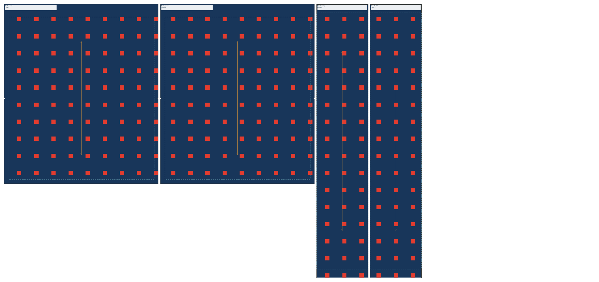

# Material cutting layouts

Open **Canvas → Sewing pattern → Material cutting layout** on a document containing annotated sewing pieces. This dedicated view lays out the actual cut contours, including seam allowances and V notches. The original contours, quantities, seam records, and material inventory stay independent from the saved layout.

A document stores one material layout. Choose its fabric, open usable width, roll or sheet surface, margins, separation, stock layers, and grain rule. Unassigned pieces use the chosen stock; pieces assigned to another material are excluded and counted. Use a separate source frame for another saved material layout. A declared material width can seed the width field. Missing widths and sheet lengths remain unknown, and planning requires an explicit value.

**Auto layout** performs a deterministic, bounded bottom-left candidate search. It sorts larger pieces first and checks permitted rotations against actual geometry. This is a useful initial arrangement, not an optimal nesting solver. It does not claim to discover every usable notch pocket or concave interlock. Current limits are 200 placements, 3000 mm open usable width, 5 m planning length, 20000 candidate tests, and a finite exact-clearance work budget. Oversize or unplaced copies remain explicit preflight issues rather than being scaled to fit.

## Editing and checking

Click a copy to select it, drag it on the material, or enter its X, Y, and rotation numerically. Positions describe the rotated cut contour's bounding-box origin in stock millimeters. Rotation is relative to the source as drawn in Canvas. Moving a source shape between Canvas positions does not move its saved stock pose. Editing source dimensions or allowances recomputes the actual footprint and preflight; it does not silently rearrange the layout.

Native changes use the normal project autosave and Undo history. One drag is one Undo step; Escape restores its starting pose. Stale drag events cannot modify a replacement project or overwrite a layout changed through MCP. Stock view pan and zoom stay in place during ordinary placement edits. **Fit stock** explicitly frames the whole working material, independently of which copy is selected.

Preflight checks the actual simple cut outlines rather than only their bounding boxes. It detects contour intersection, containment, and insufficient Euclidean edge separation, including diagonal poses and real V-notch cutouts. It also checks stock bounds/margins, source material and cut-copy identities, grain, fold alignment, and missing/extra copies. Source shape support remains the [sewing pattern editor's supported domain](sewing-patterns.md). Saved invalid placements can be inspected and corrected; physical export requires a clear preflight.

Grain rules are directional, bidirectional, or unrestricted. Directional and bidirectional rules use a 1° tolerance against the material's longitudinal direction. When grain is unrestricted, the automatic planner tries quarter turns; manually entered rotations can be arbitrary. A directional layout shows a single grain arrow. A cut-on-fold piece must have its fold edge on the left stock fold and its grain compatible with that orientation.

## Folded stock and quantities

**Folded, two plies** uses half the open width as the working width. An ordinary placement produces two physical copies, so its required quantity must be even. Its placement references both copy numbers. An on-fold placement produces one complete piece from the folded half-template; its quantity is counted as full pieces. Both cases use both material plies in the area calculation.

The left fold can have zero clearance for an actual fold edge. Other cut boundaries respect the normal margin and separation. Fold boundaries remain guides and are omitted from cutting passes. The saved layout retains numbered source-copy references; it never changes the source's cut quantity to make packing easier.

## Consumption and declared cost

For a roll, required length is the furthest cut contour plus the bottom margin. For a sheet, allocation uses the full declared sheet length. Allocated area uses the full open usable width, including unused regions. Cut area uses the actual notched footprints and the correct ply count. Waste is allocated area minus cut area; it includes unused sheet/roll space and margins.

An optional user-declared rate per usable square meter and currency produces an estimate from allocated area. No rate, currency, stock length, or missing width is invented. The view and exported metadata state those assumptions. Planning and export never deduct inventory, reserve material, or record completed production. Those actions belong to the separate production workflow.

## Fabric reference and physical export

The optional fabric view uses the material's existing [physical repeat design](fabric-patterns.md). Its origin is global roll/sheet millimeters; a motif is never fitted separately to a piece's bounds. Moving a piece changes which part of the repeat it captures. The phase controls shift the repeat by a physical amount.

For folded stock, the visible ply samples the upper/right half of the open material: working X = 0 corresponds to open-stock X = open width / 2. The hidden ply and continuity across seams are not verified. This preview does not account for stretch, shrinkage, seam take-up, or a construction simulation.

SVG, PDF, PNG, and JPEG use the exact working-stock width and consumed length, with stock origin 0,0 and physical millimeter scaling. SVG retains named cut, stitch, and guide layers and machine-readable copy/stock/preflight metadata. PDF keeps vector technical geometry at actual size. Raster output uses the requested DPI with the existing 100 megapixel/16000 pixel limits. **Include fabric reference layer** adds the roll-anchored colors beneath the technical paths; it is a reference, not seam registration or a machine program. Dedicated technical outputs remain RGB. No equipment receives these files automatically.



The proof above is rendered from the actual-size vector PDF. It uses the editable tote template, 1400 mm open stock, 10 mm margins, 5 mm piece separation, and four numbered physical cut copies.

## MCP

The existing artwork edit/export tools share the same model and preflight:

```python
call("form_edit_artwork", {
    "object_id": source_document_id,
    "command": "cut_layout",
    "layout_action": "plan",
    "cutting_layout": {
        "name": "Flight nylon / cutting layout",
        "materialID": "flight-nylon",
        "stockWidth": 1400,
        "surface": "roll",
        "stock": "singleLayer",
        "grain": "bidirectional",
        "margin": 10,
        "spacing": 5,
        "maximumLength": 5000,
        "fabricOrigin": {"x": 0, "y": 0},
        "costPerSquareMeter": 12.5,
        "costCurrency": "USD"
    }
})
check = call("form_export_artwork", {
    "object_id": source_document_id, "cut_layout": True,
    "layout_preflight": True, "format": "pdf"
})
call("form_export_artwork", {
    "object_id": source_document_id, "cut_layout": True,
    "include_fabric_preview": True,
    "format": "pdf", "path": "/absolute/path/cutting-layout.pdf"
})
```

`layout_action: save` stores complete metadata/manual poses without rearrangement. `plan` runs the explicit bounded planner, using either the supplied definition or the saved one. `cutting_layout: null` removes the saved layout. Optional `elementIDs` scopes it to selected annotated source pieces. `placements` stores `{elementID, copies, x, y, rotation}`; copies is `[1]` for a single cut or on-fold piece and `[1,2]` for an ordinary folded-stock pair. Retain the saved layout UUID when editing its definition.

`layout_preflight: true` returns issues, physical bounds, required/allocated length, actual cut/waste area, copy identities, declared cost assumptions, and fabric origin without writing a file. Invalid input or a thrown planning error leaves the prior document unchanged; a partial fit remains saved with explicit missing-copy issues. Changes participate in Undo. A saved manual layout moves between Canvas owners only with its complete source scope, preserving stock poses and remapping colliding source IDs. The source document's minimum schema becomes 27; unrelated newer features can require a higher schema.

The packaged workflow check is `python3 scripts/smoke_cutting_layouts.py`. Run it only while the app uses a disposable `FORM_LIBRARY_PATH` inside this repository’s `.local`; the script checks that guard before creating its project. It covers planning, manual poses, invalid overlap, missing width, folded stock, sheet allocation, declared cost, Undo/Redo, source preservation, zero layout-only 3D builds, physical exports, and saved reopen. It writes its report and output files under `.local/validation`.
