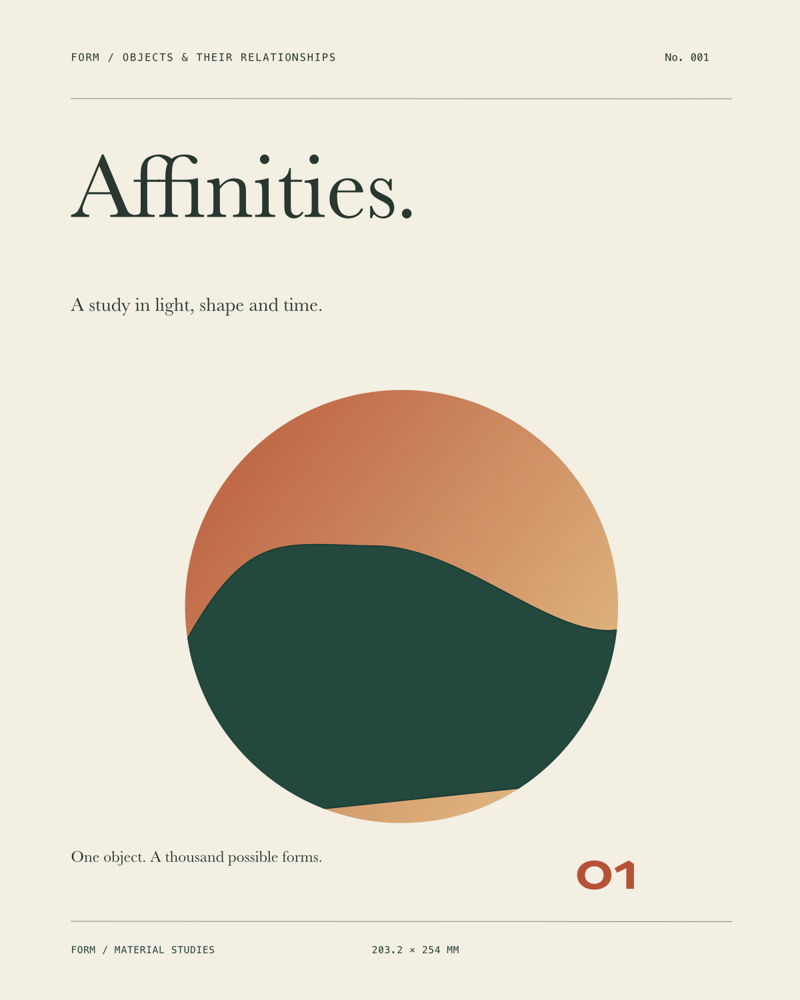
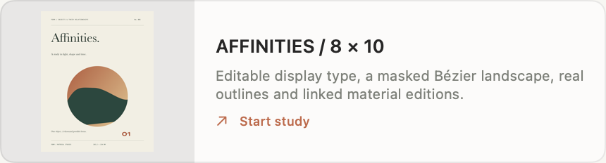
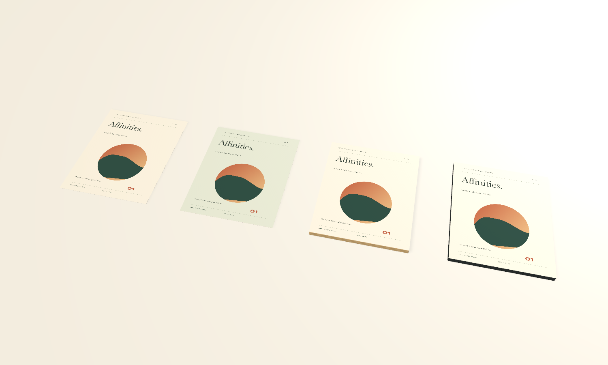

# AFFINITIES: one complete design workflow

AFFINITIES is the native study for a precisely sized, typography-heavy composition. Start it from the featured Home card, Home's **All studies** menu or **File → New from Study → AFFINITIES / 8 × 10**. It opens the editable original in split view with its wordmark selected and the linked oak edition visible.

The composition measures exactly **203.2 × 254 mm (8 × 10 inches)**. The original contains editable Baskerville text, independent ligature selections, leading, tracking and manual pair spacing; a Skia variable-font folio; precise guides; and a rotated group containing a gradient, a geometric clipping mask and a Bézier landscape. A green alternate is independent. Its wordmark contains real Core Text outline paths and a hidden recoverable text source. The oak and graphite material editions share the original artwork at actual size.

The native template is derived from the actual saved project after the workflow below was completed and reopened. Every new study receives fresh project/object/element/path/node/gradient identifiers while retaining all internal links, group relationships and the two editions' common design identity. The embedded template includes no font binaries or outside assets.

## Font availability

The saved assignments remain **Baskerville**, **Skia** and **Menlo-Regular**. If a face is unavailable, native study creation opens **Document fonts** and names the missing assignments. Preview fallback does not rewrite the document. The recorded outline alternate retains the real captured geometry even without the face; the original and hidden alternate text remain editable when the font is restored. New outlines should be generated from a deliberately selected available face. This study does not invent substitute glyph shapes or claim to bundle fonts.

## The 15 acceptance criteria

The [portable smoke workflow](../scripts/smoke_design_workflow.py) builds the composition through the packaged MCP bridge in a guarded disposable `.local` studio. It is promoted from the script used for the recorded run. The [evidence record](evidence/design-acceptance.json) records dimensions, changed source IDs, native edit/Undo history counts, reopen equality and hashes of the full original verification records.

| Criterion | Actual evidence |
| --- | --- |
| 1. Exact 8 × 10 inch frame | Frame parameters are 203.2 × 254 mm. PDF MediaBox is 576 × 720 points; 150 DPI PNG is 1200 × 1500 pixels. |
| 2. Installed Mac type | The recorded run discovered Baskerville and Skia through the actual font API. Native diagnostics preserve unavailable assignments. |
| 3. Size, weight, leading, tracking, alignment | Editable wordmark and subtitle retain their face/style assignments, 67 pt display size, leading, tracking and alignment. Actual native field editing changed 67 → 69 pt. |
| 4. Ligatures and variable settings | Baskerville independent feature selectors 2/4/20 are stored together. Skia's discovered width/weight axis identifiers and values remain editable. |
| 5. Individual glyph spacing | The original wordmark retains explicit pair spacing −0.8 at UTF-16 position 0, separately from tracking. |
| 6. Editable vector nodes | The landscape retains Bézier nodes and handles. The script edits a selected node and undoes it. Actual native acceptance selected a node by mouse and nudged it with the keyboard. |
| 7. Guides and numerical alignment | Stored 18/186 mm vertical guides and 25 mm horizontal guide support the composition. The script aligns the header and footer to an exact left edge. Native snapping remains a direct editing control. |
| 8. Groups and member editing | The circular illustration is an actual group transformed by −6°. Native node selection and keyboard editing occurred inside that transformed group. |
| 9. Paint and masks | The composition has solid fills, a stroke, a two-stop gradient and shared geometric clipping. All remain editable, including under the group transform. |
| 10. Independent alternate | The green iteration has independent artwork and design identity. Source edits leave it unchanged. |
| 11. Editable outlines | The alternate has actual shaped glyph contours plus hidden source text. A native regression regenerates the wordmark through current Core Text and compares rendered output with the recorded real paths. |
| 12. Physical surface links | Oak and graphite editions reference the original source with actual-size placement. Their common variant identity is retained. |
| 13. Live 2D → 3D | Actual native 67 → 69 pt editing changed both linked physical faces and their rendered pixels. Only the source object resource changed. The native regression also verifies exactly three dependent mesh rebuilds: source sheet and two editions. |
| 14. Physical exports | Original, alternate and linked face export SVG/PDF/PNG at the same exact physical dimensions. [Vector PDF](images/design-acceptance/composition.pdf) and [SVG](images/design-acceptance/composition.svg) are included. |
| 15. Save and reopen | The actual app was quit and relaunched, then the project reopened from Home. Source objects and history match the saved post-Undo state exactly. Repository regressions repeat round-trip checks on newly created study instances. |

Native font editing added one history entry (14 → 15); one Undo restored 67 pt and the exact original object array/history (14). The native node nudge likewise added one entry and one Undo restored exact objects. These are separate native interaction checks, beyond scripted command success.

## Phase 1 audit

The credible-canvas checklist is exercised by this composition and existing focused regressions: native canvas navigation, physically sized frames, rulers/guides, precise transforms, layers/groups, editable shapes/paths, fill/stroke, installed-font discovery, direct text entry, typographic controls, alignment, Undo/Redo, physical SVG/PDF/PNG and linked physical updates. The underlying controls are shared with MCP; opening the study does not introduce alternate camera bindings.

The concrete gaps closed here are **discoverability** and **repeatable native starting state**. The verified workflow previously existed only in a development script and saved test project. It now has a featured native entry, a source-art thumbnail, an all-studies menu, clear source/alternate/material placement, fresh identifiers and direct split-view source focus. Font availability is surfaced without changing assignments, and the original real outline data is retained rather than reconstructed with a fallback.

This is evidence for one complete professional composition workflow. It does not establish completion of the full [2D vision](2d-design-typography-vector-spec.md), universal font-feature compatibility, arbitrary imported-document fidelity or every remaining publication/production workflow. Unsupported font features and missing faces still require review; screen preview is not a calibrated print proof.

## Reproduce

`python3 scripts/smoke_affinities_study.py` checks the native template's discoverability, retained source/outline data, fresh identifiers, linked editions, Undo and physical exports through the packaged bridge.

Run `python3 scripts/smoke_design_workflow.py` only against a disposable `FORM_LIBRARY_PATH` below the repository's `.local` directory. It creates a fresh study, executes the 15-step design workflow, exports all three compositions and verifies saved reopen. It does not connect to printers or external models. Native font-field, mouse-selected-node, keyboard Undo and app-relaunch acceptance are recorded separately and must be repeated when those interaction paths change.

## Native-study release acceptance

The integrated optimized study release passes **680 tests (474 core/graphics and 206 native app)** with zero failures/skips. Both guarded packaged workflows pass: the template checks fresh identifiers, source/outline preservation, linked editions, physical output, exact Undo and reopen; the portable workflow completes all fifteen design steps and nine physical exports. Native Home creation, All studies and File discovery are verified. Home opens the editable source in split view with its wordmark and linked oak edition selected, without an extra Undo entry.

A real native font-size edit changes 67 → 69 pt, autosaves only the authoritative source file before any MCP read, updates both physical editions and leaves the camera/alternate intact. One native Undo restores the entire project exactly. After an actual quit/relaunch, Home reopens the same four-object study with exact source objects, relationships, materials and history; camera direction/pivot/distance are retained. The All studies menu uses its compact native width. All five ordinary projects and the Studio file remain unchanged. This closes the seven basic-canvas checkpoint lines while the deeper 2D/3D/textile goal stays active.
