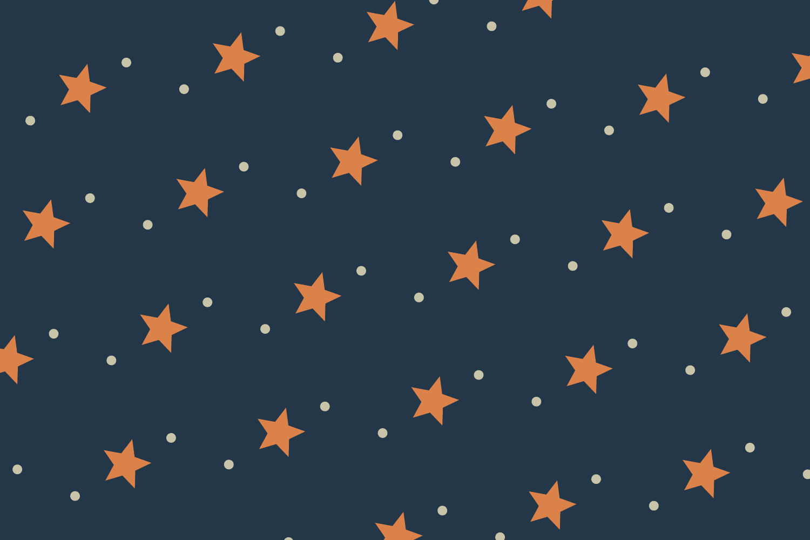

# Physical fabric repeat designs



Open **Studio Library → Fabrics & textile materials → Pattern** while a project is open. Physical stock specifications remain shared Studio resources. A repeat design is saved in the current project, where its artwork, assets, and fonts are available.

Choose an independent finite Canvas frame as the motif tile, or **Create motif tile** to start with editable vector stars and dots. **Edit source tile** opens that frame in Canvas. The repeat references the original artwork rather than flattening or copying it. Frame size changes, linked components, swatches, typography, and paint edits update the fabric without changing independent patches, labels, or garment attachments. Source artwork is clipped to its frame; draw matching edges in the tile when a motif should cross the repeat boundary.

Straight, half-drop, brick, and mirror repeats operate in millimeters. Motif scale multiplies the source frame's physical width and height. Spacing adds physical distance between cells; rotation and offset position the complete repeat lattice. Half-drop shifts alternate columns by half a cell vertically, brick shifts alternate rows horizontally, and mirror reverses alternate rows and columns. The displayed repeat dimensions describe the complete rectangular supertile, so a half-drop repeat spans two columns and a mirror repeat spans two rows and columns.

Colorways have names, a fabric base color, and exact source-to-output paint substitutions. These affect vector fills, strokes, gradient stops, and rich text colors on a rendered copy. Source artwork, project swatches, embedded image pixels, and independent component resources remain intact. **Source colors** uses the original motif paints. Tile backgrounds are transparent by default; **Include tile background** retains the source frame's background.

The yardage preview uses the saved physical width and output length and includes a scale bar. Applying a design updates every object in the project using that fabric material. The bomber's main cloth uses physical local X/Z coordinates, preserving the repeat scale when body or sleeve dimensions change. This is a presentation mapping on the generic flat-lay blank. It does not align motifs across cut pieces, account for fabric stretch, simulate drape, or provide a verified sewing pattern. Trim, lining, and independently attached decorations retain their own materials.

**SVG**, **PDF**, and **PNG** export apply the current draft first. SVG uses a vector pattern with millimeter dimensions and outlined typography. PDF draws vector motifs at actual physical page size; effects and embedded images retain their existing raster requirements. PNG renders source artwork at the chosen physical DPI and records physical dimensions. Large raster outputs are limited to 100 megapixels and 16000 pixels per edge. Repeated PDF/raster artwork has a complexity budget; SVG can represent dense repeats without expanding every motif. Exports do not send work to a printer.

An artwork frame used by a pattern cannot be deleted while its link is active. Remove the repeat or select another source first; Undo restores those changes. Patterns survive project save/reopen and Studio inventory edits. Project-specific links cannot be saved into the global Studio Library. This feature requires project schema 21; unrelated newer features may require a higher schema.

## MCP

The existing `form_update_object` tool accepts a complete `fabric_pattern` definition. The object identifies the material to edit; the design belongs to that material in the current project. Other users of the same material update together. Pass `null` to remove a pattern.

```python
call("form_update_object", {
    "object_id": garment_id,
    "fabric_pattern": {
        "sourceObjectID": tile_frame_id,
        "repeatMode": "halfDrop",
        "scale": 1.0,
        "spacing": {"x": 4, "y": 4},
        "offset": {"x": 12, "y": 0},
        "rotation": 15,
        "outputWidth": 1400,
        "outputLength": 1000,
        "includeTileBackground": False
    }
})
call("form_export_artwork", {
    "object_id": garment_id,
    "fabric_pattern_material": "flight-nylon",
    "format": "svg",
    "path": "/absolute/path/flight-yardage.svg"
})
```

Optional `colorways` entries contain `id`, `name`, `baseColor`, and `replacements`, a dictionary from source hex colors to output hex colors. `activeColorwayID` selects one. `form_get_project` returns the entire persisted definition. Invalid source links, nonfinite dimensions, invalid colorways, and unsupported repeat work fail atomically; changes participate in project Undo and batch transactions.

Engineered prints on garment construction pieces, cross-seam motif matching, cloth simulation, textile printer profiles, cutting layouts, and stitch-file generation remain outside this repeat milestone. The [textile product specification](textiles-apparel-merchandise-spec.md) continues to govern those later features.
