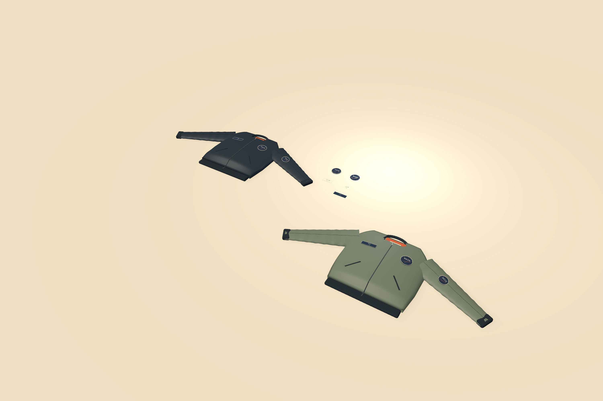

# ORBITAL flight bomber

Choose **Flight bomber** from Home's **All studies** or **File → New from Study**. The project contains midnight and sage bomber blanks, eight attached decorations, independent patch/label samples, and three editable source artworks.

New studies now include saved digitizing definitions for all five mission-patch placements: both chest patches, both sleeve patches, and the independent sample. Four declared thread colors produce running rings, a 2.2 mm constant-width satin signal, and filled lettering/stars. The large NASA wordmark has explicit sparse-fill underlay. Physical thread surfaces derive from the same needle commands used by preview and local SVG/JSON/DST output. The sleeve patches use their own 74 mm physical size; the chest and independent patches are 90 mm.

Select a patch and choose **Edit stitch program…** to inspect actual needle paths, travel, hoop clearance, threads, regions and playback. Edit the independent source artwork to regenerate every linked placement. Thread color assignments remain explicit: changing a graphic's preview color does not replace its selected thread. The jacket colorways share geometry/source artwork and retain independent material and attachment choices.

Lock stitches are off in this sample. Very small fill fragments can contain only a needle point, which cannot define a backtracking lock direction. The editor rejects that request rather than inventing a sewing route. Underlay and satin remain real configured stitches. Review the small lettering, source geometry, material, backing and tension with a sample before making production decisions.

The outer merrow-style border is a construction appearance study; it is not included in the mission artwork's generated stitch program. The name tape remains a woven-patch concept, and the sewn label retains its separate editable typography and attachment declaration. The bomber is dimensioned presentation geometry with generic fabric specifications. It does not supply garment cutting patterns, calibrated fit, fabric compensation, verified physical sew-out or machine operation.

Existing saved projects are preserved. This change affects newly created studies and uses existing schema-28 embroidery fields; it does not rewrite the user's ORBITAL project. Runtime meshes, thread textures and needle programs stay derived from the editable source.

`scripts/smoke_textiles.py` validates the full collection, source-only edits, exact Undo, invalid-batch rollback, physical patch/label files, every digitized placement, local needle exports and reopen in an isolated library. `scripts/verify_embroidery_dst.py` independently decodes the exported DST against the actual program and ordered thread sidecar using pinned Pyembroidery 1.5.1. No equipment is contacted.

The packaged workflow passes. The independent reader matches **2,274 records / 1,417 stitches / four thread passes** for the 90 mm patch, including 91 underlay stitches. Native Home creation, direct patch picking/Focus, preconfigured stitch review and actual quit/relaunch/Home reopen pass. Four actual mouse orbit directions isolate/reverse axes within 1e−12 radians, with exact target/distance and unchanged objects/history; geometry/program/texture builds stay 32/9/9 throughout. Perspective leaves patch isolation and produces the identical whole-project camera with or without selection. Studio scene focus now retains Studio mode/preset during actual orbit and wheel input; a real AppKit regression also covers Shift-pan and explicit return to Table. Its native resource counts stay 15/5/5. These images are actual 3000 × 2000 FORM renders. All checks are part of the 719-test integration; see [recorded evidence](evidence/bomber-showcase.json).
