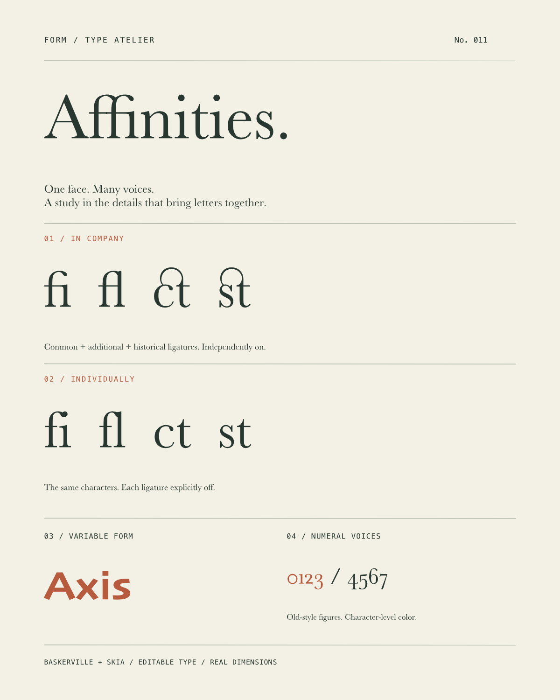
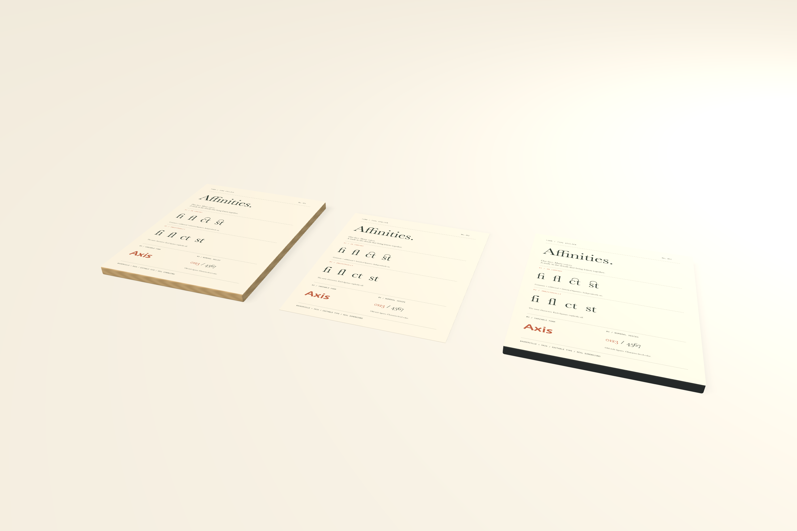

# Font features and the FOUNDRY specimen

FORM discovers each installed face's features through Core Text. Exclusive groups such as numeral case use a picker. Independent groups such as ligatures offer **Default**, **On**, and **Off** for each supported selector. Common, additional, and historical ligatures can coexist; changing one no longer replaces another.



## Native editing

Select text and expand **OpenType features** in its inspector. Names come from the installed face. **Default** omits that pair; **Off** stores an explicit off assignment. **Reset font features** clears explicit feature assignments while retaining font, size, axes, colors, and other typography.

During native text editing, select characters to change only that UTF-16 range. Other characters retain their settings. Native text Undo remains available; after Escape, document Undo restores the complete editing session. Whole-object feature edits and variable-axis changes also use document Undo/Redo.

AppKit sometimes removes explicit settings that match the face's current defaults. FORM retains the assignment when the native font still matches it, preserving the document's intent. Actual native font replacement/reset is respected. Missing font names and assignments remain stored until replaced.

## Local MCP and persistence

`form_font_features` returns each type's ID, exclusivity, supported selectors, defaults, and actual variable axes. Exclusive/single choices retain `features`. Independent types use optional `featureSelections`. This typography fragment combines lower-case figures with common ligatures off and additional/historical ligatures on in Baskerville:

```json
{
  "fontName": "Baskerville",
  "features": {"21": 0},
  "featureSelections": {"1": [3, 4, 20]}
}
```

Place it in a complete element sent through `form_edit_artwork` with `command: "replace"`, or in a `textRuns` span. UTF-16 ranges refer to the original text. Even selectors turn independent pairs on; the next odd value turns them off. Omitting a pair uses the font default. A `featureSelections` entry replaces the legacy single assignment for that type. Invalid IDs, conflicting/duplicate pairs, and more than 256 explicit settings per typography value are rejected. Failed atomic batches leave the project unchanged.

Pairing follows Apple's [font feature table](https://developer.apple.com/fonts/TrueType-Reference-Manual/RM06/Chap6feat.html). Descriptor ordering follows the [Core Text feature-settings contract](https://developer.apple.com/documentation/coretext/kctfontfeaturesettingsattribute), which leaves conflict handling to the application.

Independent assignments require **schema 11**, including assignments present only in rich spans. Schemas 1–10 remain readable. Older readers reject schema 11 explicitly. Glyph conversion preserves the original text for recovery.

## FOUNDRY and validation

**FOUNDRY · The character of type** is an **8 × 10 inch** specimen with Baskerville ligatures/figures, character-level color, and Skia variable weight/width. A shared source drives oak and graphite product faces. Feature changes through a linked product rewrite only the source resource.



Run `python3 scripts/smoke_font_features.py` against an isolated `FORM_LIBRARY_PATH`. It checks installed capabilities, independent settings, linked consumers/immutable files, invalid-pair rollback, outlines/recovery, physical exports, schema-11 reopen, and edits across 200 text objects. At 150 DPI, PNG is **1200 × 1500 pixels**; PDF is **576 × 720 points**. Default SVG outlines the shaped glyphs. Optional live-text SVG still requires receiving-font/shaping review.

Font discovery has a 256-face cache cleared on font changes. Layout uses the existing 800-entry cache: changed features rebuild text, placement reuses it. See [validation evidence](validation.md) for real native controls, mouse checks, and local timings.

The full goal remains active. Alternate-glyph selection, reusable styles, complete mixed-case treatment, tabs/lists, linked frames, and sequential documents still require work.
