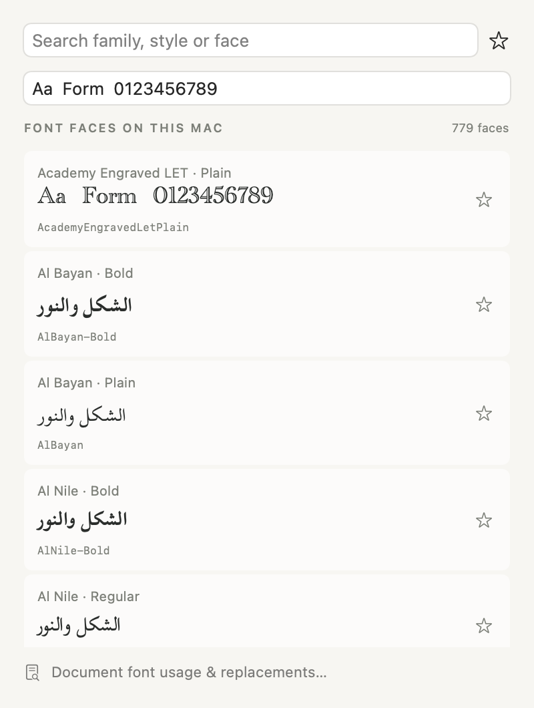
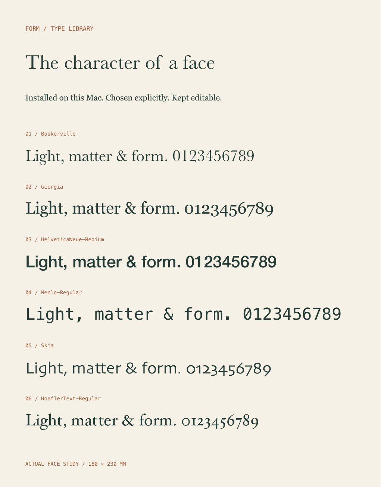

# Font browser, usage and deliberate replacement

The font browser uses installed Mac faces. Its rows show family, style, stable PostScript face name and an actual face preview. Search matches all three names. Choosing a face changes only its assignment: original words, features, variable axes, rich ranges, case/language metadata and exact glyph records remain stored.

The existing inspector style picker remains available. The browser adds explicit face selection, editable preview text, face favorites and a twelve-face recent list. Legacy family favorites remain favorite across their faces; changing one legacy favorite converts that family into explicit sibling-face favorites. Legacy family recents resolve through the same first-face choice used by the earlier browser. Browsing, search, previews, favorites and recents never create document Undo entries.

A default preview uses characters covered by the actual face. Arabic and other supported script samples replace the Latin default when needed. Custom sample text stays exactly as typed; a row reports when some characters require system fallback. Missing faces retain their requested names and metadata. A fallback preview is not a replacement assignment.

## Preferences and installed faces

Ordinary preferences remain in UserDefaults. An app launched with `FORM_LIBRARY_PATH` stores its font preferences at `FontPreferences.json` in that library root. Tests inject a temporary preference file. This keeps validation favorites/recents out of ordinary user preferences and out of project packages/history.

The catalog enumerates registered family members through AppKit, using the face's PostScript name as identity. Registration-change notifications invalidate its index. Only visible lazy rows request preview fonts; that cache holds at most 128 entries. The existing 256-face capability cache and bounded glyph/layout caches remain in use. No font installation, download, upload or copying occurs.

These boundaries use Apple's [available family members](https://developer.apple.com/documentation/appkit/nsfontmanager/availablemembers(offontfamily:)), [PostScript font names](https://developer.apple.com/documentation/coretext/ctfontcopypostscriptname(_:)), [font descriptors](https://developer.apple.com/documentation/appkit/nsfontdescriptor), and [covered character sets](https://developer.apple.com/documentation/appkit/nsfont/coveredcharacterset). Persistent choices refer to names and settings, rather than a transient row index.

## Document fonts

Open **Studio → Document Fonts…** from any open project, or **Document font usage & replacements…** in the font browser. The report includes raw and hidden recoverable text, rich spans, reusable text styles, shared publication stories, explicit list-marker fonts and exact glyph choices. A linked frame's empty geometry record is not another source font assignment. Shared and component sources retain their own identities; a linked product does not manufacture duplicate source fragments.

Each face reports availability, its resolved local face, assignment locations and retained feature/axis settings the currently installed face does not offer. Those settings stay stored. This report complements glyph-output preflight and the existing per-selection missing-font warning.

Choose an exact source face, choose an installed replacement, and click **Review**. The preview states how many assignments change and flags settings or exact glyph choices requiring attention. **Replace throughout document** applies one atomic document edit. Original words, rich ranges, feature/axis values, style references, list identities and source structure stay editable. A locked affected layer/object rejects the complete operation. One document Undo restores it.

Exact glyph choices retain their original face, glyph name/ID and font signature. A replacement never reinterprets an ID using another font. A resulting mismatch remains explicit and blocks affected output until the user clears or reselects that choice, or undoes the replacement. Retaining a feature/axis value does not imply a different face supports that value.

Native selected-character changes use the existing shared text storage and native Undo. Changes outside editing use document Undo. Character edits in linked publications target the global story range without copying words into frames. Rejected font commands/replacements are prevalidated before handing off a live editor; active marked input must finish before structural replacement.

## Agent workflow

`form_list_fonts` remains read-only. Its default `families` command returns families and real faces; `faces` returns individual face identities. Both support family/style/face `query`, `offset`, and `limit` 1–256. `usage` reports the open document's complete assignments, availability and retained-setting warnings.

`form_font_features` retains its existing capability and alternate-glyph discovery behavior.

`form_edit_artwork` with `command: "font"` and `font_name` changes only the selected text's face. Optional `location` and `length` are a nonempty global UTF-16 source range for one text source; surrogate splits and Boolean/fractional offsets are rejected. Paragraph boundaries are not expanded. It also works through a linked story frame. An explicit unavailable assignment is retained and reported, just like imported or reopened source; intentional whole-document replacement requires an installed target.

`form_replace_font` takes exact `from_font`, `to_font`, and optional `dry_run`. A dry run reports affected/remaining uses without changing project, native editor or recents. An actual replacement uses one document Undo. Source words and settings remain intact, and its result includes retained exact-glyph warnings. Font-library UI adds no project schema.

## Validation

The native browser proof above uses an offscreen `NSHostingView`, with 5 preview fonts created for its visible viewport rather than all 779 installed faces. The installed set contains 197 families. A cold index took about 94–114ms; a warm `Bold` search took about 1.7–1.8ms. A 200-object/800-span fixture plus a shared publication story contains 1,021 assignments: usage reporting took 12–14ms and replacement about 4ms. These are local source-test measurements, not a universal timing guarantee.

The 180×230mm specimen below uses six actual installed faces. Its PDF was rendered with Poppler at 144DPI and visually reviewed. Tests verify original source/assignments and physical size. Source tests also cover stable identities, paged discovery, bounded cache reuse, script coverage, missing marker/glyph fonts in physical publication artwork, favorites/recents persistence and legacy migration, locked rollback, source range boundaries, native character and shared-story Undo, missing-face opening without reassignment, replacement dry run and exact glyph retention.

`scripts/smoke_font_library.py` exercises the packaged MCP in a disposable `.local` library, including document usage/replacement, untouched bounded-frame files, original words/settings/list identities, one Undo/Redo, unresolved exact choices, physical exports and reopen. The packaged workflow passes with 1.69 ms median / 1.79 ms p95 catalog queries on this installed set. Actual native control checks verify face search, exact-face favorites, read-only Review and a 35-assignment document replacement that changes no other source fields; one native Undo restores the complete project/history. Favorites/recents persist separately in the disposable studio. The full integrated suite passes 620 tests; see the validation record. The offscreen image above is distinct from those running-app controls.
