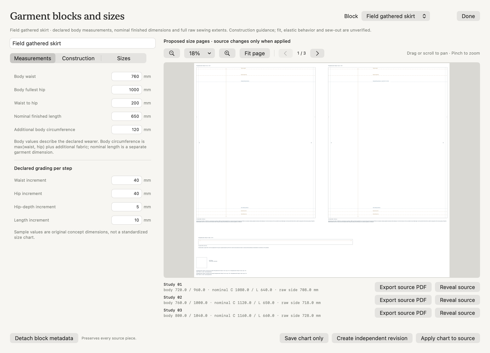
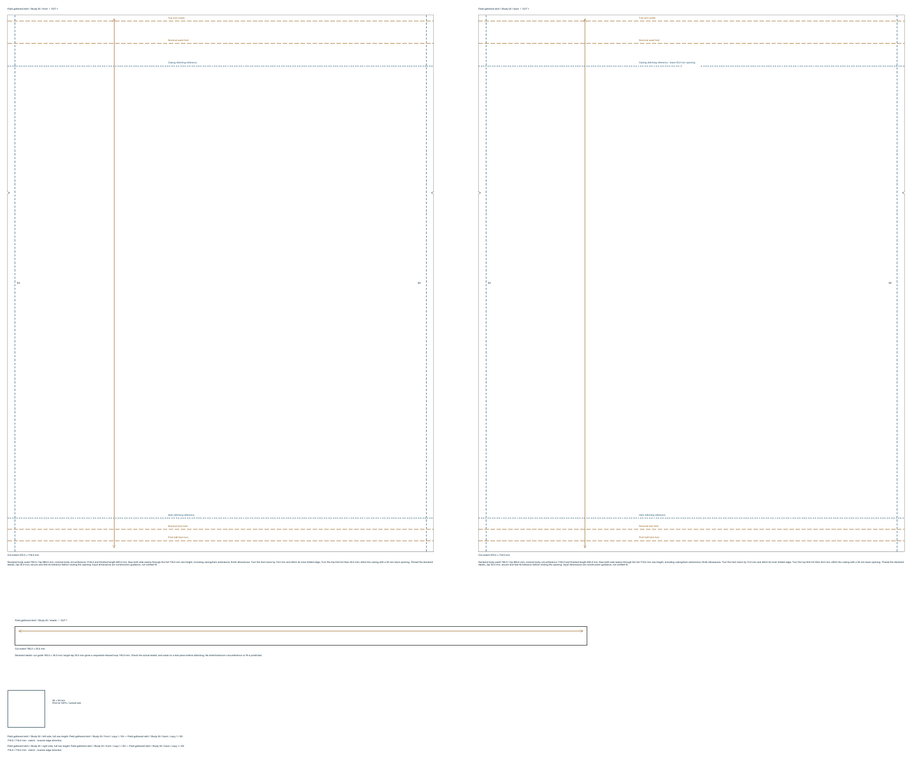

# Declared garment blocks and grading

Canvas's sewing actions include **Garment blocks and sizes…**. The first versioned construction is an original **Field gathered skirt**: independent front/back woven panels, an elastic-cut guide, explicit casing/hem construction references and a user-defined size chart. All sizes coexist as editable source in one project.



The hosted native proof shows a still-editable 1000 mm hip input after a real Generate/Apply/Undo test. The default concept below uses 980 mm. These are original example inputs, not retailer sizes, population measurements, a fitted sloper or a verified garment. Material behavior, sewing quality, elastic extension and worn fit require separate evaluation.

## Body, garment and raw source

Body waist, fullest hip and waist-to-hip distance are declared inputs. Nominal finished length is a separate garment dimension. Additional body circumference is added to the larger of waist/hip, so the straight panel circumference does not silently become smaller than either declared body value. This geometric clearance does not predict whether a particular elastic can stretch over a body.

The default base uses waist 760, hip 980, waist-to-hip 200, nominal finished length 650 and additional circumference 120 mm. Nominal garment body circumference is 1100 mm, giving two 550 mm-wide panels. Each editable panel includes its complete raw height, 718 mm: 650 nominal body + 30 casing depth + 8 underturn + 30 hem. Side allowances are 10 mm; raw top/bottom allowance is zero. Each cut is therefore **570 × 718 mm**, and each actual side sewing edge is **718 mm**.



The source raw top is y0. A top underturn is marked at y8, nominal waist fold at y38, casing stitching reference at y68, nominal hem fold at y688 and first hem turn at y703. The 30 mm hem means **two 15 mm turns**, followed by stitching its inner folded edge; that stitching reference is at y673. Both side seams are sewn through the complete raw height, including casing/hem extensions. Raw top/bottom boundaries are black cut edges and are excluded from blue side-sewing paths and seam pairing.

The back casing stitching guide has an actual 25 mm insertion opening. The elastic guide is a declared 765 × 25 mm cut, comprising a requested 740 mm loop plus a 25 mm lap. Instructions identify the lap and require checking the actual elastic before closing the casing. The guide is not an elastic stretch model or a machine stitching program.

The [base physical PDF](images/garment-blocks/field-skirt-base.pdf) is 1220 × 1016 mm and includes real notches, construction guides, cut quantities, a side-seam schedule and the existing 50 mm calibration square. Print at actual size and check calibration. The [three-size large-format drawing](images/garment-blocks/field-skirt-three-sizes.pdf) retains every editable size. Existing sewing SVG/PDF/raster, tiled PDF and material cutting-layout tools consume the actual source; detaching metadata does not remove its old pieces from those outputs.

## Size chart and source propagation

The original sample labels are **Study 01–03**. Their grade steps are -1, 0 and +1, with editable increments of 40 mm waist, 40 mm hip, 5 mm hip depth and 10 mm garment length. Each of 1–12 rows can use explicit measurement overrides instead. Measurements and grade arithmetic are finite and bounded; unsupported values are rejected rather than clamped. The base row uses the base input fields directly. Rebasing preserves existing resolved dimensions, materializing explicit overrides when needed; select another base before removing its row.

The native review has one actual-size vector PDF page per proposed size, with previous/next, Fit, zoom and pan from the existing document viewer. It does not move Canvas sources. **Export source PDF** writes one committed size; **Reveal source** explicitly selects its editable pieces in Canvas.

- **Generate editable sizes** creates source and managed metadata in one Undo.
- **Apply chart to source** regenerates eligible owned geometry, construction notes and joins while preserving source/contour/node/notch/guide/seam IDs, appearance and the chosen transform origin.
- **Save chart only** changes metadata, retaining the exact source objects and render signatures. Pending source updates stay explicit.
- **Create independent revision** drafts fresh independent source from the declared chart and leaves edited originals intact.
- Removing a size or **Detach block metadata** retains all existing artwork. Ordinary Canvas duplicates remain independent and acquire no managed binding.

Manual path, owned-note, allowance or seam edits produce review conflicts. Missing/deleted sources stay missing; Update never recreates them. An inherited nonrigid transform requires review. A single conflict rejects the complete update atomically. Rigid grouping, rotation/mirroring and chosen transform origins are preserved. Whole managed-size transfers remap source and seam references atomically, including real identity collisions; move front/back/elastic together, or detach that size first. Edited/nonrigid transfer conflicts never overwrite source.

Draft preview is read-only. Read-only MCP list/get/report also preserve active native measurements, caret, selection and history. External saved-chart changes retain a dirty local draft and require explicit Reload or an independent revision. Normal mutations schedule autosave and share native Undo/reopen.

## MCP

The existing `form_edit_artwork` route adds `command: "garment_block"`; no top-level tool was added.

```python
result = call("form_edit_artwork", {
    "object_id": canvas_id, "command": "garment_block", "operation": "create",
    "block": {"name": "Field / declared sizes", "body": {"hip": 1000}},
})
block_id = result["block"]["id"]
call("form_edit_artwork", {
    "object_id": canvas_id, "command": "garment_block", "operation": "report",
    "block_id": block_id,
})
call("form_edit_artwork", {
    "object_id": canvas_id, "command": "garment_block", "operation": "update",
    "block_id": block_id, "block": {"grade": {"hip": 44}},
})
```

Definitions support `body {waist,hip,waistToHip}`, `style {bodyLength,bodyEase,sideAllowance,casingDepth,casingTurnUnder,hemAllowance,elasticWidth,elasticLoopAdjustment,elasticOverlap,materialID,elasticMaterialID}`, `grade {waist,hip,waistToHip,bodyLength}`, `sizes [{id,label,step,overrides}]` and `baseSizeID`. All distances are millimeters. Existing size rows require their stable UUIDs; `get.definition` is suitable for editing. Generated bindings/seams are server-owned and cannot be supplied as a definition. Materials are optional declared labels; assembly must separately resolve suitable physical fabric snapshots.

Operations are `create`, `update`, `configure`, `create_revision`, `detach`, `detach_size`, `list`, `get` and `report`. Detach operations use `block_id`, with `size_id` for one row. Removing the final row detaches the block; detaching its current base among remaining rows requires first choosing another base. The report returns resolved sizes, source conflicts, ungenerated rows and sizes needing an explicit update.

## Construction guides and compatibility

Optional `SewingPatternPiece.unstitchedEdges` entries are source references `{edge,edgeID,endID}`. Generated paths always use both original endpoint UUIDs. Optional `constructionGuides` store `{id,edge,offset,kind,label,opening,openingPosition}`; `edge` is the same source reference, offset/opening are physical millimeters, and kind is `fold` or `stitch`. Offsets measure inward from the transformed source edge. Derived lines intersect actual cut geometry; an opening removes a real physical segment.

This first guide resolver supports sharp strictly convex straight contours. Curves, holes, concavity, collinear/ambiguous cut intersections, removed/reversed endpoint guards, nonfinite values and unsupported guide spans fail explicitly. General curved sewing geometry retains its earlier separate contract. Existing pieces without these optional fields have identical old output. New guide metadata or managed blocks require schema 41; older projects remain readable.

Assembly uses actual source object/element/copy and original edge endpoints. Different sizes have different source identities and never silently replace each other in an assembly. Unstitched boundaries are ineligible as sewing pairs while physical support pins may remain valid. This milestone does not change cloth states, rest poses or physics, and makes no assembled-fit or sew-out claim.

## Verification and provenance

Twenty-one new core/graphics/native tests cover exact three-size dimensions, transformed physical offsets/openings, stable identities and origins, finite bounds/overrides, source-safe revisions/detach/delete/duplicates, collision-safe complete transfers, locked/manual/nonrigid conflicts, chart-only rendering, schema/reopen, actual native mouse Generate/Apply while a field remains focused, normal autosave/one Undo, read-only caret preservation and external-change handling. The complete isolated suite passes **718 tests**.

The independent [PDF/SVG report](evidence/garment-blocks-independent.json) parses actual vector paths with pypdf and Python's XML parser. It confirms four full 718 mm sewing sides, the 25 mm gap, eight physical fold lines, omitted top/bottom sewing edges, the 570 × 718 mm cut extents, the 50 mm calibration square and physical page boxes. All proofs were rendered with Poppler and reviewed. Native hosted screenshots demonstrate controls; visible installed-app and packaged-bridge acceptance are separate release checks.

`scripts/smoke_garment_blocks.py` exercises the real packaged bridge in a disposable `.local` library. Its `--read-only-block UUID` mode only queries an existing block, useful while checking an active native draft. `scripts/verify_garment_blocks.py proof-folder --report result.json` independently checks the physical proof; it needs pypdf and Pillow. Neither script communicates with equipment or changes Studio inventory.

The [NMSU primary guide](https://pubs.nmsu.edu/_c/C228/index.html) informs the distinction between body data, ease and pattern dimensions. [Utah State University's construction guide](https://extension.usu.edu/sewing/research/youth-elastic-waist-skirt) informs measurement/construction terminology; its specific drafting multipliers, text and illustrations are not copied. The official [ISO 8559-1 abstract](https://www.iso.org/standard/61686.html) concerns anthropometric definitions; this work reproduces no standards table and claims no standard sizing conformity. [FreeSewing](https://freesewing.eu/docs/about/) distinguishes a parametric design from a drafted pattern. [Seamly's official GPL3 license](https://github.com/FashionFreedom/Seamly2D/blob/develop/LICENSE) was reviewed; no drafting software, external pattern, illustration, font or new dependency was vendored. FORM's sample chart, construction and implementation are original.

## Integrated release acceptance

The combined release passes **790 tests (548 core/graphics/IPC and 242 native app)** with zero failures/skips. Two integration checks preserve the distinction between raw construction supports and sewing eligibility: a raw top can carry a physical support, and cannot enter the seam graph. Original convex pieces with per-edge allowances use the ordinary geometry resolver during assembly-source preparation.

The real packaged bridge workflow and independent pypdf/XML checks pass. Computer use enters a still-focused 1000 mm hip, then clicks Generate: all three editable sizes save in one history step, and native Undo/Redo restores the complete exact states. A focused 1012.5 mm pointer Apply preserves every piece, node, guide and seam identity while regenerating real geometry; one Undo restores the entire earlier project. Save chart only captures a 44 mm grade without changing source objects and explicitly reports pending source updates. Invalid input visibly disables Apply. Read-only MCP list/get/report retain an unapplied 1005 mm draft and its selected text.

A native base-size PDF independently measures 1240 × 1016 mm, two 580 × 718 mm cuts, four full 718 mm sewing sides, a 25 mm casing-opening reference and the 50 mm calibration square. Export leaves source/history/camera exact. Actual process quit/relaunch and native Home reopen preserve the entire project and restore the saved native measurement. All five ordinary projects and Studio settings remain unchanged. [Compact integrated evidence](evidence/garment-blocks-native.json) records the checks; no equipment is contacted. The broader garment-development and textile goals remain active.
