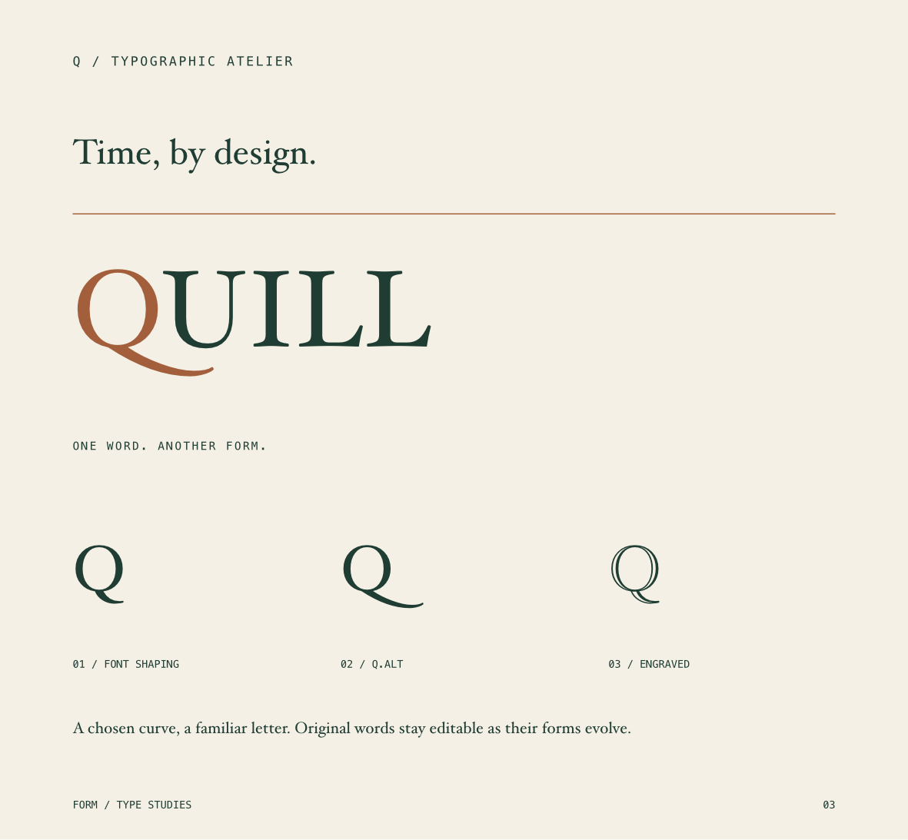
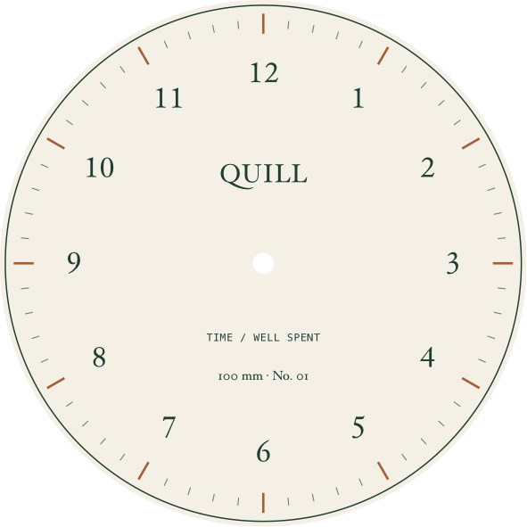

# Alternate glyphs and the QUILL study

FORM can pin a real font glyph to a source character or cluster while retaining the original editable text. The typography inspector’s **Glyphs…** palette discovers actual alternatives supported by the selected face, previews their native outlines, and applies the chosen form immediately.





## Native workflow

Select a character or complete cluster while editing text on the canvas, then open **Glyphs…** in the typography inspector. A one-character text object can be selected as a whole. **Alternates for selection** shows single-glyph forms produced by the font’s actual feature selectors, alongside its normal shaping. It does not infer alternates from similar Unicode characters or glyph-name patterns. A ligature extending outside the source selection is excluded.

Click a form to apply it and return to the canvas. **Use font shaping** clears the selected choice. Character fonts, colors, sizes, spacing, source case, and styles stay editable. A forced cluster needs uniform font, size, paint, and spacing across its source characters; incompatible rich formatting produces an error. Formatting part of an existing forced cluster expands to its complete range.

Point-text bounds update with the glyph, including swash overhangs, through either the palette or MCP. Clearing the choice restores normal shaping and automatic sizing in the same Undo transaction. Area-text frames keep their explicit dimensions.

**All glyphs** browses the face’s repertoire in pages of 48. Search by glyph-name substring, numeric ID, `gid:815`, or a Unicode scalar such as `U+0051`. Tiles preview the actual glyph in the current face and variable-font settings. Applying an arbitrary repertoire glyph changes the form associated with the captured source selection; it does not insert a Unicode character. Larger text objects need an inline character selection before a tile can apply.

Choices support 1–64 source UTF-16 units, without splitting surrogate pairs or including tabs/paragraph breaks, and up to 256 choices per text element. Native typing beside a choice does not inherit it. Insertion before it shifts its source range; replacing its source removes it. Attributed paste gives duplicated choices distinct IDs. Marked input stays unforced until commit. Glyph assignment and clearing each form a native Undo step. Typing follows AppKit's normal word/event grouping; undo all typing groups before finishing to cancel the interaction. Document Undo after finishing restores the complete text-editing session.

Read-only agent inspection preserves an open palette and character selection. A successful agent mutation or project switch dismisses the captured palette. A failed operation leaves the capture available; Apply can use the same source range after native text editing has finished, provided the object and source text still match.

## Shared rendering and file format

`ArtworkElement.glyphOverrides` stores a UUID, source UTF-16 location, original source string, and a `FontGlyph` containing its base PostScript face, numeric glyph ID, optional stable glyph name, and SHA-256 font-table signature. Nonempty choices require **schema 15**. The current reader accepts schemas 1–16; camera orientation can independently require schema 16. Older glyph-free files retain their defaults.

The renderer maps source ranges through case treatment before deriving Core Text glyph-info attributes. Native text, Core Text layout, TextKit hyphenation, 3D surface textures, raster/PDF exports, and converted paths consume the same choices. No glyph-info objects or native source/render markers enter project files. Production layout avoids serializing native metadata. Bounded caches retain face discovery, alternate queries, canonical variable-face names, glyph-info objects, and text layouts; font activation invalidates them.

Variable instances can synthesize different PostScript names at different axis positions. FORM resolves them to the font file’s default face for glyph identity while retaining the actual instance and axis values for preview, shaping, and outlines. Named glyphs can survive font-version reordering by resolving their names again. Unnamed numeric choices require an exact signature match. Changing to an incompatible static face keeps the source and choice for review; the inspector explains the issue, and production exports reject unresolved choices before writing a file.

SVG outputs custom glyphs as portable outlines even when its general text option requests live text. `composed_text_outlined` reports this fallback. Bitmap glyphs remain available to native/PDF/raster rendering but explicitly reject vector outlining. Conversion retains the original hidden editable text and its choices, with ordinary editable Bézier paths in its place.

## Local MCP

The existing read-only `form_font_features` tool supports three commands; FORM still exposes 50 tools.

- `features` is the default and retains the existing selector/axis response.
- `glyphs` accepts `font_name`, `query`, nonnegative `offset`, and `limit` from 1 to 128. It returns the actual repertoire, em-normalized bounds/advances, outline availability, and glyph metadata.
- `alternates` accepts `font_name`, source `text`, UTF-16 `location`/`length`, and optional current `typography`, including feature settings, case, and variable axes. It returns supported single-glyph forms for that exact cluster.

Use the returned `glyph` metadata directly with `form_edit_artwork`, command `glyph`:

```python
forms = call("form_font_features", {
    "command": "alternates", "font_name": "HoeflerText-Regular",
    "text": "Quill", "location": 0, "length": 1,
    "typography": {"fontName": "HoeflerText-Regular", "caseTreatment": "uppercase"}
})
choice = next(x["glyph"] for x in forms["glyphs"]
              if x["glyph"].get("glyphName") == "Q.alt")
call("form_edit_artwork", {
    "command": "glyph", "object_id": FRAME_UUID,
    "element_ids": [TEXT_UUID], "location": 0, "length": 1,
    "glyph": choice
})
```

`glyph: null` clears intersecting choices in the given range. Omitting the range clears all choices in the selected text objects. Native and MCP operations share source-range validation, locked-owner checks, atomic batches, linked-source persistence, and Undo. Discovery does not require an open project and makes no external model calls.

## QUILL validation

`python3 scripts/smoke_glyphs.py` creates a **200 × 185 mm** wordmark specimen, a **100 × 100 mm** dial, and linked oak cover/clock objects. Hoefler Text’s default Q, `Q.alt`, and engraved Q appear side by side. The main wordmark retains source **Quill** while displaying **QUILL**, with an independently colored initial and manual pair spacing. The dial combines twelve precisely positioned numerals, sixty vector markers, a shaft opening, and the same editable alternate wordmark.

The workflow checks actual discovery, immutable source-only updates through physical users, invalid-batch rollback, clearing/Undo, schema-15 reopen, SVG/PDF/PNG/JPEG output, recoverable conversion, editable converted nodes, and saved updates across 200 glyph-bearing text objects. Native computer use checks selection, real previews, application, search/paging, Undo, and agent handoff.

The glyph milestone passes **311 tests**: **276 core/graphics** and **35 direct app tests**. Twenty saved style changes across 200 glyph-bearing text objects measured **60.09 ms median / 70.56 ms p95**, including the local MCP bridge and persistence. Native PNGs measure **1181 × 1093 px** for the specimen and **591 × 591 px** for the dial at 150 DPI. PDF pages measure **566.929 × 524.409 pt** and **283.465 × 283.465 pt**, confirmed with Poppler; both final renders were visually reviewed. These timings do not measure sustained all-visible gesture FPS or process memory. [Validation notes](validation.md) retain test, export, and native-editing evidence.

Advanced text composition/publication, broader font-language controls, production color workflows, and the remaining [implementation goal](implementation-goal.md) stay active.
