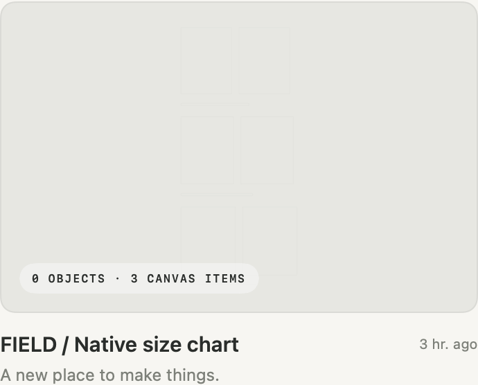
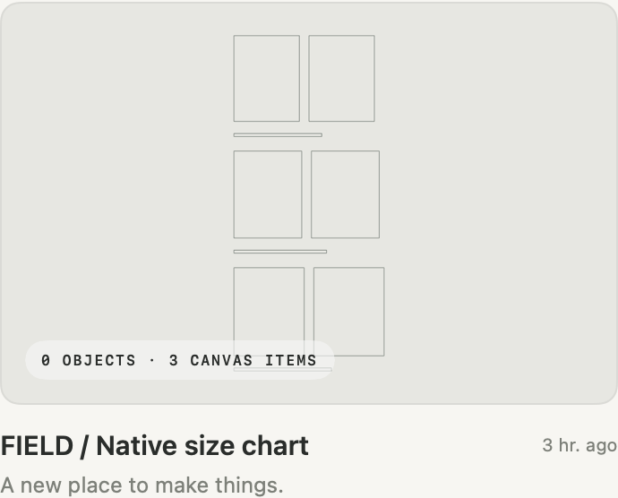

# Home technical Canvas previews

Home gives eligible sewing diagrams a clearer display outline while preserving the saved drawing and its complete framing. Opening the project still shows the physical source; SVG/PDF exports keep their actual millimeters. No cached `Preview.png` file is rewritten by this display service.

The saved FIELD size-chart fixture contains three size groups and nine 0.25 mm sewing contours. Its complete padded frame is 5116.615 × 3325.8 mm. At the existing 1000 × 650 cache size, a physical contour is only 0.04886 pixels wide. Reducing that image into Home made the drawing nearly disappear.

The Home-only image uses a **1.0 cached-pixel minimum**, corrected for each path's world scale, after computing the original frame. This changes only stroke widths on a disposable copy. It keeps every group, centerline, transform, color and existing 20% framing. Wider strokes stay as drawn.

| Before | Home display outline |
| --- | --- |
|  |  |

These are actual offscreen AppKit/SwiftUI Home-card renders of the saved fixture, not an installed-app acceptance claim. [Full hosted Home](validation/home-technical-preview/native-home-after.png) and [independent verification](validation/home-technical-preview/independent-verification.json) accompany them. Parent-owned installed/native validation is a separate release gate.

## Fidelity and fallback

The initial profile supports plain, opaque, centered solid sewing outlines with a single straight convex closed contour, interior angles of at least 45 degrees, and conformal transforms. Rotations, reflections and uniform scales work. Normal opaque groups are supported.

Filled or mixed drawings, curves, concavity, holes, masks, components, booleans, effects, dashes, noncentered strokes, nonuniform scale/shear, any bounding dimension or edge shorter than three cached pixels, and outlines whose conservative expanded bounds overlap keep their existing cached preview. This conservative fallback avoids merging distinct features or changing clipped/filled artwork. 3D and publication cover selection use their existing paths. No representative size or new cover is selected automatically.

## Bounded work and lifetime

- Aggregate manifest plus active source bytes: **2 MiB**, checked before object/Artwork decoding. Read only the active object revision; reject unsafe paths, file links and manifest changes during the read.
- At most 256 elements, 128 sewing outlines, 128 nodes per outline and 16 parent levels. A **50,000-work-unit counter** bounds geometry/spacing checks and fails closed when exhausted. Convexity is linear in node count. Spacing compares constant-size expanded bounds; no node-pair geometry loop runs across outlines.
- Disk snapshots are serialized off the main actor. Rendering has one main-actor owner. A late older source cannot replace a completed newer result. Concurrent cards for the same revision share one image; cancelled/deleted-project jobs cannot publish.
- Image-only in-memory LRU: at most **8 entries / 32 MiB**; one 1000 × 650 RGBA image accounts for 2,600,000 bytes. No Project, decoded source or PDF object is retained. Keep only the current revision of each project; purge deleted projects. No on-disk cache migration or source save occurs.

On the optimized actual saved-fixture proof, Home processing used **174 work units** and **62,771 aggregate source bytes**. Maximum measured main-actor processing was **1.87 ms**. End-to-end request latency was 11.66 ms cold and 21.06 ms maximum warm while the full hosted Home populated its other study previews; those figures include IO and run-loop scheduling. The isolated helper cache probe observed a 0.26 ms warm request. One image rendered, retained as 2,600,000 nominal RGBA bytes. These observations are machine/workload-specific, not latency guarantees.

The image budget is not a total process-memory claim: bounded source decoding, AppKit and the renderer also use transient memory. The profile adds no model, schema, preference, MCP tool or camera interaction.

## Verification

`HomeTechnicalPreviewTests` exercises source/framing preservation, transformed contours, conservative fallback, the worst allowed 128 × 128-node input, explicit work-budget overflow, aggregate bytes before decode, manifest races, cache bounds/invalidation, late/cancelled/deleted requests, concurrent identical cards, and actual native Home cards. The existing `ProjectPreviewTests` retain their publication-cover, negative-coordinate Canvas and empty-Canvas checks.

The fixture's original default render is pixel-identical to the baseline. Independent Pillow/pypdf checks confirm all original package files (including `Preview.png`) retain their SHA-256 values, SVG bytes match, and physical PDF MediaBox and decoded page content match. Original and clearer thumbnail ink support remains in the same locations within a two-pixel antialias/outline envelope. The final fixture proof reports cost separately for main-actor processing and end-to-end request latency; request latency also includes disk and main-run-loop scheduling beside existing Home study previews.

To reproduce from a local saved fixture, copy it to a disposable test location, then run:

```sh
FORM_HOME46_FIXTURE=/absolute/path/to/disposable.form \
FORM_HOME46_PROOF_DIR=/absolute/path/to/existing/proof-directory \
swift test --disable-sandbox --filter 'HomeTechnicalPreviewTests|ProjectPreviewTests'
python3 scripts/verify_home_technical_preview.py /absolute/path/to/proof-directory
```

The independent verifier requires Pillow and pypdf. It never opens an app or modifies a project. Optional `--original-package` plus `--original-hashes` checks every fixture file; `--baseline-render` compares the original renderer's pixels.

Installed acceptance in the **881-test integration** confirms the actual FIELD card is legible alongside unchanged publication and 3D cards. Opening Canvas shows the original 0.25 mm stroke. All 57 copied fixture files, including cached previews, remain byte-identical through Home → Canvas → Home and actual restart; the in-memory display image is never saved into the package. All five ordinary projects and Studio/font preferences remain exact. [Shared native evidence](evidence/collection-home-native.json).
