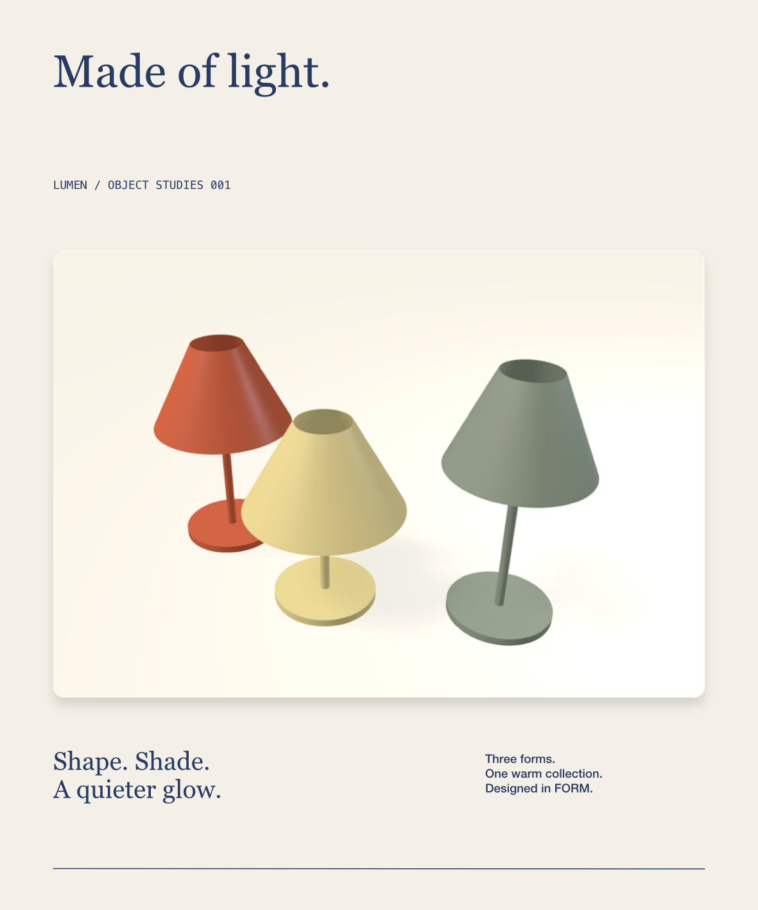
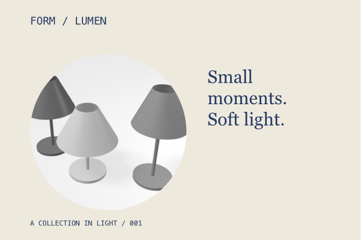

# Image editing and the LUMEN collection

Placed images retain their original files while crop, color adjustments, transforms, opacity, and clipping remain editable. The canvas, linked physical faces, and exports share the same image rendering path. Native actions and MCP edits share validation and Undo.



## Native workflow

Use **Place image** in the Artwork toolbar, or drop a local file onto a physical frame. Placement preserves the image's proportions and centers a dropped image at the pointer. Multiple files can be chosen in the file panel. Select an image to inspect its original pixel dimensions and effective output DPI. The original-image thumbnail can be dragged onto another frame to place another copy; this reuses the existing asset.

Double-click an image or choose **Crop image**. Drag its contents to reposition them inside the fixed frame; wheel up zooms into the image. Precise scrolling is less sensitive, and unusually large individual wheel events are bounded. A blue border and thirds grid identify crop mode. **Return**, **Escape**, or **Done cropping** finishes; Undo reverses each gesture. Cropping supports transformed images and nested groups. Pan remains available through the Hand tool or Space-drag.

**Crop bounds** provides exact percentages of the original image, measured from its top-left corner. **Fill frame** creates a centered crop without distortion. **Fit frame to image** adjusts the image frame's height to match the original proportions. **Show full original** clears the crop inside the existing frame; use Fit frame to image when its proportions differ. Cropping and zoom limits preserve the crop's aspect ratio during gestures; numeric bounds permit independent edits.

**Image adjustments** exposes brightness (−100–100%), contrast (0–400%), and saturation (0–200%), with sliders and numeric fields. Reset adjustments preserves crop and layout. The existing opacity, blend, effects, and clipping controls remain available. Color adjustments require a raster image; placed PDF/SVG references retain their vector-reference workflow and have no fixed pixel DPI.

**Replace…** uses a native file chooser. It retains the frame, transform, parent, clipping mask, opacity, and adjustments, then refills that frame around the previous crop center using the new image's proportions. The previous original stays in the package and Undo restores its placement. Replacing with a PDF/SVG reference requires clearing raster-only color adjustments first.

## Resolution and original assets

PNG, JPEG, TIFF/TIF, HEIC/HEIF, GIF, BMP, and WebP decode through ImageIO. EXIF orientation is applied once before normalized cropping. Animated GIFs retain their full source files and frame counts; the artwork displays the first frame. The inspector reports oriented pixel dimensions. Import accepts regular files up to 50 MB and raster sources up to 100 megapixels / 65,535 pixels per edge.

Effective DPI uses the visible crop, the image's physical frame, ancestor transforms, component placement, and resolved fitting onto a product face. It uses the largest physical size of a source pixel, including shear, to avoid overstating resolution. The inspector flags values below **300 DPI** and below **150 DPI**. `form_image_info` can inspect each resolved placement on a selected physical product.

Original bytes are copied into the `.form` package's `Assets` folder. Routine edits update the artwork definition and leave those bytes intact. File replacement retains older originals; asset garbage collection remains future work. Preview decoding uses bounded thumbnails and a 64 MB cache cost limit. Density follows the crop and physical transform; the same original can serve many placements. Each decoded preview is limited to 16 million pixels / 8192 pixels per edge. These are per-image allocation limits, not a bound on the entire process's memory.

## MCP

There are **48 tools**. Image commands accept an artwork frame or a linked physical product:

```json
{"name":"form_import_image","arguments":{"object_id":"<frame UUID>","path":"/absolute/path/study.png","x":100,"y":80,"width":120,"anchor":"center"}}
{"name":"form_edit_image","arguments":{"object_id":"<frame UUID>","element_ids":["<image UUID>"],"crop":{"x":0.1,"y":0.1,"width":0.8,"height":0.8},"adjustments":{"saturation":0.82,"contrast":1.05,"brightness":0.015}}}
{"name":"form_image_info","arguments":{"object_id":"<physical product UUID>"}}
{"name":"form_import_image","arguments":{"object_id":"<frame UUID>","element_id":"<image UUID>","path":"/absolute/path/replacement.jpg"}}
{"name":"form_edit_image","arguments":{"object_id":"<frame UUID>","element_ids":["<image UUID>"],"adjustments":null}}
```

`form_import_image` returns `selected_elements`, `asset`, and the canonical `object_id`. Placement accepts physical `x`, `y`, `width`, `height`, optional `parent_id` and `name`, and `anchor: top-left` (default) or `center`. Omitting height preserves the original aspect ratio; specifying both dimensions crops to fill. `element_id` replaces an existing unlocked image. File import/replacement stays outside atomic batches.

`form_edit_image` patches normalized crop bounds and adjustments. Omitted properties remain unchanged; `crop: null` or `adjustments: null` clears that setting. `command: reset` clears both while preserving the original asset and frame geometry. Crops must stay inside the source and span at least 1% in each dimension. Invalid edits leave the project unchanged. This tool supports atomic batches and Undo/Redo. Read-only `form_image_info` preserves native editing focus.

## Output and persistence

Image settings require **schema 9**; schemas 1–8 still load. Crop and adjustments remain source definitions rather than rewritten bitmap files. Shared source edits update linked product faces while consumer object resources remain unchanged.

SVG embeds original PNG/JPEG bytes, normalized crop viewports, and a live sRGB color matrix. Other raster formats convert to oriented PNG for portable SVG output; conversion rejects originals exceeding the per-image allocation limits. Native Core Image and SVG use the same combined saturation/contrast/brightness matrix, avoiding differences from intermediate clamping. PDF and PNG/JPEG use resolution appropriate to the requested output DPI. Raster/PDF export rejects image decodes that would exceed the allocation limits at that resolution, allowing a lower DPI or smaller physical placement. Original assets stay intact in every case.

The implementation uses Apple's [ImageIO orientation handling](https://developer.apple.com/documentation/imageio/kcgimagesourcecreatethumbnailwithtransform) and [Core Image color matrices](https://developer.apple.com/library/archive/documentation/GraphicsImaging/Reference/CoreImageFilterReference/), with saturation coefficients and compositing defined by the W3C [Filter Effects specification](https://www.w3.org/TR/filter-effects/).

## LUMEN demonstration

An original **3000 × 2000 px** render of FORM's three-lamp study becomes the placed image in a **200 × 240 mm** collection sheet. A **120 × 80 mm** card uses an independent circular crop and monochrome treatment. Clay and graphite products reference the two layouts, demonstrating the path from a 3D scene through raster composition back onto physical surfaces.



```sh
FORM_LIBRARY_PATH="$PWD/.local/ImageLibrary" build/FORM.app/Contents/MacOS/FORM
python3 scripts/smoke_images.py
```

The script creates its source renders locally, checks exact original bytes, crop/adjustment output, physical DPI, source-only revisions, centered asset reuse, layout-preserving replacement, rollback, physical SVG/PDF/PNG/JPEG, schema-9 reopen, and saved edits across 100 images. See [validation evidence](validation.md) for native computer-use checks, measurements, and browser comparisons. Production color management, broader SVG/PDF interchange, and the remaining professional editing work stay in the [active goal](implementation-goal.md).
