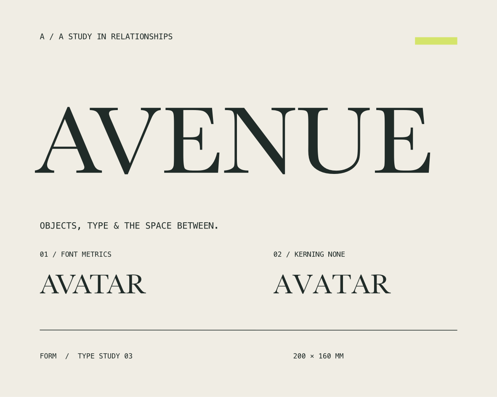
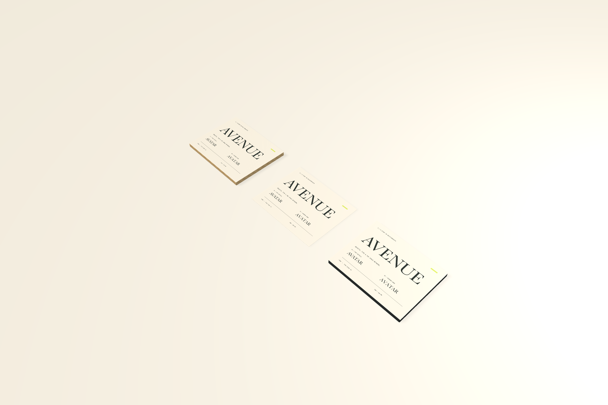

# Font kerning, independent spacing, and AVENUE

The native typography inspector now separates **Kerning** from Tracking and Pair kerning. Font metrics uses the face's built-in pair spacing. None disables automatic pair spacing. Both retain independent tracking, word spacing, and manual pair adjustments.



## Native behavior

Choose **Font metrics**, **None**, or **Original spacing** on a selected text object. During native text editing, a character selection changes only that range. Place the caret between characters to change **Pair kerning**. A zero manual adjustment retains automatic font kerning in Font metrics mode.

New point text drawn with the Text tool starts in Font metrics mode. Existing artwork keeps Original spacing until explicitly changed. That compatibility choice retains the original renderer's spacing algorithm, including its behavior at zero tracking; it does not reinterpret saved layouts. Reusable text styles inherit the mode, record local overrides, and support Reset and Redefine. Manual pair positions remain local to the text object.

Native Undo reverses mode, tracking, and pair edits independently. Returning to the initial input restores the complete original stored element, including style references. Linked physical faces consume the same shaped artwork.

## MCP and persistence

`Typography.kerningMode` is optional: `"metrics"`, `"none"`, or omitted/null for Original spacing. It works in a whole element's `typography`, UTF-16 `textRuns`, and a reusable style definition. For example:

```json
{"command":"update","style_id":"STYLE_UUID",
 "typography":{"kerningMode":"metrics","tracking":0.5}}
```

Use that argument with `form_text_style`. Generic `form_edit_artwork` replacement accepts the same field. Unknown modes reject the edit; failed atomic batches leave the project and Undo stack unchanged. `font_size`, tracking, word spacing, and manual pair deltas use points. In the explicit modes, word and manual adjustments add to tracking; Original spacing retains its existing precedence at a space boundary.

Explicit modes require **schema 13**, including a mode present only in a rich span or unused style definition. Schemas 1–12 remain readable without changing their appearance. Older readers reject schema 13 instead of discarding its behavior.

## Shaping and exports

The explicit modes use Core Text tracking for added spacing. Font metrics omits the kerning-disable attribute; None combines zero kerning with tracking. Apple's [kerning contract](https://developer.apple.com/documentation/coretext/kctkernattributename) explains zero versus omitted kerning, and its [tracking contract](https://developer.apple.com/documentation/coretext/kcttrackingattributename) describes additional cluster spacing. The installed SDK's `CTStringAttributes.h` also confirms that zero kerning remains honored when tracking is present. Existing documents retain the prior `kern` path.

Core Text glyph positions drive native drawing, PDF, physical surfaces, and outlined SVG. SVG import now inherits `font-kerning` (`normal`/`auto` use metrics; `none` disables it), including nested text. Newly imported SVG text defaults to font metrics. Live-text SVG exports explicit `font-kerning` and spacing. Default outlined SVG carries the shaped glyph geometry; live text still requires the assigned fonts and receiving-application shaping review.

## AVENUE and evidence

**AVENUE · The space between** is a **200 × 160 mm** Baskerville wordmark study with separate metrics/disabled specimens and linked oak/graphite faces. The native sheet is **1181 × 945 pixels at 150 DPI**; PDF is **566.929 × 453.543 points**. PDF and browser-rendered SVG were visually reviewed.



Run `python3 scripts/smoke_kerning.py` with an isolated `FORM_LIBRARY_PATH`. It verifies distinct rendered spacing, style overrides/reset, source-only immutable updates, invalid-batch rollback, recoverable outlines, physical outputs, schema-13 reopen, and 200-text saved mode edits. Eight automated regressions inspect actual glyph positions, spacing composition, repeated native round trips, outline identity, legacy compatibility, style inheritance, schema detection, SVG conversion, and layout-cache reuse. Native computer use verifies the picker, selected characters, new point-text default, tracking/manual pairs, and exact full-project Undo.

Twenty saved edits across 200 text objects measured **43.52 ms median / 56.75 ms p95**, including bridge and persistence; a sampled canvas draw was **16.63 ms**. These are local samples, not sustained gesture-FPS guarantees. Actual Table mouse orbit/wheel input retains all objects and the geometry-build count. See [validation](validation.md) for export comparisons and restoration evidence.

The full goal remains active for alternate glyphs, advanced composition/publication, color management, cross-project named-resource transfer, and the remaining physical workflows.
