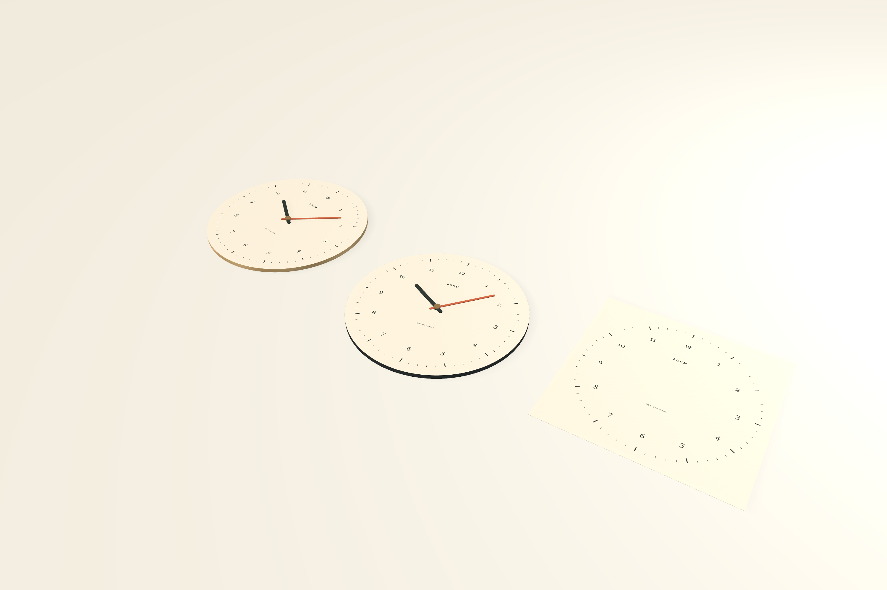

# Shared artwork and the clock study

**Home → Start with a study → Clock dial** creates *Time, well spent*: two 240 mm clocks and one independent artwork sheet on the Table. The physical clocks share that sheet. Their oak and graphite materials and placements remain local to each object. **File → New from Study** also includes the clock, folding package, lamps, and material/form studies.



## Work directly in FORM

1. Select a clock and choose **Edit artwork** or **Surface Artwork → Edit source**.
2. Edit the sheet's typography, grouped hour numerals, minute indices, or signature. The adjacent live preview shows the physical clock; both clocks receive the same source edits.
3. Double-click text or choose **Edit text on canvas**. Middle/bottom alignment is preserved during native input, drawing, and conversion to outlines.
4. Use **Convert to outlines** for editable glyph paths. The original text remains as a hidden editable source. Direct selection and precise node commands operate on the resulting ordinary paths.
5. Return to the Table to change the dial diameter, thickness, shaft opening, displayed time, or hand visibility. Time changes update hand pivots without rebuilding the dial or its texture.
6. Export physical artwork from the clock, the independent source sheet, or an artwork selection. **Share → Cut profile · SVG** exports the outer dial and shaft opening separately from printable artwork.

The source sheet is a rectangular authoring document. The physical clock clips its resolved artwork to a circular face with a shaft opening. SVG, PDF, PNG, the Table, and the live inset share that boundary. PNG retains transparent corners and the hole; JPEG uses a white matte.

## Physical placement

The **Surface Artwork** inspector links supported flat product faces to an artwork sheet in the same project. Existing inline artwork can become a separate document with **Make independent artwork document**.

| Placement | Behavior |
| --- | --- |
| Actual size · centered | Keep the source's physical typography and geometry, center the document on the product face, and clip at the product boundary. A changed product size leaves source dimensions intact. |
| Fit proportionally | Uniformly scale the source to fit the product face and center any remaining space. Preserve its aspect ratio and editable source dimensions. |

The inspector reports source dimensions and the applied percentage, with guidance when source and surface dimensions differ. For example, a 240 mm source fitted to a 280 mm dial displays **116.7%**. Actual size stays at **100%**.

Linked product variants share their source and fitting choice. **Detach** preserves the current physical appearance as inline artwork for those variants. Creating an independent iteration also bakes the current placement and breaks the source link for that iteration. Deleting an artwork source preserves surviving consumers by detaching their current appearance; Undo restores the original graph.

An extracted folding-sleeve source retains the existing **Artwork / Dieline** workflow. The unfolded view derives its cut and score geometry from the physical sleeve and places the resolved source artwork on its printable face. Switching views frames the relevant surface.

## Codex and MCP

The native interface and these tools use the same validated operations:

```json
{"name":"form_create_project","arguments":{"name":"Time, well spent","template":"clock"}}
{"name":"form_link_artwork","arguments":{"object_id":"<physical object UUID>","source_object_id":"<artwork sheet UUID>","fit":"actual"}}
{"name":"form_extract_artwork","arguments":{"object_id":"<object with inline artwork>"}}
{"name":"form_link_artwork","arguments":{"object_id":"<physical object UUID>"}}
```

The last call detaches. `form_get_artwork`, `form_set_artwork`, element edits, outline conversion, and node operations accept either the source ID or a physical consumer ID and edit the same source definition. `form_export_artwork` on a consumer exports the physically mapped/clipped appearance; on a source sheet it exports the independent document. Adding a `clock` object also creates and links its initial dial sheet in one undoable operation.

## Storage and rendering

Shared links and physical artwork boundaries require schema 3. Readers retain support for schema 1 and 2; an older reader rejects newer schemas. A consumer stores its source UUID and fit mode rather than duplicating the source artwork. Editing the source publishes only its new immutable object revision and the project manifest; consumer object files remain unchanged.

Render signatures use resolved artwork with editor metadata removed. Text layouts and rendered face images are bounded caches. Hand-time changes update node rotations and visibility without invalidating the face. The dial uses a closed radial mesh with 256 segments and small bevels: **4,096 triangles**, with a real bore. Curve-based face/hand geometry sets flatness in scene units; [Apple documents how path flatness controls SceneKit tessellation](https://developer.apple.com/documentation/scenekit/scnshape/path?language=objc).

Fit and Focus account for viewport aspect, view direction, and perspective depth. The live object inset and starting-study previews use the same fitting rules. Saved project previews retain their camera composition, and exports preserve the source viewport when output ratios differ. SceneKit's [projection direction](https://developer.apple.com/documentation/scenekit/scncamera/projectiondirection) determines the primary field-of-view axis.

## Fabrication and current limits

**⌘P** opens native print preparation with **Dial** selected for a clock. It excludes the artwork rendering face and the illustrative hands. Separate hand blanks and the complete assembly are also available as components. The cut-profile SVG contains the exact millimeter outer circle and shaft opening. Artwork exports contain the graphics; they do not turn printed numerals into relief geometry.

The demonstration provides a prototype dial and illustrative hands. It does not include a working clock movement, a tested mounting system, production hand hubs, or verified movement/shaft clearances. The project records those physical questions. Hand blanks need engineering for the chosen movement before fabrication.

The real local Orca test produced a 240 × 240 × 6 mm dial, 30 layers at 0.2 mm, G-code, and sliced 3MF. Mesh edge incidence and volume were checked independently. **No printer connection or print transmission occurred.** The user's instruction not to print remains in effect.

Links currently target supported flat faces and same-project artwork sheets. Curved/UV surfaces, arbitrary projection, panel continuity, reusable artwork across projects, advanced publication/color workflows, and the full professional 2D acceptance suite remain active work. Textile/apparel implementation remains queued.

See [validation evidence](validation.md) and the [full implementation goal](implementation-goal.md).
