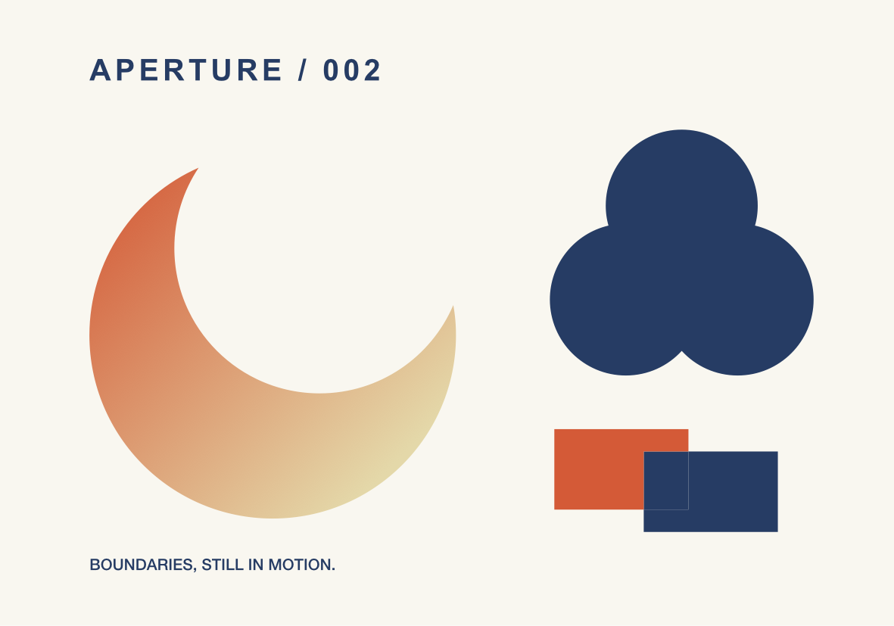

# Live vector booleans

Select compatible shapes or paths and choose **Artwork → Live Boolean** or the inspector's **Combine paths** menu. Union, Subtract, Intersect, and Exclude now create a live group. The operands remain ordinary editable objects inside it. Subtract uses the bottom operand as its base and removes the others.

The inspector lets you change the operation, edit operands, release them, or flatten the result. **Edit operands** opens the group's layers and shows dashed source boundaries. Moving a shape, changing its dimensions, editing its nodes, hiding it, or reordering the operands updates the result and linked product faces. An empty intersection remains editable and can recover when its operands move.

## Appearance and geometry

The result starts with the frontmost operand's fill, gradient, stroke, and opacity. For an ordinary group, the frontmost visible vector supplies that appearance. The live group then has its own appearance controls. Individual operand fills and strokes are retained for release; their filled shape boundaries drive the geometry. Outline a stroke or text first when its visible outline should be an operand.

Nested groups, compound holes, transformed paths, and vector clips are supported. Geometry and paint remain aligned through rotation, scale, shear, and reflection. Group bounds follow operands that move beyond the original frame. Common outer clips and clips inside operands remain effective.

Results occupy the frontmost selected operand's stack position. Flattening and division retain that position below unrelated foreground objects. Releasing a reordered live group places its operands at the group's current position.

**Release operands** restores their individual appearances and geometry. A clipping wrapper is retained when both an outer clip and operand clips need to survive. **Flatten result to path** produces ordinary editable nodes and retains the complete live group hidden as an editable source. Undo restores the prior structure in one step.

**Divide into editable regions** partitions the selected shapes into separate paths. Each region inherits the appearance of its frontmost covering operand. Source objects remain hidden for recovery. Regions can be selected, moved, recolored, or edited individually.

## MCP

The existing `form_boolean_artwork` tool supports the same workflow. `mode` defaults to `live`; `operation: divide` defaults to Divide mode.

```json
{"name":"form_boolean_artwork","arguments":{"object_id":"<frame or linked product UUID>","element_ids":["<base UUID>","<cutter UUID>"],"operation":"subtract"}}
{"name":"form_boolean_artwork","arguments":{"object_id":"<frame UUID>","element_ids":["<live group UUID>"],"mode":"update","operation":"intersect"}}
{"name":"form_boolean_artwork","arguments":{"object_id":"<frame UUID>","element_ids":["<live group UUID>"],"mode":"flatten"}}
{"name":"form_boolean_artwork","arguments":{"object_id":"<frame UUID>","element_ids":["<live group UUID>"],"mode":"release"}}
{"name":"form_boolean_artwork","arguments":{"object_id":"<frame UUID>","element_ids":["<first UUID>","<second UUID>"],"operation":"divide"}}
```

`mode: path` creates a flat result directly while preserving hidden source objects. Responses include `selected_elements`, resulting element definitions, `empty_result`, and `mode`. Boolean edits and shape/text/stroke conversion can participate in `form_batch`; invalid members roll back the entire batch. File imports and exports remain outside batches.

Use `form_get_artwork` to inspect operand UUIDs and `form_edit_artwork` or `form_edit_path` to change them. A linked product ID resolves to its canonical source. `form_set_view` can select a live group or an operand; the native layer scope follows the selection.

## Outputs and storage

The native canvas, physical face textures, PDF/raster output, and SVG use the same resolved geometry. Selecting an operand for export includes its complete owning live boolean, preserving the evaluated appearance and required operands. SVG emits ordinary paths; the editable live structure remains in the FORM project.

Live groups use schema 5; schemas 1–4 still load. A project stores the operation and original operands. Resolved paths are ephemeral. The bounded 64 MB geometry cache keys operand geometry, hierarchy, transforms, visibility, and clips. Names, colors, locks, and the live group's placement do not rebuild geometry. `form_status.boolean_geometry` exposes build/cache diagnostics.

Current limits are 64 direct operands, 256 visible vector shapes, 20,000 path nodes, and 16 nested group levels per live group. Divide accepts 2–16 operands and at most 512 regions. Selected operands must share a parent and common clipping mask; release their use as another object's clipping mask before combining them. These are vector operations; solid CAD booleans remain separate work.

## Demonstration and validation

`python3 scripts/smoke_boolean.py` creates **Aperture · Live boolean study** in an isolated running library. Its crescent and trefoil remain live, its divided regions are separate editable paths, and two physical product editions reference the independent 200 × 140 mm artwork. The script checks atomic batches, source-only persistence, operand edits, cache invalidation, flatten/release/undo, actual exports, reopen, and a 100-group edit sample.



See the [validation record](validation.md) for tests, native mouse checks, and measured results. The implementation uses Apple's [Core Graphics path operations](https://developer.apple.com/documentation/coregraphics/cgpath) and [separated components](https://developer.apple.com/documentation/coregraphics/cgpath/componentsseparated%28using%3A%29).
