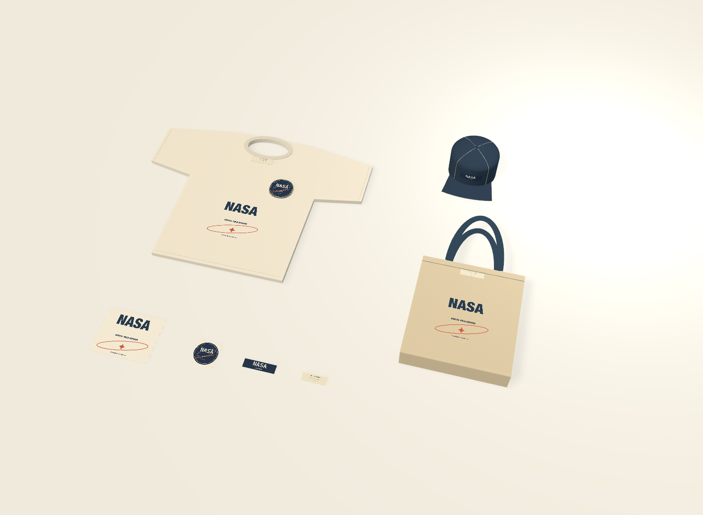
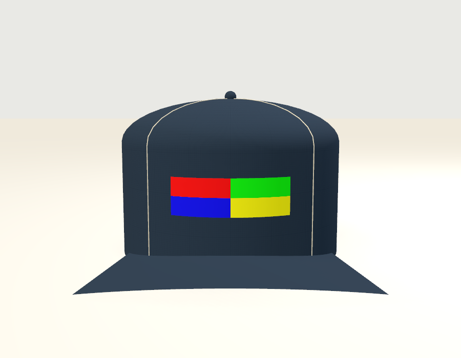

# Merchandise blanks and bounded decoration regions

FORM includes three dimensioned concept blanks: a crew-neck jersey tee, a curved-front cap and an open canvas tote. Choose **ORBITAL / Field collection** from the study templates for an original NASA-inspired collection with independent direct artwork, patches and sewn labels linked to editable vector sources.



These are presentation blanks with declared generic fabrics. Their dimensions do not identify supplier products, standard sizes or verified fit. They remain separate from the editable sewing patterns and simulated cloth study. Open garment surfaces and direct artwork reject FDM slicing rather than becoming closed print solids.

## Physical blank controls

| Blank | Default dimensions | Construction represented |
| --- | --- | --- |
| Crew-neck tee | 540 mm body width, 700 mm body length, 190 mm sleeve extension | Jersey body, real neck opening, rib collar and seam details |
| Curved-front cap | 200 mm crown diameter, 140 mm height, 75 mm visor reach | Cylindrical lower crown, domed roof, curved visor, panel seams, rear opening and sweatband |
| Canvas tote | 380 × 420 mm body, 80 mm gusset, 230 mm handle drop | Open front/back/side panels, bottom gusset and two webbing handles |

Body and trim fabrics can be changed independently. **Show back** turns over a tee or tote together with its attached artwork, preserving the authored sources and physical region orientation. The cap remains upright; orbit to inspect its rear and sides. Moving a blank carries its decorations once. Dimension edits validate every attached region atomically, and Undo restores the complete prior design.

## Independent artwork regions

The native textile inspector lists available regions and their physical bounds. `form_textile_zones(object_id)` returns exact millimeter dimensions and the allowed processes without changing the project. Region coordinates are centered across/down. Offsets, rotation and full rotated rectangle corners must remain within the selected bounds; FORM never silently scales or clamps a design to make it fit.

Tee regions include front, back, left/right chest, sleeves and inside neck. Tote regions include front, back, both gussets and inside top. Cap front, rear and side regions lie below the dome, above the rear opening and between the authored panel seams.

Use `textilePrint` with process `directPrint` for a physically sized transparent artwork region. Its source colors govern appearance; the virtual **Direct artwork / source colors** material does not represent a backing fabric. The default ARTWORK text is immediately editable. Existing shared artwork, styles, assets, variants and transform origins remain available. Patches and labels use their existing fabric and process controls on supported planar regions.

```json
{"recipe_id":"textilePrint","parameters":{"width":96,"depth":30},
 "textile":{"kind":"patch","process":"directPrint",
 "attachment":{"garmentID":"CAP_UUID","zone":"front",
 "offset":{"x":0,"y":0},"rotation":0,"clearance":0}}}
```

A cap's direct artwork is a real conforming mesh sampled on the same crown surface as the garment. Horizontal source dimensions map to arc-length millimeters. Rotation remains in that physical surface coordinate system. The implementation explicitly rejects rigid cap patches, labels and embroidery: these need a conforming construction model before support can be claimed. Direct-art clearance is bounded to 0–0.25 mm. Planar patches/labels allow 0–3 mm; legacy bomber behavior is retained.



The four-color proof is an actual Metal render of the cap: red/green above blue/yellow in source order. It checks the front/back and vertical UV conventions rather than inferring them from geometry alone.

## Source and physical exports

Select an independent decoration or its editable artwork source to export SVG, PDF or raster artwork. Its physical width/height and source link remain intact. Exporting a garment through the generic physical-artwork route rejects with an explicit region-selection message; scene export provides a garment preview. Dedicated fabric-repeat exports retain their separate intent.

The included [tee print proof](images/merchandise/tee-print-240x200.pdf) is 240 × 200 mm; its [SVG](images/merchandise/tee-print-240x200.svg) preserves the same page size. Raster export DPI affects output resolution, never the region dimensions.

## Validation

Core tests cover physical zone bounds, rotated-corner containment, unsupported cap processes, atomic shrink rejection, schema34 round-trip, shared variants and source preservation. Native tests inspect actual crown/ink vertices, tee surface bounds, back-facing orientation, autosave, physical PDF/SVG/raster export and geometry reuse. A hidden native window sends real AppKit down/drag/up events through the Move tool in four host/selection/order scenarios; every case retains one Undo and zero geometry rebuilds. Camera controls are unchanged.

`scripts/smoke_merchandise.py` exercises the packaged MCP bridge against an explicitly isolated `.local` library: discovery, template, read-only zones, validation rollback, source edits, variants, back display, exports and saved reopen. It never connects to printers or sends jobs.

## Packaged and native acceptance

The optimized integrated release passes 639 tests (461 core/graphics and 178 native app tests), with zero failures or skips. Its 59-tool packaged MCP bridge passes `smoke_merchandise.py` in an isolated library, including rotated bounds, atomic host-shrink rejection, supported processes, source and variant sharing, physical exports, Undo and saved reopen.

Computer-use acceptance in the running app verifies the original collection, readable conforming cap artwork, explicit Focus and a real mouse orbit. The native Show back control changes only the tee display state; one Undo restores the entire project exactly. Keyboard entry changes the direct artwork offset to 12 mm, autosaves before any MCP read, and creates one Undo entry. One native Undo restores the complete source and history. Both edits preserve the camera, linked sources and all 34 existing geometry builds. The ordinary five-project library and Studio file remain byte-equivalent in reconstructed content and SHA checks.
