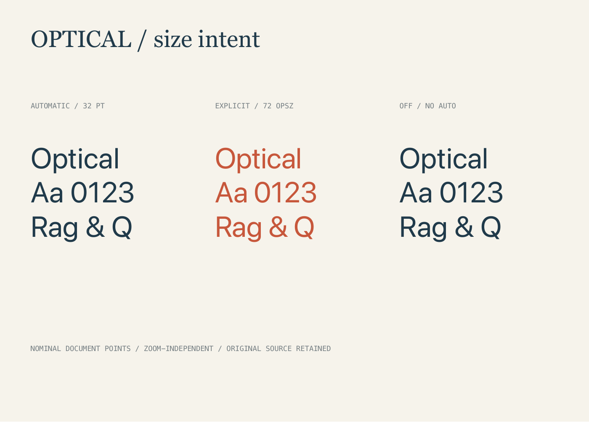
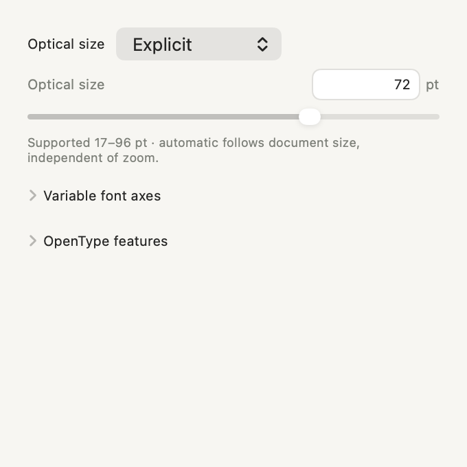

# Optical sizing and numeric precision

Milestone 42 adds explicit optical-size behavior to the existing variable-font controls and focused Up/Down increments to typography's numeric fields. Legacy typography remains unchanged until a new optical policy is assigned. No Canvas/Table camera binding changes.

## One optical-size control

The font feature inspector replaces the generic opsz axis row with one optical group. It uses the installed face's real axis/range:

- **Font default** clears the optical override and stored opsz coordinate deliberately. With neither present, the original font creation behavior applies.
- **Automatic** follows each source span's nominal document point size. Font size changes update the optical design. Canvas zoom, thumbnail enlargement, backing pixels and drawing-unit conversion do not.
- **Explicit** uses a separate point value, independent from the text size. Switching from Automatic freezes its current effective optical coordinate. Type an exact value or use the slider. Edited values outside the actual supported range reject visibly; they are not clamped into the document.
- **Off** disables automatic optical sizing and uses the face's optical default. It differs from Font default when that face normally enables automatic sizing.

An old source with only `variations[opsz]` shows **Stored axis** as its current informational state. Its original rendering stays intact. Editing its value or choosing a new mode is intentional; reset remains explicit. Mixed modes or distinct explicit/stored values show Mixed. Unsupported selections retain their assignments and offer reset, rather than silently selecting a different font.

Automatic/Explicit/Off override an old stored opsz coordinate only in the derived font descriptor. The original axis dictionary, other axes and features remain recorded. Font-only changes/replacement retain them. If a later face cannot apply a stored policy/value, the inspector, document font usage and export reports identify the incompatibility; the source value is preserved. Previews use the face's available range, without claiming that an incompatible stored assignment was applied exactly.

## Source, styles and Undo

`Typography.opticalSizing` is optional:

```json
{"mode":"automatic"}
{"mode":"explicit","points":72}
{"mode":"none"}
```

Explicit values must be finite 0.1–10000 points in stored data; a focused edit also requires the current installed face's actual range. Automatic/none do not accept an explicit point value. Omission preserves the exact existing font path, including legacy axis assignments. A deliberate optical reset clears the policy and legacy opsz together while retaining unrelated axes.

The policy is a character property: base text, rich UTF-16 spans and reusable styles retain it with their existing override/reset/detach rules. Selected-character changes do not expand to paragraphs. One global story retains its source instead of storing fragments in every frame. Linked owners/components and recoverable hidden original text keep their metadata. Original words/case mappings, glyph identities/signatures, list IDs, palette links, features and axes remain source data.

Native field changes, optical commands and styles use the shared document Undo. Rejected values/ranges/locks and rejected model-only batches preserve the current text responder, selection, source/history and native draft. Existing native text-edit lifetime remains intact; a numeric hold creates a nested native Undo group rather than prematurely finishing the editor.

## Point units and actual Core Text behavior

An optical policy resolves against the original typographic point size before the renderer converts to millimeter drawing coordinates. The resolved descriptor carries an agreeing optical attribute and axis value. This matters for real cached named instances: some drop an optical attribute supplied alone. Off supplies the default coordinate plus the native `none` setting. These are derived values; they do not replace the stored policy/axes.

Local primary-API measurements show the difference. The installed broad-axis system face exposes 17–96pt, default 28. At 36pt the actual A advance is 23.23828125pt in Automatic, 22.921875pt with Explicit 72, and 23.361328125pt with Off. Creating an unpinned auto font at 12.7 drawing units normalizes to 24.1171875pt and opsz 17. Pinning its nominal 36pt optical context normalizes to 23.23828125pt, exactly matching point-coordinate shaping. This corrects the new explicit modes while keeping omitted legacy modes unchanged.

Native resizing re-resolves Automatic using each selected rich run's source size, preserving other fonts/settings. Native metadata roundtrip retains the policy and dormant source coordinates rather than baking a transient resolved axis back into the document.

## Glyphs and physical output

Optical instances can synthesize a different PostScript name. Exact glyph resolution accepts that derived instance only when its recorded original face matches and its complete glyph/font table fingerprint agrees. Stored glyph IDs, names and signatures are never retargeted. Intentional replacement with another face still leaves an unresolved choice requiring explicit review.

Glyph alternate discovery and native glyph previews use the source nominal point context, independently from their enlarged display. `form_font_features command:alternates` accepts optional `font_size`; omission keeps its 48pt preview default. Its current Typography may include opticalSizing. The glyph repertoire and stored glyph identity remain tied to the original source face.

Native/raster output, physical faces, publication pages and PDF use the same resolved font/shaping. SVG text affected by a new policy uses the established composed-outline fallback even when live text is requested. The response reports `optical_text_outlined`, `optical_sizing_fallback` and retained-setting warnings. Ordinary legacy live text stays live. This gives precise physical geometry without claiming cross-browser optical metric equivalence; the original text stays editable in FORM.

## Focused numeric keys

Only opted-in typography fields use the new native editor. **Up/Down** increments/decrements the focused value; **Shift** multiplies its step by 10. There are no Option/Space aliases, application event monitors, window-delegate replacements or global key changes. Without that numeric field as first responder, existing text/Canvas/Table behavior continues.

| Field | Normal step |
| --- | --- |
| Font size, leading | 1pt |
| Tracking, baseline, manual pair and word spacing | 0.1pt |
| Paragraph spacing and indents | 1pt |
| Character width, hyphenation percentage | 1 percentage point |
| Explicit optical size | 1pt within the actual shared range |
| Other variable axes | Range-aware axis units; smaller steps for small ranges |

A key hold updates interactively and groups repeat events into one Undo. Separate presses remain separate actions. Command-Z from the focused field restores both the model and displayed value. An unchanged formatted draft steps the exact underlying value, rather than its former four-decimal display approximation; opted-in fields display up to 12 fractional digits without rounding source data. Edited drafts use their parser. Invalid/empty/nonfinite drafts stay visible with an error and produce no model/history change. Marked input keeps its native candidate navigation.

Interaction generations scope late key-up/Undo to its original project, object, selection, character range, workspace and editing state. An old field cannot edit a new selection or close a replacement interaction. Other scalar and geometry fields keep their prior behavior unless explicitly opted in.

## MCP and format

No new tool is added. The existing `form_edit_artwork` command **optical** takes `optical_sizing` and the ordinary element IDs, with optional source UTF-16 location/length:

```json
{
  "object_id":"ARTWORK-UUID",
  "element_ids":["TEXT-UUID"],
  "command":"optical",
  "optical_sizing":{"mode":"explicit","points":72},
  "location":0,
  "length":1
}
```

Null performs the intentional reset; missing `optical_sizing` rejects that command. A shared frame targets its global story source. The existing style API accepts `typography.opticalSizing`; an explicit null style patch clears its old opsz as well. Complete serialized source preserves portable assignments; font-only operations preserve incompatible retained values and report them. Optically relevant model-only batches can be preflighted before ending a native draft. Finish current input before combining those edits with graphics operations in one batch.

Only projects containing a policy in source/rich/style/story/recoverable text require schema 42. Projects without it keep their existing minimum. The integrated reader must retain all intervening/newer schema fields. Numeric field stepping and derived native metadata do not add project fields.

## Validation and limits

The isolated tree is based on the parent's 718-test 38/40/bomber integration, before the later 36/41/43 additions. Its full graphics/IPC suite passes 738 tests (508 core/graphics +230 native app), including 20 new optical/precision tests. The final focused scope passes 11 core/graphics and 9 actual native tests. New coverage includes real Core Text policy/axis/metric differences, point/mm equivalence, zoom invariance, named instances, Unicode scope, rich styles/local overrides/reset, global story/glyph/list/case preservation, source-only font replacement, portable reopen, actual Up/Down/key-up/repeat/Shift/Command-Z, active invalid/marked input, unconfigured-field behavior and stale project/selection/interaction safety. The existing glyph suite also passes.

The actual 230×165mm physical proof contains three optical modes with effective coordinates 32/72/28 and the original dormant coordinate 19 unchanged. Independent pypdf/XML/Pillow checks verify page/trim dimensions, outlined optical SVG layers, ordinary live labels, actual PNG density/physical dimensions and source records. Poppler renders the PDF; actual native controls and physical output are visually reviewed. The integrated raster exporter accepts native integer and decimal DPI values explicitly; invalid explicit values reject instead of falling back to 300. The original native test passed an integer that previously triggered that fallback. The regenerated 150 DPI proof is 1358 × 974 pixels, with encoded densities approximately 149.96/149.94 DPI from pixel/metadata quantization and physical dimensions verified independently. This discrepancy was numeric input handling, not Retina scaling. Glyph backing fingerprints have a 64-entry cache; existing font/layout/glyph caches remain bounded.

The final integrated optimized signed release passes **812 tests: 559 core/graphics/IPC and 253 native app**, zero failures/skips, including 20 optical and 2 strict DPI regressions. The real packaged `smoke_optical_typography.py` passes discovery of all 59 tools and/source/style/story/glyph/Undo/export/reopen checks in a disposable library. Independent Pillow/pypdf/XML reads confirm the packaged 150 DPI PNG is 1358 × 974 pixels and PDF/SVG remain 230 × 165 mm. `verify_optical_typography.py` separately checks the three-mode physical proof.

Actual computer use verifies all four modes, focused Up 32→33, Shift-Down 33→23, distinct one-step Undo, focused Command-Z/Redo and exact whole-project restoration. Font size 32.125→33.125 retains its fraction and one Undo restores the entire project. A 1200 ms computer-use hold delivered one step; OS autorepeat is not claimed from that input. Repeated native events/grouping and invalid/marked/stale drafts are covered by the AppKit tests. Actual process quit/relaunch/native Home reopen preserve the entire project. Four real Table mouse directions preserve source/history and reverse within 1e−12 radians, with unchanged bindings. All five ordinary projects, Studio and font preferences remain exact. See [native evidence](evidence/optical-typography-native.json). The broader typography/publication/3D/textile goal remains open.

Primary references: [Apple's optical-size attribute](https://developer.apple.com/documentation/coretext/kctfontopticalsizeattribute) and the local public SDK CTFontDescriptor.h document number/auto/none; [OpenType opsz](https://learn.microsoft.com/en-us/typography/opentype/spec/dvaraxistag_opsz) defines physical point units, ordinary zoom independence and axis-bound handling. Local results above are actual measurements, not assumptions from those declarations. No font download/install or external model/hardware operation is performed.

## Integrated physical proof



The [230 × 165 mm PDF](images/optical-sizing-proof.pdf) is actual vector output rendered with Poppler for this preview. Original words, point sizes and dormant source axes remain unchanged.



The controls image is an offscreen hosted native inspector, not an installed-app screenshot. The integrated 812-test release also passes actual packaged and native computer-use acceptance; the installed Canvas and inspector were visually reviewed separately.
