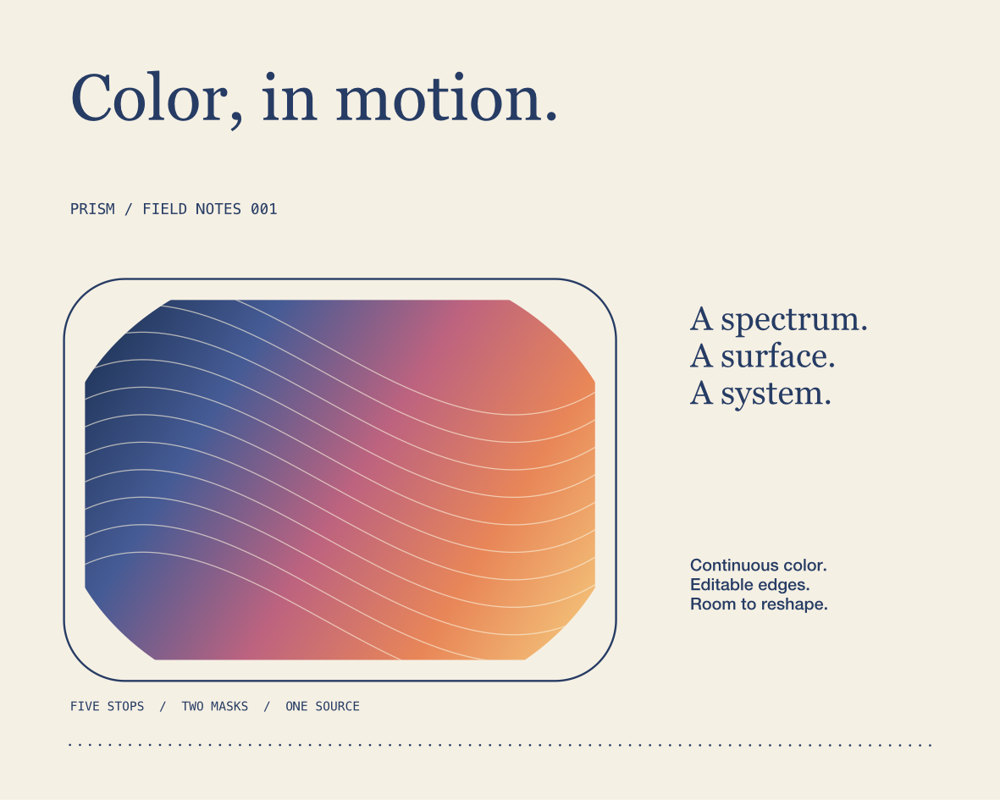
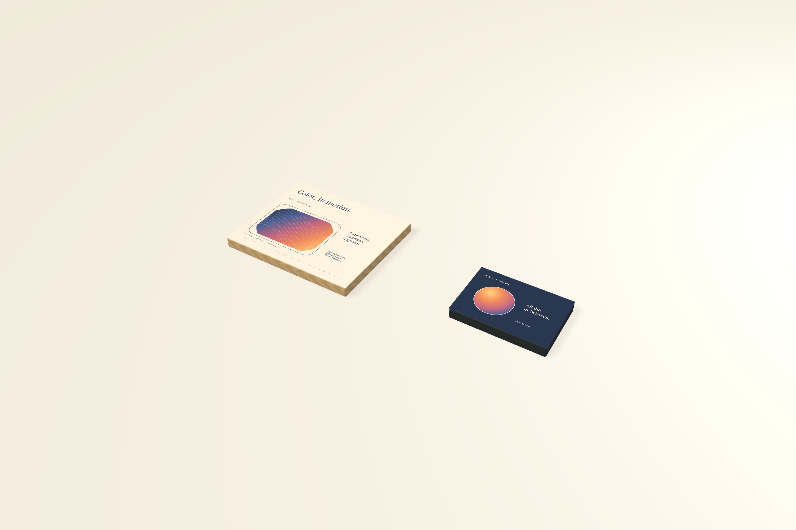

# Gradients, strokes, and editable masks

FORM's vector paint controls operate on the same editable source as the native canvas, linked physical products, and local MCP. **PRISM · Color in motion** demonstrates five-stop color, linear and radial gradients, inside/outside edges, dotted rules, and two nested clipping masks.



## Native editing

Select a vector shape and open **Gradient** in the inspector. Use linear or radial paint, set start/end positions, choose local or shared stop colors, change positions and opacity, add/remove stops, or reverse their order. Stop UUIDs survive reordering. A gradient retains two to 32 stops. Equal positions retain their order, with the later color defining the hard edge.

The canvas shows the gradient axis, its endpoints, and individual color stops. Drag either endpoint, drag the axis to reposition the whole gradient, or drag a stop along it. Double-click the axis to insert an interpolated stop. Selecting a stop in the inspector also highlights its canvas handle. Delete removes that selected stop while retaining at least two; Escape clears stop selection. Imported affine gradient transforms remain intact until explicitly reset.

**Stroke** provides width, color/shared swatch, opacity, cap, join, miter limit, alignment, dash/gap array, and dash phase. Lengths use the document unit and accept explicit unit suffixes. Up to sixteen comma-separated lengths are supported; odd-length arrays repeat, and zero-length dashes with round caps produce dots. Blank is solid. Disabling a stroke retains its settings. Lines can disable their implicit stroke too.

Center alignment works on open and closed geometry. Inside/outside alignment requires closed geometry, including compound holes and live boolean results. These alignments are computed as actual filled paths, keeping the native preview, physical surface, PDF/raster output, and portable SVG consistent.

**Outline stroke** produces ordinary editable geometry at the original layer position. A filled shape retains a separate editable fill, including its gradient, plus outlined stroke geometry. A wrapper applies opacity, effects, blending, and clipping once. The original remains as a hidden editable source. Shape and text conversion also preserve layer order.

Select sibling artwork and an area shape, then use **Use bottom shape as clipping mask**. Select clipped contents and choose **Edit mask** to work on its geometry. The footer identifies mask editing and offers **Back to contents**. Primitive masks can become editable Bézier paths; conversion redirects every consumer to the new path. The mask's shape is visible as an editing outline; its fill/stroke do not affect clipping. **Release mask** preserves the shape. Nested clipped groups provide editable nested masks.



## MCP

There are **49 tools**. `form_edit_paint` accepts an artwork frame or linked physical product, `element_ids`, and optional `command` (default `update`). Omitted properties are retained. Stroke/gradient `null` removes the explicit setting; lines then recover their implicit stroke, so use `enabled: false` to hide a line stroke.

```json
{"name":"form_edit_paint","arguments":{"object_id":"<frame UUID>","element_ids":["<shape UUID>"],"stroke":{"width":1.2,"alignment":"outside","color":"#263C64","opacity":0.7,"join":"round","dash":[0,3],"cap":"round","dash_offset":1}}}
{"name":"form_edit_paint","arguments":{"object_id":"<frame UUID>","element_ids":["<shape UUID>"],"gradient":{"kind":"linear","start":{"x":0,"y":0.2},"end":{"x":1,"y":0.8}}}}
{"name":"form_edit_paint","arguments":{"object_id":"<frame UUID>","element_ids":["<shape UUID>"],"command":"add_stop","offset":0.45}}
{"name":"form_edit_paint","arguments":{"object_id":"<frame UUID>","element_ids":["<shape UUID>"],"command":"update_stop","stop_id":"<stop UUID>","offset":0.7,"color":"#BD637F","opacity":0.8}}
{"name":"form_edit_artwork","arguments":{"object_id":"<frame UUID>","element_ids":["<contents UUID>"],"command":"clip","mask_id":"<mask UUID>"}}
```

Stop commands operate on one object. `add_stop` samples the current resolved colors and alpha unless values are provided, and returns `selected_stop`; it accepts an optional new `stop_id`. `delete_stop` retains at least two stops. `reverse_stops` reverses the color field. Shared colors bind through `form_swatch target: gradient_stop` with `stop_id`. Gradient start/end coordinates are normalized to the object's paint dimensions; optional `transform` is affine, and `transform: null` resets it.

Stroke width is 0–100 mm, opacity is 0–1, and dash lengths are 0–1000 mm with a nonzero total. Native/MCP paint edits share Undo and atomic batches. Invalid values, locked artwork, and unsupported open-path alignments leave the project unchanged. Paint edits on clipping masks are rejected because masks use geometry. `form_edit_path` edits mask nodes, and `form_convert_to_paths mode: shape` preserves their references.

## Persistence, output, and limits

Explicit stroke enable/alignment settings require **schema 10**. Schemas 1–9 remain readable. Sources retain gradient stops, all stroke styles, masks, and recovery layers. Shared artwork changes update linked faces while consumer resources retain their source links.

Stroke geometry has a 32 MB cache cost limit and ignores placement, colors, opacity, and UUID changes. Dash expansion rejects estimates above 20,000 segments before allocating their geometry. Preview and export use this guard; excessive patterns should be simplified. Cache cost limits do not bound the whole process's memory. Selection/component bounds include visible stroke overflow.

Centered SVG strokes retain standard stroke attributes; inside/outside strokes become filled vector outlines. SVG retains editable gradient definitions and nested clips. Native PDF and PNG/JPEG use the same artwork renderer. These choices follow Apple's [stroke expansion API](https://developer.apple.com/documentation/coregraphics/cgpath/copy(strokingwithwidth:linecap:linejoin:miterlimit:transform:)) and SVG's [painting](https://www.w3.org/TR/SVG/latest/painting.html) and [gradient definitions](https://www.w3.org/TR/SVG/latest/pservers.html).

```sh
FORM_LIBRARY_PATH="$PWD/.local/PaintLibrary" build/FORM.app/Contents/MacOS/FORM
python3 scripts/smoke_paint.py
```

PRISM includes a **200 × 160 mm** sheet, **120 × 80 mm** edition card, and linked oak/graphite products. The script checks stop reorder/undo, complete stroke patches, nested clips, reference-preserving mask conversion, fill-preserving expansion, invalid edits, physical outputs, save/reopen, and saved paint edits on 200 elements. See [validation evidence](validation.md) for actual measurements and native mouse checks. Variable-width strokes remain a later-stage feature in the governing specification; advanced SVG paint/interchange and production color management remain open in the [full implementation goal](implementation-goal.md).
