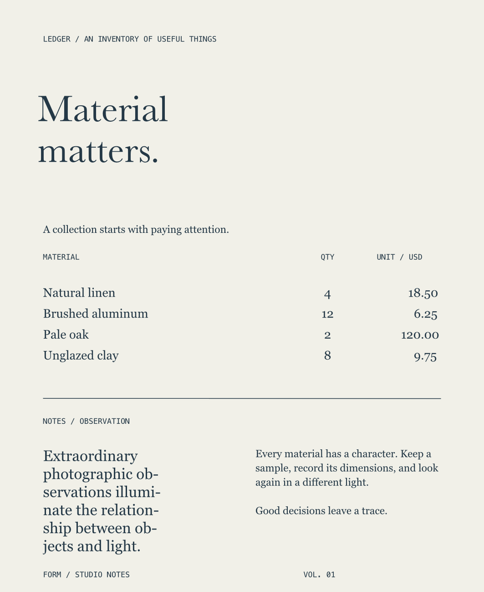
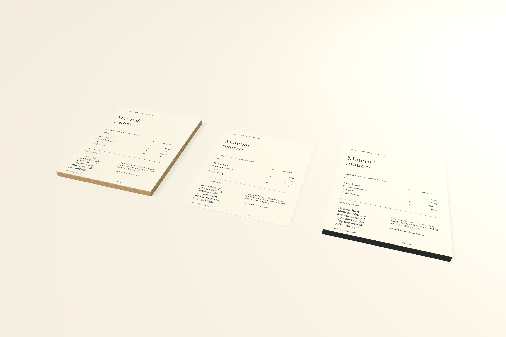

# Paragraph composition and LEDGER

Saved tab stops and real hyphenation now work in native text editing, the artwork canvas, linked product faces, and production output. **LEDGER · Material matters** demonstrates both on a **180 × 220 mm** material inventory.





## Native controls

Select text, expand **Paragraph & character**, and choose **Tab stops…**. Stops use typographic points and support Left, Center, Right, and Decimal alignment. Decimal stops accept a period or comma and align the separator's center. Stops are sorted on Apply; duplicate positions, invalid values, and more than 64 stops are rejected without changing the document. Positions and repeating intervals must be finite, between 0 and 10,000 points.

**Custom tab stops** enables saved settings. **Use system tab stops** retains AppKit's twelve left stops at 28-point intervals while allowing a custom repeating interval. Turn it off to define an explicit list, including an empty one. A zero repeating interval stops automatic tabs after the last explicit stop. **System defaults** clears both saved properties. Opening and applying an unchanged sheet preserves exact positions and optional defaults.

While editing characters, tab changes apply to their containing paragraphs and retain character formatting. A whole-object selection edits all its paragraphs. **Cancel** or Escape discards the draft. Return does not implicitly apply it. Invalid input stays visible with an explanation.

**Hyphenation** accepts 0–100 percent of the native paragraph factor. Zero disables it; positive values enable the system's discretionary hyphenation decisions. It is a composition setting, not a promise that every word receives a break. The Observation paragraph visibly changes its line breaks and overflow state. Generated hyphens are glyphs; the original words remain unchanged.

Read-only agent inspection preserves the tab sheet and draft. A failed project open retains its original paragraph target even if inline editing has ended. A successful agent mutation dismisses an unapplied sheet; successful project transitions also dismiss it. Apply rejects a changed project, object, or selection.

## MCP editing

`form_edit_artwork` adds `command: "paragraph"`; the tool count remains 50. Patch only the paragraph properties you intend to change:

```json
{
  "command": "paragraph",
  "object_id": "OBJECT_UUID",
  "element_ids": ["TEXT_UUID"],
  "typography": {
    "tabStops": [
      {"location": 300, "alignment": "center"},
      {"location": 400, "alignment": "decimal"}
    ],
    "defaultTabInterval": 0,
    "hyphenation": 1
  },
  "location": 0,
  "length": 7
}
```

Omit `location`/`length` to format all selected text. Supplied ranges use integer UTF-16 offsets, expand to containing paragraphs, and may have zero length for a caret. Ranges cannot split surrogate pairs or exceed the text. A caret in an empty trailing paragraph is explicitly rejected because no stored characters can carry its formatting; empty whole-text elements can still receive base formatting. Group targets traverse eligible text descendants. Locked targets, unknown/non-paragraph properties, and invalid settings fail atomically, including within `form_batch`. One successful edit is one Undo step.

The patch accepts alignment, leading, paragraph spacing/indents, direction, hyphenation, tab stops, and repeating interval. `null` clears an optional value. Font, size, color, manual pairs, source text, transforms, other paragraphs, and independent character-style links are retained. Paragraph style inheritance includes the new tab properties; deliberate local overrides survive style redefinition and Reset follows the style again.

`Typography.tabStops` is optional: `null`/missing retains system stops, while `[]` stores an explicitly empty list. `defaultTabInterval` is separately optional. Custom tabs or positive hyphenation on text, rich spans, or unused style definitions require **schema 14**. Readers retain schemas 1–13, and old documents without these settings retain their previous layout.

## Composition and exports

Core Text's frame setter does not perform the requested automatic hyphenation. Hyphenated text therefore uses a shared cached TextKit glyph layout. Measurement, overflow, native drawing, linked textures, PDF/raster output, and editable outlines use its actual line breaks and generated glyphs. Ordinary text retains the existing Core Text renderer. Native inline editing uses matching paragraph attributes.

SVG outlines tabbed or hyphenated text even when `outline_text:false`, preserving the composed positions. The result reports `composed_text_outlined` for these fallback text elements; ordinary text can remain live. The native document stays editable, and conversion to editable paths retains a recoverable hidden text source. Optional live SVG still needs receiving-font/shaping review for its remaining text.

The LEDGER PNG is **1063 × 1299 pixels at 150 DPI**; its PDF measures **510.236 × 623.622 points**. Native raster and Poppler-rendered PDF were visually reviewed. A real browser comparison of default outlined SVG with the native PNG measured **0.054602 foreground mean channel error**, with matching column positions and hyphenated line breaks and visible antialiasing differences. The default outlined output carries the actual composed glyph positions.

## Validation and limits

`python3 scripts/smoke_paragraphs.py` creates the inventory and two linked oak/graphite faces in an isolated library. It checks source-only resource updates, selected-paragraph style overrides/reset, unchanged raw words, visibly different hyphenated output, invalid-batch rollback, SVG fallback metadata, recoverable outlines, exports, and schema-14 reopening.

Twenty saved paragraph edits across **200 text objects** measured **119.03 ms median / 120.44 ms p95**, including MCP and persistence. A sampled canvas draw measured **1.19 ms** with continuous rendering disabled. The sample may cull objects outside the viewport; it is not a sustained all-visible gesture-FPS claim. Paragraph layout caching is bounded at **256 entries / 16 MB estimated cost** and reuses layout across placement changes. Font changes invalidate it.

Native computer use verifies unchanged Apply, invalid-input retention, exact one-step Undo, selected-paragraph changes, retained character formatting, agent draft handoff, actual hyphenation/overflow changes, and identical source after native editing. See [validation evidence](validation.md).

Hyphenation decisions depend on the installed system dictionaries and language. Explicit document language, consecutive-hyphen limits, advanced composition, lists, linked text frames, baseline grids, and sequential publication remain unfinished. [Reversible mixed-character case](text-case.md) is now available; alternate glyph selection remains in the expanded goal.
