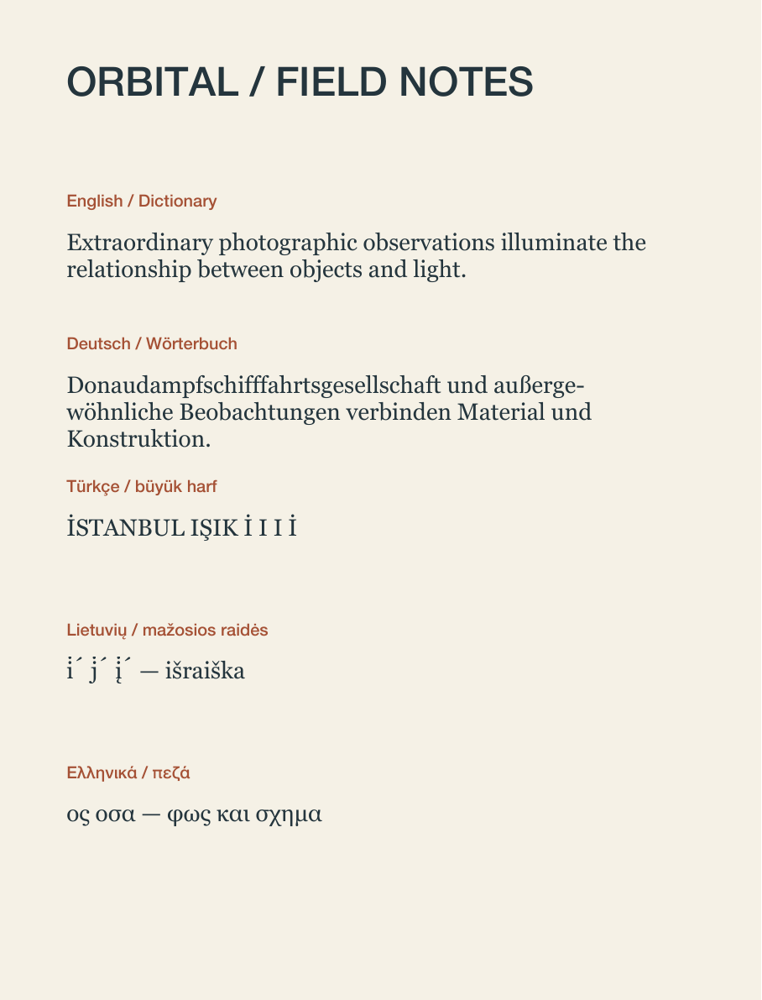

# Paragraph language and hyphenation

FORM stores an optional language on each artwork document and an optional character language in `Typography`. Explicit identifiers are canonical BCP 47 tags, such as `en-US`, `de`, `tr`, or `lt`. An omitted text language inherits the document language. An omitted document language preserves the existing automatic behavior. Changing either value preserves source words, colors, rich spans, and reusable style references.

The Paragraph inspector exposes Text language, a custom identifier field, Document language, and optional minimum word/prefix/suffix limits. Writing direction remains the existing Natural, Left to right, and Right to left choice. Character language may differ within one paragraph. Hyphenation limits apply to the containing paragraph.

Language drives localized font forms, locale case treatment, and the installed hyphenation dictionary. The shared `PublicationTextStorage` overrides AppKit's actual hyphenation candidate boundary with Core Foundation's locale-specific dictionary. Native editing and generated paragraph glyphs use that same storage. Unsupported dictionaries produce no automatic word hyphens and the inspector identifies the missing dictionary; source text remains editable. Explicit discretionary hyphens remain source characters.

Case treatment retains the user's original words. The source/display mapping handles Turkish and Azeri dotted I, Greek final sigma, and Lithuanian combining-mark insertion/deletion. Native editing temporarily retains rich source attributes when a case conversion hides a combining mark; these editing records never enter the project JSON. Returning to Original restores that source and its formatting. Explicit character language participates in reusable text styles. Components retain the language of their source artwork.

## MCP

Set a document default:

```json
{"object_id":"ARTWORK_UUID","command":"language","language":"de-DE"}
```

Use `language: null` to restore automatic document language. Set a containing paragraph's language and limits without replacing its characters:

```json
{
  "object_id":"ARTWORK_UUID",
  "command":"paragraph",
  "element_ids":["TEXT_UUID"],
  "location":0,
  "length":12,
  "typography":{
    "language":"de",
    "hyphenation":1,
    "hyphenationLimits":{"minimumWordLength":7,"minimumPrefix":3,"minimumSuffix":3}
  }
}
```

The UTF-16 range expands to full containing paragraphs. Whole-text and mixed character overrides may also use `form_edit_artwork` replacement values with `Typography.language`. Text styles accept `language` and `hyphenationLimits`; explicit local overrides survive style redefinition. Document changes and paragraph changes share native document Undo. Point text is measured again after an effective language change; area frames keep their dimensions.

## Persistence and validation

Explicit language or hyphenation limits require schema 20. Legacy files retain their previous behavior. Derived document-language attributes are excluded from saved Typography. Live SVG text carries `xml:lang`; hyphenated SVG uses the shared generated outlines so its breaks match native composition.

The initial automated checkpoint passes 61 scoped tests: 43 core/graphics and 18 native app tests, including seven new language tests and three new native language tests. A subsequent physical-export test also passes. The tests exercise actual dictionary candidate positions and TextKit line breaks, unsupported dictionaries, UTF-16 boundaries, locale case expansion/deletion, hidden rich combining marks, exact source restoration, canonical identifiers, persistence, owner locks, document Undo, point/area behavior, native typing Undo/Redo, and enter/finish without a spurious document edit. Existing paragraph, case, and glyph regressions also pass.

The exported multilingual proof is one 160×210mm PDF page (453.543×595.276pt), with English, German, Turkish, Lithuanian, and Greek samples. Its actual PDF was rendered with Poppler at 144 DPI and visually inspected. Native text and converted outlines have a mean foreground red-channel difference of 0.0106253 at 3 pixels/mm. The fixture also exports SVG and PNG, preserves the project exactly, and verifies physical PDF dimensions. These are offline export/native tests; the separate packaged-app smoke workflow is `scripts/smoke_paragraph_language.py` and must run against a disposable `.local` library.



This checkpoint does not complete structured lists, linked text stories, page sequences, or production color management.
