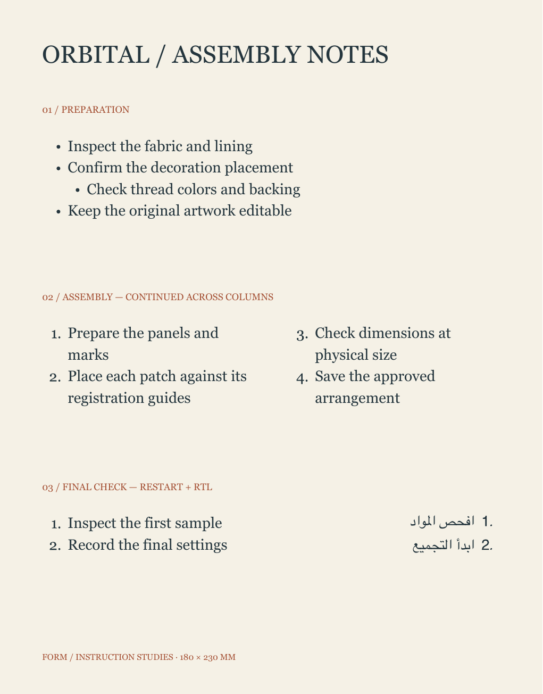

# Structured paragraph lists

The list foundation stores each item's stable identity, source UTF-16 paragraph start, list identity, bullet/decimal marker, nesting level, optional numbering restart, and optional marker font. Source text contains the user's words. Generated bullets and numbers are drawn by the shared native paragraph compositor and included in vector outlines, SVG, PDF, raster output, and physical artwork surfaces.

Select text and use Paragraph lists in the type inspector. Bullets and Numbers apply to the selected paragraphs while editing, or the selected text objects otherwise. Return adds an item; Return on an empty item exits the list. Tab indents and Shift-Tab outdents, within six supported levels. Removing a list preserves source words and rich formatting. List changes, nesting, and empty-item exit have native Undo/Redo.

Decimal lists continue across text objects sharing one list identity, in artwork layer order and then paragraph source order. Reordering layers changes that reading sequence. Restart accepts 1–999999. Continue previous joins the nearest preceding numbered text object's list. Nested counters restart after a higher-level numbered item. A hidden recoverable text source retains its place in the source sequence. Selection and production-role exports freeze the effective numbers before filtering their source document, so exporting a later section does not reset it to one.

Markers inherit the first character's font, size, and color unless an explicit marker font is supplied. Hanging indents reserve enough space for the actual marker width, including large restart values. RTL lists reserve the marker gutter on the right and align default paragraph text to its leading edge. Generated indentation and alignment remain derived; removing the list restores the underlying paragraph settings. Reusable character/paragraph styles do not own item identities or restart state.

## MCP

Apply numbers across selected text objects:

```json
{"object_id":"ARTWORK_UUID","command":"list","element_ids":["TEXT_A_UUID","TEXT_B_UUID"],"marker":"decimal"}
```

`list_action` accepts `set` (default), `remove`, `indent`, `outdent`, `restart`, and `continue`. An optional source UTF-16 `location`/`length` targets the containing paragraphs of one text object. `level` accepts 0–5. Use a shared `list_id` UUID for continuation across text objects. `restart` accepts 1–999999. `marker_font` accepts an installed face name; an empty value inherits the body font. Unsupported marker types are rejected.

```json
{"object_id":"ARTWORK_UUID","command":"list","element_ids":["TEXT_UUID"],"location":42,"length":8,"list_action":"restart","restart":1}
```

The persisted `ArtworkElement.listItems` array contains paragraph structure. `resolvedNumber` stays ephemeral. Render keys include effective numbers so a preceding item's edit invalidates affected physical output. Duplicated layers and pasted duplicate paragraphs receive distinct item identities. The native attributed representation also supplies `NSTextList` paragraph attributes for interoperability, with FORM's generated marker record kept separate from editable source/display character ranges.

## Validation scope

The initial checkpoint passes five core/rendering tests and six native/export tests. They exercise source/rich formatting preservation, stable identities, continuation, restart, nesting, canonical persistence, schema 23, MCP Undo and invalid-batch rollback, case expansions, attributed paste, native Return/empty exit/Tab/Shift-Tab, native and document Undo, and opening/finishing an editor without a spurious document change. The physical instruction fixture is 180×230mm and exports SVG/PDF/PNG; native and converted outline foregrounds are compared. A strengthened RTL check compares generated marker placement against actual body glyph ink.

The final paragraph/case/glyph regression set passes 76 tests: 51 core/graphics and 25 native app tests. The actual PDF was rendered with Poppler at 144 DPI and visually inspected after correcting RTL leading-edge placement. Its physical page is 180×230mm (510.236×651.968pt), and native/outline mean foreground red-channel error is 0.0129313 at 3 pixels/mm. The source remains unchanged through export. Marker shapes use a bounded 2,048-entry font/text cache, and generated outlines retain TextKit's actual substituted glyph fonts.



The packaged-app MCP workflow is `scripts/smoke_paragraph_lists.py`; it requires a disposable `.local` library and passes against the packaged schema-25 app. It records 20 saved nesting changes (35.39 ms median / 42.38 ms 95th percentile) on the ten-text-object fixture with active viewport status, explicitly scoped to that page. Linked text stories, page sequences, baseline grids, and production color management remain separate publication milestones.
