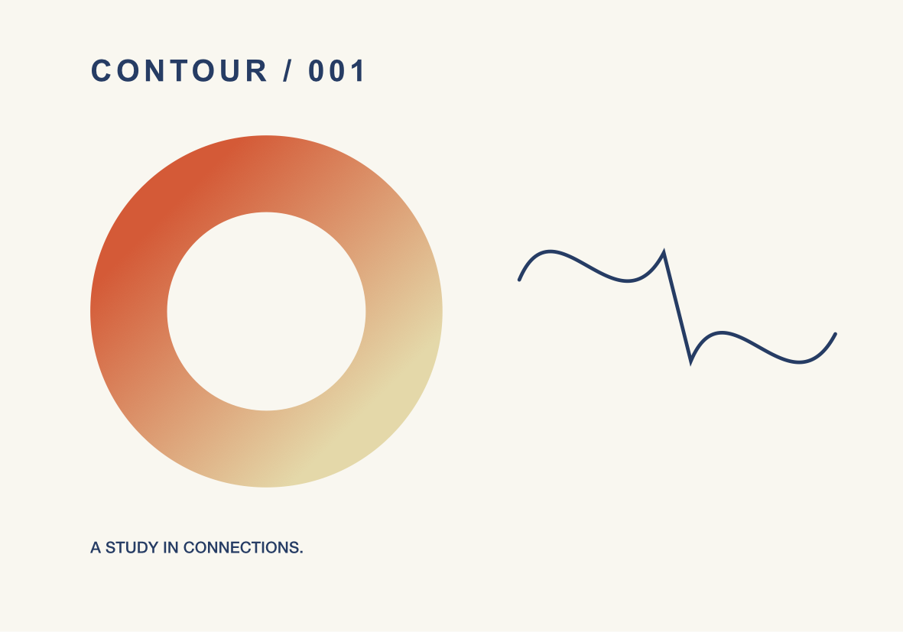

# Precise curves and transformed text

FORM's direct-selection editor operates on ordinary Bézier contours. The same commands are available through `form_edit_path`; native and MCP edits share validation, linked artwork, undo, and persistence.

## Native workflow

Select a path and choose **Direct select** (`A`). Click a node, Shift-click to extend/toggle selection, or drag a marquee around anchors. **Select all nodes** selects anchors across the selected paths. Shift-click can add an anchor on another path; the inspector reports the combined physical node bounds. The inspector shows physical coordinates for a single node or the bounding span of several nodes.

- Double-click a curve to insert a node at that position. **Insert midpoint** subdivides the segment following the selected anchor.
- Drag anchors with their handles. Smooth nodes keep opposing handles collinear while preserving the other handle's length; symmetric nodes use equal lengths. Option-drag a handle to make it independent. Double-click an anchor to switch between a corner and a smooth node.
- **Split** opens a closed contour at the selected node, or separates an open contour at an interior node. The new endpoints retain the original curves.
- **Join** (`⌘J`) connects two open endpoints in one compound or across separate paths in the same group. Coincident split endpoints merge; separate endpoints receive a connecting segment. The operation orients the contours to connect the chosen ends.
- **Reverse direction** swaps each affected contour's order and incoming/outgoing handles. **Closed contours** opens/closes affected contours. With no node selection, these operations apply to all contours in the selected paths.
- Use **Node X/Y**, **Span W/H**, and **Rotate nodes by** for exact physical transforms. Arrow keys nudge selected anchors; Shift uses the larger configured increment. These transforms include the object's and every ancestor's rotation, scale, shear, and reflection.
- Delete selected anchors with Delete or **Delete nodes**. Empty contours are removed. Deleting the final contour removes the path and releases references that used it as a clipping mask; undo restores the original definition.

Subdividing a cubic uses de Casteljau interpolation and preserves its curve. Splitting and reversal preserve existing segments. After geometry changes, the path viewport is fitted to exact cubic extrema with a compensating affine transform, so object handles match the edited curve and unrelated nodes stay in place.

Use **Artwork → Convert Shapes to Paths** to turn rectangles, ellipses, lines, polygons, or stars into ordinary nodes while retaining hidden editable source shapes. Appearance and transforms are preserved, including a line's implicit stroke.

**Make Compound Path** (`⌘8`) combines selected paths using the even-odd fill rule, so overlapping contours form holes. **Release Compound Path** (`⌥⌘8`) separates its contours into individual objects. Combine and cross-object Join use the frontmost path's appearance and retain its object ID. Curve geometry stays in place under rotation, shear, scale, and reflection; the frontmost gradient's physical field is preserved when the path bounds change. Gradient handles follow that affine field on the canvas.

Paths being combined must share a parent and clipping mask. Release any use of the selected paths as clipping masks first. Joining requires two open endpoints; interior or closed nodes reject the complete operation. Different colors, strokes, opacity, and production roles become the frontmost path's values. Document Undo restores the original separate objects and their complete appearance; hidden parametric source shapes also remain recoverable. Combining older duplicated paths refreshes any colliding node IDs; new duplicates and pasted paths receive independent IDs from the start.

[Live boolean groups and Divide](live-booleans.md) extend these path workflows with editable operands, operation changes, release, and flattening. [Reusable components](reusable-components.md) share editable marks across layouts and physical products. The complete [vector specification](2d-design-typography-vector-spec.md) still retains full SVG fidelity and further advanced editing work.

## MCP

There are 43 tools. Inspect node UUIDs with `form_get_artwork`, then call:

```json
{"name":"form_edit_path","arguments":{"object_id":"<frame UUID>","element_id":"<path UUID>","operation":"insert","node_ids":["<preceding anchor UUID>"],"t":0.37}}
{"name":"form_edit_path","arguments":{"object_id":"<frame UUID>","element_id":"<path UUID>","operation":"transform","node_ids":["<anchor UUID>"],"matrix":{"tx":5,"ty":-2}}}
{"name":"form_edit_path","arguments":{"object_id":"<frame UUID>","element_id":"<path UUID>","operation":"join","node_ids":["<endpoint UUID>","<endpoint UUID>"]}}
```

Use `element_id` for a single path or `element_ids` for several; provide exactly one of these fields.

```json
{"name":"form_convert_to_paths","arguments":{"object_id":"<frame UUID>","element_ids":["<shape UUID>"],"mode":"shape"}}
{"name":"form_edit_path","arguments":{"object_id":"<frame UUID>","element_ids":["<outer path UUID>","<inner path UUID>"],"operation":"combine"}}
{"name":"form_edit_path","arguments":{"object_id":"<frame UUID>","element_id":"<compound UUID>","operation":"release"}}
{"name":"form_edit_path","arguments":{"object_id":"<frame UUID>","element_ids":["<first path UUID>","<second path UUID>"],"operation":"join","node_ids":["<first endpoint UUID>","<second endpoint UUID>"]}}
```

Operations are `insert`, `delete`, `split`, `join`, `reverse`, `open`, `close`, `corner`, `smooth`, `symmetric`, `transform`, `combine`, and `release`. A transform matrix uses `a`, `b`, `c`, `d`, `tx`, `ty` in artwork coordinates; omitted linear terms default to identity and omitted translations to zero. The response contains `selected_nodes` and `selected_elements`, including newly generated node IDs. Locked paths and ancestors reject edits. Path edits participate in atomic `form_batch` operations.

To focus the native editor on a node:

```json
{"name":"form_set_view","arguments":{"view":"artwork","object_id":"<frame UUID>","element_ids":["<path UUID>"],"node_ids":["<anchor UUID>"]}}
```

## Transformed native text

Double-click text or choose **Edit text on canvas**. Native text, caret, pointer selection, character formatting, and input-method coordinates use the full artwork transform. Rotated, nonuniformly scaled, sheared, and reflected groups are supported. Text entry remains clipped to the physical artwork frame. Choosing text editing from a dieline returns to its artwork surface; entering dieline view ends inline text editing.

The implementation uses [AppKit view coordinate transforms](https://developer.apple.com/documentation/appkit/view-coordinates), with a signed two-dimensional SVD to express an affine map as translation, rotation, scale/reflection, and rotation. It does not use a layer-only visual transform. Reconfiguration reverses the previously applied operations before setting a new map, preserving reflected coordinates during text growth, frame resizing, and other updates.

## Evidence

- Unit checks compare 48 successive native affine maps, changing frame sizes/origins, and forward/inverse coordinate conversion. Curve tests sample original and subdivided/split/reversed cubics under nested affine transforms, verify exact extrema, and confirm unselected geometry stays fixed.
- A physical-frame clipping container was visually checked with transformed text extending across the paper edge. Focused numeric undo and pending-draft unit conversion were also exercised; the folding sleeve returned from dieline to artwork when text editing began.
- Native testing selected a visible word in rotated/sheared text, replaced it, and undid the change back to the exact stored artwork. The same pointer selection and undo worked with a reflected parent group; screenshots showed editing stayed aligned with the static renderer.
- Native controls inserted, split, joined, numerically moved, nudged, and marquee-selected anchors. The resulting six-node curve was resized to a 150 mm span, propagated to its linked variant, and exported to SVG/PDF/PNG. Its PDF was rendered with Poppler and reviewed.
- `python3 scripts/smoke_paths.py` reproduces the linked **Curve atelier** demonstration through the real stdio MCP bridge, including invalid-edit rollback, undo/redo, physical exports, and save/reopen.

These checks do not complete the full [implementation goal](implementation-goal.md). Advanced typography, publication, interchange, production color handling, and the required physical product demonstrations remain active work. Textiles remain a queued feature push.


## Compound-path demonstration

`python3 scripts/smoke_compound.py` creates **Contour atelier** in an isolated running library: a gradient ring with a true compound hole and two editable curves on an independent 200 × 140 mm document. Clay and chalk product editions reference that source. The script exercises shape conversion, combine/release/undo, separate-path endpoint joining, immutable consumer files, physical exports, saved-project reopen, and a 300-path / 600-node edit sample. It leaves the curves separate for native mouse testing.



See the [validation record](validation.md) for native endpoint selection, shortcuts, gradient controls, and measured results.
