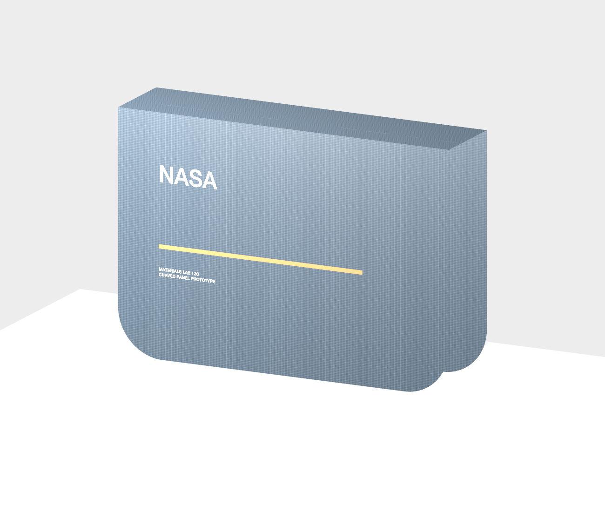
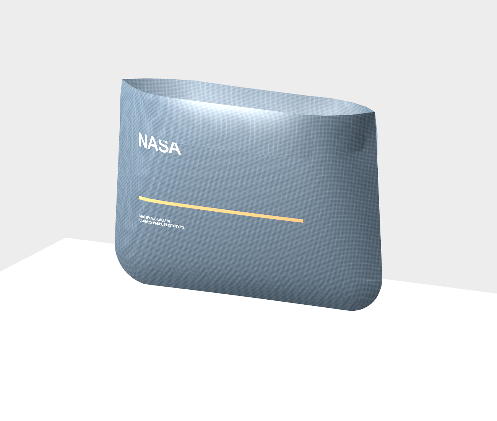

# Pattern-derived cloth assembly

This milestone derives an open cloth surface from original editable sewing contours. It computes actual triangles, material-area masses, constraints and positions; it does not turn the authored bomber blank into a physically assembled garment.

## Geometry and source ownership

An assembly declaration identifies independent source artwork, original piece/copy IDs, stable boundary start/end node IDs, selected sewing seams, explicit rigid panel poses, fabric assignment snapshots, declared GSM, guarded boundary pins and numerical budgets. The source stays editable. Generated triangles and current positions are derived data; they are not another editable pattern or a saved simulation result.

Each panel uses its stitch contour, including actual curved and concave boundaries and holes. Seam allowances, notches, grain arrows and construction labels remain technical source information. On-fold half pieces must first be made into an explicit full piece. Unsupported or stale references fail visibly rather than silently selecting another edge.

Boundary sampling retains original edge identities and every required seam/pin sample. Curve sampling has a declared physical deviation budget; the original cubic remains the source. Paired seams use common physical arc fractions, an explicit reversal flag and declared length tolerance. The generator certifies the two actual arc lengths before creating zero-gap constraints. It never stretches or rescales source pieces to make a seam match.

The triangulator starts with pinned Mapbox Earcut 2.2.4, adds bounded interior Steiner points, and performs conforming shared-edge subdivision plus deterministic interior-edge quality flips. Balanced physical arc subdivision avoids incidental near-duplicate curve samples beside exact seam anchors. Both sides of a declared seam consume a shared adaptive arc plan, so intermediate curved boundary vertices are actually paired too. The mesher restores collinear boundary points as real mass-bearing vertices. Independent checks reject nonpositive faces, missing vertices, inconsistent boundaries, nonmanifold edges, crossings, area disagreement and triangles in holes/outside the material. Earcut is not a general guarantee for malformed input and these floating-point predicates and bounded refinements make no general Delaunay/minimum-angle guarantee.

Limits are explicit: 1–8 panel copies, at most 128 seam/pin declarations, 512 sampled boundary vertices and 16 rings per panel seed, at most 4096 total generated vertices, 8192 faces, 32768 links and a declared operation budget capped at 32 million. Subdivision is limited to 24 rounds. An exhausted budget fails with a source simplification/spacing explanation.

## Physics and material coordinates

The existing fixed-step XPBD solver uses SI internally and millimeters at model boundaries. Vertex masses are one third of incident triangle area multiplied by each panel's declared kg/m². Structural links are classified by material direction; opposite-vertex distance links are a bending proxy. These are explicit uncalibrated parameters, not measured constitutive fabric data. Seams and pins are real constraints. Static plane/sphere contacts retain the existing finite/work diagnostics.

Each vertex retains physical panel coordinates and normalized UVs. Decoration uses the same printable artwork renderer at the panel's original 2D millimeter bounds. Construction pieces are excluded from implicit ink even when a legacy shape has no production role. Only effective print-role content draws; cut, score, stitch, engrave and guide content does not. Multi-piece frames are never fitted wholesale onto every panel. Fabric repeat origin and scale remain physical. Each panel has its own portable fabric material.

Preview textures are capped at 1024 pixels per edge and eight cached images/32 MB. Their keys include rendered print source, resolved component/swatches/stories, live repeat source, font revision, material assignment, physical crop and texture origin. Runtime positions, panel pose and mass do not rebuild the texture. SceneKit reuses material, topology and UV sources while position/normal sources update. Travel-free idle reads do not advance a solver.

The assembly prototype uses the existing single preview owner and camera contract. Source changes, project changes, Undo and invalid references must invalidate pending work. Run/Stop/Step/Reset remain transient and do not append document history or save per frame. Material-point attachments are resolved against the derived mesh so a resolution change cannot silently bind them to an unrelated triangle.

## Rounded pouch evidence

The original rounded-pouch pattern supplies two curved main panels and two rectangular facings, with explicit mirrored back pose, counterpart edge declarations and four opening supports. The measured prototype has 872 vertices, 1514 triangles, 4108 links and 102 actual source seam pairs. An independent Python reader verifies original cubic area/arc samples, poses, physical mass/UVs, topology and that every actual sewn boundary vertex is paired. Its minimum triangle angle is 5.696° and mass ratio 36.23×; the rejected earlier mesh had 0.0017° slivers and a 24,191× mass ratio.

Initial panels are deliberately separate, 60 mm apart. Joining is an explicit gravity-free numerical preparation stage before physical time starts. Ideal zero-gap seams share one translational degree of freedom with aggregate physical area mass; source vertices, panel IDs, UVs and rest positions remain separate and unchanged. Nonzero/compliant seams retain their declared XPBD constraints. Conflicting transitive supports or collapsed material faces are rejected.

Preparation retains multipliers across batches, solves soft bend proxies before structural links, and requires every structural length within ±5% plus P95 absolute relative error ≤1%. It stops after at most 16384 passes/160 million declared constraint/contact/residual evaluations. Each cancellable worker batch is capped at 500000 evaluations. Failure blocks physical integration and reports its residual; tolerances are never silently loosened. The default pouch explicitly saves 6 substeps and 24 iterations, visible in the native settings editor. A user's other declared iteration count is never overridden.

The canvas keeps the declared source pose visible while preparing or failed. The ready candidate publishes atomically; snapshots expose unready candidate positions separately. Initial projection, worst/minimum preparation ratios, final readiness residual, pass/work counts and physical-frame diagnostics remain distinct. The immediate projection measures 9.294× maximum ratio and 40.600 mm structural error; it is not a valid physical frame. Ideal seam, support and contact reactions are not estimated by the distance-multiplier force diagnostic.

The complete 240-frame/four-second physical run is tested after preparation, including reversed constraint order. Recorded final maximum ratios are about 1.021–1.039×, P95 ratios 1.002–1.006×, and worst physical-frame ratio below 1.15×. Compression is reported too. These are numerical fixture results, not calibrated material predictions. Stop freezes preparation and rejects late worker results; Reset restores the exact declared source pose, while project/source changes and Undo invalidate pending work. Run/Step prepare in bounded batches before advancing physical frames; preparation never fabricates elapsed physical time or writes history/files.

No self-collision, cloth-on-cloth contact, zipper hardware, layer thickness solidification, seam bending model, calibrated fit, verified drape prediction, production sewing instruction validation or sew-out is claimed. Cloth is an open flexible surface and remains rejected by the closed-solid print pipeline.

## Cleaner default drape reset

New default fabric-drape recipes begin on the inflated sphere's top tangent plane. The central default pin already lies on that plane. Existing saved rest meshes are preserved. Settings changes never regenerate their rest positions; a recognized generated support pin alone follows a contact-thickness change. Explicit geometry changes are a separate regeneration action.

The paired default-resolution study retains identical 289 vertices, 512 faces, mass, links, UVs, settings, collider and pin. Initial stretch changes from 3.0789× to 1.0000×; first-step maximum constraint force changes from 0.150486 N to 0.004560 N. After 90 frames the tangent study still drapes and its measured maximum surface penetration is 0.002921 mm. The same-camera real Metal reset and solved renders accompany the tests. These numerical values describe this declared uncalibrated study only.

## Primary references and dependency provenance

- [Macklin, Müller and Chentanez, XPBD](https://matthias-research.github.io/pages/publications/XPBD.pdf): compliance-based position constraints and substep multipliers.
- [Macklin et al., Small Steps in Physics Simulation](https://matthias-research.github.io/pages/publications/smallsteps.pdf): bounded substeps and constraint convergence context.
- [Müller's cloth teaching implementation](https://matthias-research.github.io/pages/tenMinutePhysics/14-cloth.html): explicit particles, mass and distance constraints; not a calibrated textile model.
- [Mapbox Earcut.hpp v2.2.4](https://github.com/mapbox/earcut.hpp/tree/v2.2.4), [ISC license](https://github.com/mapbox/earcut.hpp/blob/v2.2.4/LICENSE). Exact vendored files and SHA-256 values are recorded in `Sources/CFormMesher/UPSTREAM.json`. Upstream source is unmodified; the bounded C wrapper is FORM code.
- [Shewchuk, Delaunay Refinement Algorithms for Triangular Mesh Generation](https://people.eecs.berkeley.edu/~jrs/papers/2dj.pdf): quality-meshing context. FORM’s bounded floating-point refinement makes no general Delaunay quality guarantee.

The existing Clipper2 dependency continues to provide source contour boolean/offset operations under its pinned Boost license. The beta triangulation module is not used for this cloth derivation.

The singly selected attached-decoration Move gesture uses one fixed screen-facing plane captured on mouse-down. The candidate ray must hit the same visible material panel; missed panels and other-object occlusion reject movement. Only then does the actual surface hit become a persistent physical material anchor. This permits front-view horizontal/vertical editing without changing any camera control. A selected parent and child retain the existing ground-plane group movement and apply the translation once. Actual hidden-window AppKit mouse tests cover both directions, no mouse-down jump, misses/occlusion, exact Undo/Redo and unchanged camera.

The final optimized native preparation test measures 3.49 seconds for this four-panel fixture, maximum worker batch 14.35 ms, maximum main-thread publication 2.12 ms, and Stop returning in 0.92 ms with its stale result rejected. In the complete optimized regression run, a physical solver/controller frame measures 16.05 ms median/16.99 ms P95, the MCP step including metadata 25.32 ms, maximum worker batch 17.16 ms and main-thread publication 2.86 ms. These separate measurements include different machine load and are not general frame-rate guarantees. Idle reads perform zero mesh/texture builds and zero solver evaluations. Strict failure gates remain active for other source arrangements or insufficient budgets.

## Rendered evidence

The same fixed camera and unchanged physics declarations show the old reset pit and the tangent-plane reset:

| Saved legacy-height comparison | New tangent-plane factory |
| --- | --- |
|  |  |

Original curved source panels use explicit rigid poses; the second view is the calculated 240-frame physical result after explicit preparation with four declared opening supports. Its folds/intersections are solver output, not authored wrinkles. Self-collision and calibrated fit are absent.

| Initial declared arrangement | Calculated open-surface study |
| --- | --- |
|  |  |

This slice previews one assigned fabric/print source as a two-sided thin surface. Separate reverse-side ink assignments and material transparency calibration are not modeled.

## Packaged and native release checks

The signed app passes the original-source independent geometry audit and its complete 240-frame/four-second packaged run. Actual positions independently measure final maximum structural ratio 1.020864, minimum 0.938351, P95 ratio 1.001985 and maximum absolute structural error 0.158162 mm. Worst physical-frame maximum ratio is 1.128043. A separate actual native Run reaches the same final positions. These numerical results include compression and do not establish predictive fabric mechanics.

Computer use verifies immediate Stop during preparation at 112 passes with zero physical frames/time and the exact declared pose still visible, Resume through readiness and the time limit, and exact Reset. A focused 22→26 mm mesh edit is captured with a pointer click on Apply and verified in the saved package before any MCP read: only the declared spacing, timestamp and one history event change. One native Undo restores the entire project; Cancel discards another focused draft.

Actual horizontal and vertical mouse drags move an attached label along the same material panel, leave the camera fixed, and each undo exactly in one step. Four actual mouse orbit directions change only the expected axis and return within 1e−12 radians; geometry builds remain 11→11. Perspective produces an identical whole-project camera with and without a selection. The original-pattern action opens the correct editable source on Canvas; its first use intentionally creates the standard freeform Canvas workspace, leaving existing source objects and the camera exact.

Actual quit/relaunch and native Home reopen retain the entire saved project and camera while resetting transient cloth to its exact initial pose. All five ordinary projects and Studio settings remain unchanged. Print visibly rejects the open cloth and disables slicing. [Compact release evidence](evidence/pattern-assembly-native.json) records these checks; no equipment is contacted.
