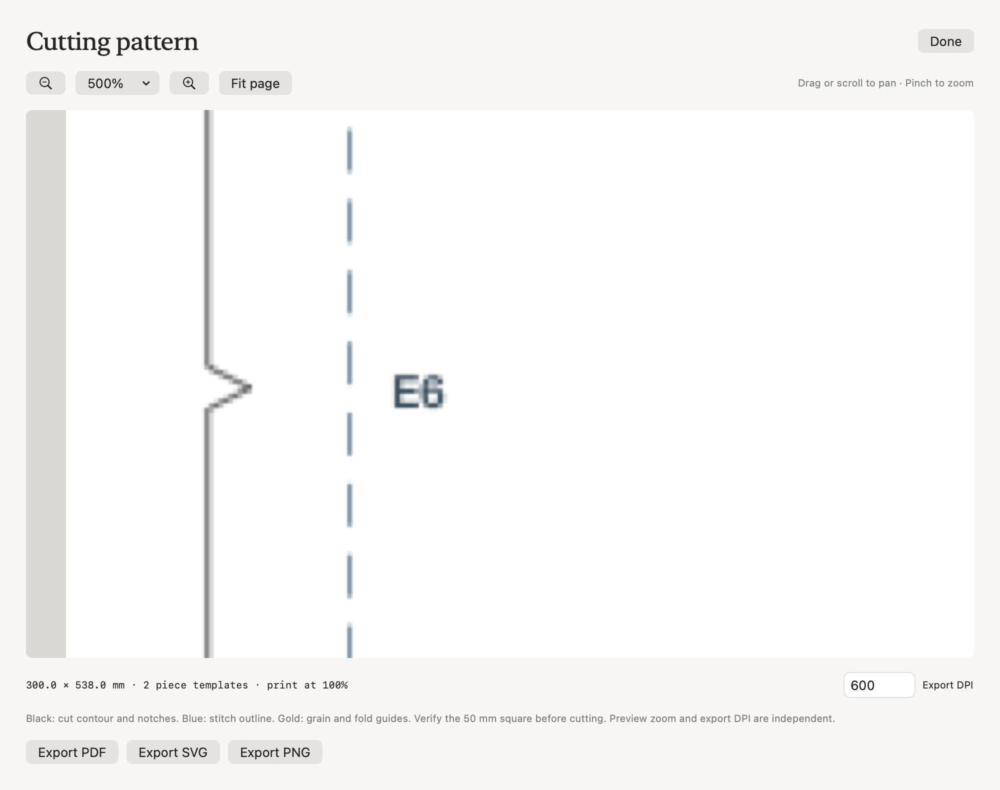
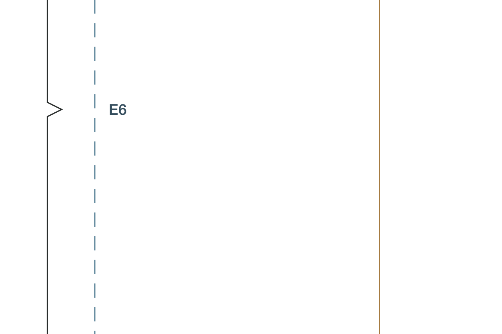
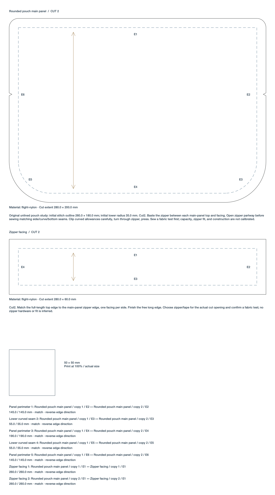

# Physical document review

**Preview cutting pattern** now opens the actual vector PDF through the native [PDFKit PDFView](https://developer.apple.com/documentation/pdfkit/pdfview). The material cutting layout keeps its editable stock canvas and adds **Review PDF…** for a dedicated physical proof.

Drag the page or scroll to pan. Pinch, use the zoom buttons or choose a percentage to zoom. **Fit page** shows the whole physical page. Multi-page documents also expose previous/next page controls. These interactions belong to document review; the Table camera controls are unchanged.

Zoom and location stay stable when the source refreshes or the viewer is resized. Reopening the same project/object/document kind restores its most recent view during the current app session. Different documents begin fitted. The cache retains at most 24 scalar viewport records and keeps no project, artwork, asset or PDF objects. Closing a review releases its PDF data and document view.

## Preview and export resolution

The preview uses the existing technical PDF output, retaining vector cut contours, notches, stitch outlines, guides and labels. The fixed preview effect density is independent of export DPI. Changing **Export DPI** does not regenerate the review PDF or reset navigation. PDF/SVG technical paths remain vector; raster export DPI controls raster resolution and supported effect layers.

The footer reports the physical page dimensions in millimeters. Screen zoom is a document viewing scale, not a calibrated display measurement. Print at 100%. For a cutting pattern, verify its 50 mm calibration square. A stock-layout proof preserves the declared working-stock dimensions; check those and a known piece dimension before cutting fabric.

The native-host proof shows an edited export DPI of 600 while the PDF remains at 500% zoom. It is captured from a hidden native test window; the [underlying vector PDF](images/document-review/rounded-pouch-vector.pdf) remains the authoritative physical output.

The detail above is independently rendered from the PDF with Poppler; the contour, notch and edge label remain crisp. Visible-window PDFKit tile quality is verified separately below.

## Tiled sewing pages

The cutting-pattern review also offers [Tiled sheets](tiled-sewing-patterns.md): an actual-size A4, Letter or custom multipage PDF with calibration and assembly marks. Its paper settings are separate from source geometry and review navigation. The existing previous/next controls navigate the generated pages; large-format and tiled review keep separate session viewports.

## Cutting layouts

**Review PDF…** appears beside **Fit stock** after a valid layout exists. Its fabric-reference toggle controls only the proof layer, preserving the same physical roll phase as the existing export. It never rearranges cut copies, changes source geometry or deducts fabric inventory. Close the review to return to the editable stock canvas. Invalid or missing sources produce an explicit error instead of retaining a stale proof.

## Verification

Nine focused native tests cover actual four-direction AppKit mouse drags, Escape and stale-drag handling, initial Fit and fitted resize, zoom/location preservation on manual resize and source replacement, page navigation, invalid documents, independent physical export DPI, the bounded per-source cache and actual hosted SwiftUI controls. The native export-DPI field is edited through the AppKit field editor and committed before asserting that the PDF was not reloaded or reset. Existing sewing and material cutting-layout regressions continue to run with the viewer changes.

## Visible-window acceptance

Computer use in the running optimized app verifies the actual PDFKit view at 500%: cut/stitch lines and the E1 label remain sharp. Four primary-button mouse drags independently move the document right, left, down and up; reverse drags restore both scrollbar positions exactly. Changing Export DPI from 150 to 600 preserves 500% and the same center. Closing/reopening that source restores 500% and its center; Fit returns to the complete 320 × 548 mm page. The full project, history and camera are unchanged.

A native Auto layout produces a valid 1400 × 230 mm stock proof. Review PDF opens its actual physical PDF. At 200%, toggling Fabric reference refreshes the proof while retaining both navigation coordinates exactly. Closing both reviews leaves every source object, saved placement, history entry and camera value unchanged. The runtime validation uses an isolated library and does not deduct stock or contact equipment.
