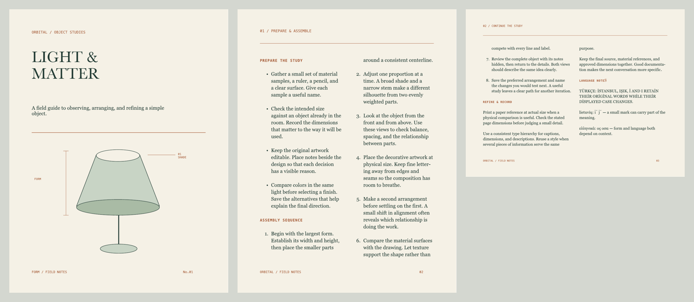

# Linked stories and physical publications

A text story owns one original source string, rich UTF-16 formatting, list identities, glyph choices, and optional language. Its text frames contain references and physical geometry. Text is laid out across those frames in order; resizing a frame changes the flow without rewriting the story into separate fragments.

The **ORBITAL / Field notes** study is a working three-page instruction booklet. Its cover is independent vector artwork. The body flows through four columns on a portrait and a landscape page, with shared numbering, localized text, a baseline grid, and physical PDF boxes.

## Native workflow

Select text on an independent physical artboard and open **Text flow & publication** in the inspector. **Start linked text story** transfers its editable source into a story. Select another text frame using **Link another frame**. An empty frame adds capacity; **Link + append its words** explicitly appends an existing frame's words and formatting to the global source, separated by a paragraph break.

Double-click a linked frame to edit. Arrow navigation moves the native caret into the next physical frame as its insertion range crosses the boundary. All linked native text views share one `NSTextStorage`, layout manager, source mapping, and native Undo manager. Edits reflow the whole chain. Escape finishes linked editing and returns keyboard commands to the Canvas, matching ordinary text editing. Formatting a native selection edits its source range; formatting selected frames outside text editing edits their story once. Page geometry stays bounded. Frame vertical alignment belongs to its geometry; linked frames always use area text.

**Story source** opens a galley using the same storage, including text that does not fit the physical frames. It also recovers an unframed story by attaching a new empty frame. Removing a frame removes capacity and preserves every word. Deleting a physical page removes its frame references and page entry; it retains the global story, including when all frames are removed. Duplicating a page as an iteration adds independent capacity to the same story. Linked variants are rejected for publication pages.

**Create publication** establishes an explicit ordered page sequence. The page editor reorders pages and therefore the story's reading order, while preserving the order of columns on each page. **Add page** creates a physical artboard with two body columns and the current margins. Margins guide new frames; existing artwork does not move when margins change. Publications reopen on their first ordered page in Canvas. Home uses that ordered cover for projects consisting of publication pages.

## Baselines and language

A publication has an optional baseline grid with spacing and origin in points. Paragraphs opt in separately. The compositor reserves complete line heights before accepting a line, then aligns actual baselines to the page's grid. Preview, native editing, physical faces, generated outlines, and PDF use the same placement. Grid activation during editing recalculates the native containers' padding and capacity.

Grid-aligned frames must be unrotated, unscaled, and top-aligned. Other linked frames can retain ordinary frame transforms and vertical alignment. Different font metrics can occupy multiple grid intervals. Explicit manual character baseline shifts retain their typography metadata. A grid is a composition rule, rather than a saved replacement for a paragraph's leading.

Language precedence is explicit character language, story language, publication language, then system behavior. Existing rich source/case provenance and locale-specific dictionary hyphenation stay intact. Lists continue across linked frames because their paragraph identities and source offsets belong to the global story. Frame layout ranges are UTF-16 source coverage: a displayed case expansion can share one original source cluster across two frame boundaries.

## Preflight and physical output

**Preflight** reports overset source, overly wide glyph/line content, missing fonts, unresolved exact glyph choices, external story capacity, missing/conflicting ICC profiles, and geometry outside the bleed area. Hidden linked frames continue to reserve capacity and are reported; their frozen outlined replacements remain recoverable.

**Export booklet PDF…** writes the ordered physical pages, supporting different page sizes and orientations. Each page has MediaBox, CropBox, TrimBox, and BleedBox; trim is the artboard's millimeter size, and bleed extends around it. Native text and outlined-text output use the shared compositor. A source story is unchanged by exporting. Default export refuses overset. The explicit MCP `allow_overset` option permits reviewed partial flow only; other errors still block output.

Source artwork remains sRGB. If pages have an assigned [ICC output profile](color-management.md), every page must reference the same profile digest. Public Quartz conversion applies the actual profile after composing the multipage PDF and preserves its physical boxes. A profile assignment alone does not change Canvas or Table colors.

## Agent workflow

- `form_story`: list/get/create/append/reorder/unlink/edit/publication/delete/layout. Frames use `object_id` and `element_id`; stored model references use `objectID` and `elementID`. `get` returns the complete editable `source` object. Edit that source with its rich fields when changing words; sparse text replacement must still satisfy the existing range metadata.
- `form_publication`: list/get/create/settings/reorder/add_page/delete/preflight. Page arrays use ordered `page_ids`. Grid settings use `baseline_grid: {spacing, origin}` or null.
- `form_export_publication`: `publication_id`, optional absolute `.pdf` path, `dpi`, `outline_text`, and explicit `allow_overset`.
- `form_edit_artwork` paragraph/list/glyph commands on a linked frame route to the global story. Their ranges are global source UTF-16 offsets. Swatches and reusable text styles also target the story.

Rejected story/page operations and core-only atomic batches are validated before ending a live native story editor. They preserve its responder, selection, draft, and Undo. Finish native editing before combining publication edits and graphics operations in one batch. Active marked input must be committed before a structural agent edit or publication export. Story list/get/layout, publication list/get/preflight, and PDF export do not end native editing.

Schema 26 introduces optional story/publication records and text-frame references. Older projects retain ordinary text behavior. Runtime layout contexts, derived line heights, displayed fragments, and resolved list numbers are excluded from saved files. Higher-schema production features retain their reader requirements.

## Validation and remaining scope

The automated scope covers global ownership, rich merge/language, frame lifecycle and transfer, atomic rejection, shared native input and Undo, baseline geometry and activation, locale/list/glyph provenance, bounded caches, source-preserving reopen, physical multipage native/outlined output, profile conflicts, overset refusal, and the ordered Home preview. The PDF proof above was rendered with Poppler at 144 DPI and visually reviewed on every page. It has two 160 × 210mm trim pages and one 210 × 160mm trim page, each with 3mm bleed. Native and outlined ink remains within one raster pixel for at least 99.97% of measured foreground coverage; antialiasing differs.

The guarded `scripts/smoke_publications.py` exercises the actual packaged MCP in a disposable `.local` library. The packaged workflow passes with three physical pages and four linked columns; 20 saved metadata edits plus layout queries measured 123.63 ms median / 128.74 ms p95 on this fixture. Actual computer use verified caret handoff into column two, typing at global UTF-16 offset 595, saved source-only changes, exact source/object/history Undo, page reordering, the separate global-source window, the cover Home preview, and reopening on the first ordered page. The complete schema-30 release suite passes 538 tests; see the validation record for the integrated workflows. Automated hidden-window tests are native editing tests, not mouse or camera validation.

Master pages, automatic running furniture, widow/orphan and keep-with-next controls, cross references, footnotes, spreads/imposition, spot plates, PDF/X certification, placed PDF import, and automatic page generation from overset remain separate work. This checkpoint does not complete the whole publication or 2D specification.
