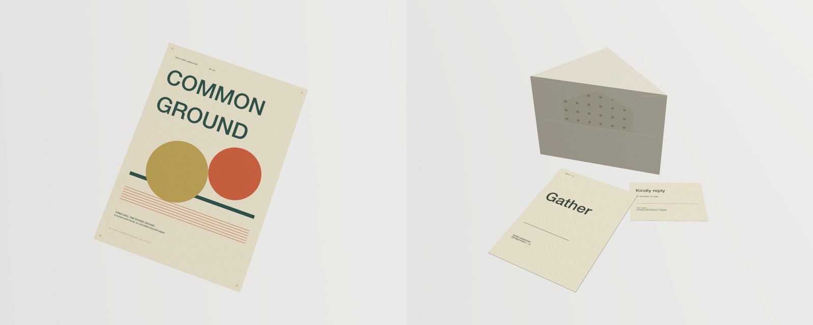
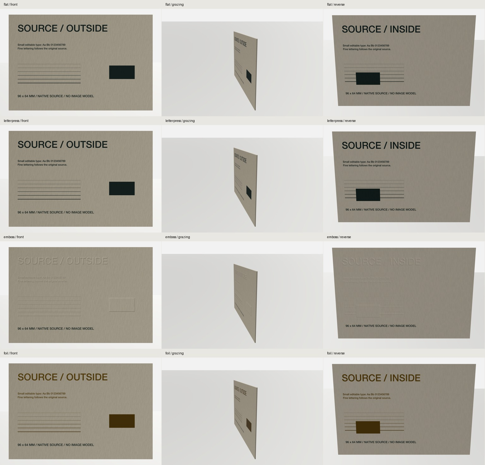
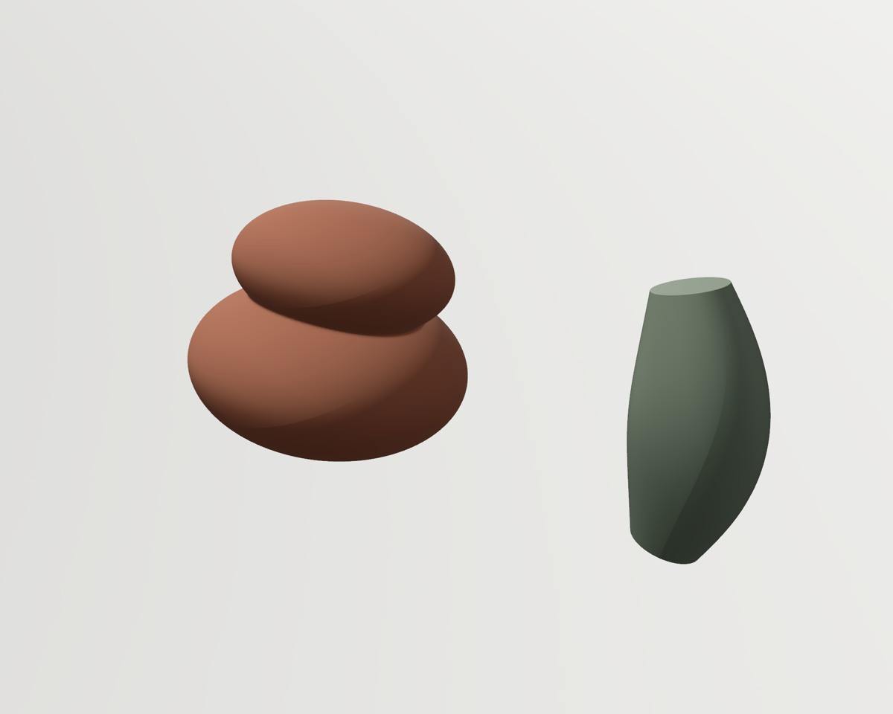
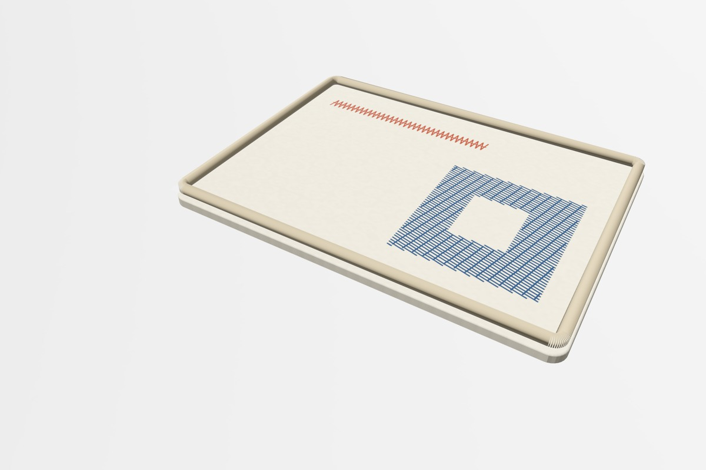

# Solid editing and final material quality

This checkpoint improves the existing project-authored modeling loop, final Studio source sampling and paper/textile handoff. It adds no modeling command, in-app agent or inspector redesign. The implementation lives on `codex/solid-render-quality`, based on main `a3c79a5`.

## Behavior

Native solid controls keep transient parameter drafts while bounded background workers build geometry. Superseded work cannot publish into a newer source or project. Released edits validate full geometry before accepting parameters; moving to another control retains pending intent, Escape restores the preceding intent and separate edits retain separate Undo steps. Full detail remains authoritative for inspection, STL, print, Studio and linked object views. See [parametric solids](parametric-solids.md).

Final Studio captures allocate source resolution from the actual output camera and physical surface coordinates. The allocation covers paper faces, sewn panels, fabric repeats and embroidery, with an 8192-pixel edge limit and a shared source-channel budget. Output dimensions remain exact. The budget includes stock/composite/GPU channels; temporary allocations, warm caches and output images mean it is not a peak RSS ceiling.

Final Studio paper relief also moves bounded face geometry. Physical stock meshes, cut walls, ply edges, production masks and tooling remain separate. Fine details retain high-resolution shading when the geometric budget cannot represent them. This is a viewing improvement, not a verified press simulation.

Embroidery production revisions now retain an ordinary self-contained source-artwork SVG alongside the needle program. Packets remain portable after live edits or deletion. Legacy revisions derive this reference only from their archived source without rewriting the revision.

## Checks run

- Two focused gates passed: 89 and 43 executions, **118 unique test methods**, zero failures. Coverage includes 14 coordinator cases, native mesher cancellation, paper geometry/finishes, source allocation, fabric patterns, embroidery, print meshes and linked-view lifetime/export behavior. The official local XCTest fallback was used because this Mac has Command Line Tools rather than Apple's XCTest launcher.
- A release app was built and deep/strict code-signature verification passed. One ordinary LAB instance ran with a disposable local library. All **146 pre-existing normal-library object files** retained their original hashes.
- Public MCP authored sampled and analytic solids, applied 14 rapid parameter changes, checked full-source revisions, exported both STLs, exercised Undo/Redo and reopened the saved source. Fifteen helper/status round trips had a 24.07 ms median and 55.41 ms maximum; these measure command round trips, not frames or pointer latency. Three native 2000 × 1600 stills were reviewed. Reducing the authored sampled spacing from 1.6 to 0.45 mm removed the coarse junction appearance visible in the first round.
- In the running app, actual native accessibility slider actions changed Height 146 → 155 and Width 90 → 96. Two Command-Z actions restored Width and Height separately. Physical held-pointer drag latency and FPS were not measured.
- The twelve paper studies were recreated through public tools. The [poster and invitation-suite addendum](paper-acceptance-addendum.md) passed physical packet registration, artifact hashes, source IDs, Undo/Redo, reopening and exact original-object preservation. Round one exposed clipped heading frames and an unsuitable liner composition; round two fixed the authored typography and added an independent clean suite envelope. Native glyph output is now checked before accepting the poster.
- Twelve 3072 × 2048 controlled paper captures compare flat, letterpress, emboss and foil at fixed front, grazing and reverse cameras. Artwork, geometry and camera preservation checks passed; finishing assignments were restored exactly. Small type, thin rules, asymmetric reverse registration, grain and blind/metallic appearance were visually reviewed.
- Native fabric-pattern and embroidery-surface smokes passed source-link updates, error recovery, Undo, cache behavior, physical exports and reopening. Independent Pyembroidery 1.5.1 checks decoded 506 production-job records / 462 stitches and 1314 physical-surface records / 1088 stitches, each with two thread passes. Folder and ZIP packets preserve the same ordinary SVG and needle bytes after source deletion.

The machine-readable [validation record](evidence/solid-render-quality/validation.json) pins the tested app and review-image hashes. Full native captures, request/response logs, source projects and failed rounds remain under the task's ignored `.local/validation/quality-native/` directory. No external image-model call or hardware operation was made.

## Native review images

## Remaining work

Physical held-drag timing, calibrated press results and sew-outs remain unverified. The separate reference-tree visual goal, broader reference benchmark, general garment fit/self-contact and further stitch-generation capabilities remain open. This checkpoint does not close those goals. MCP expansion, in-app agents and broader shared-inspector adoption were explicitly deferred.
