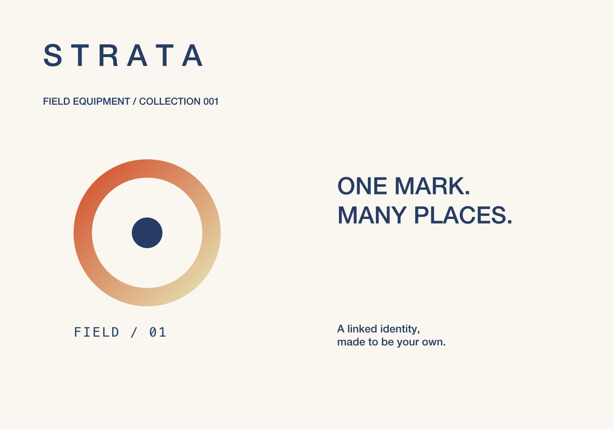
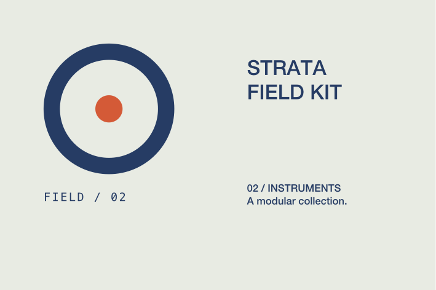

# Reusable artwork components

A component is an editable source frame with linked placements in other artwork documents. Several layouts and physical product faces can share the same mark. Instances keep their own transforms, size, opacity, and selected appearance or text overrides.

## Native workflow

Select sibling artwork and choose **Artwork → Create Component from Selection** (`⌥⌘K`). FORM moves the selected hierarchy into a new transparent source frame and replaces it with a linked placement in the same stack position. The source appears with a filled diamond in the frame list; instances have a diamond in Layers.

Use **Artwork → Insert Component** to place that source in another frame. Each placement has ordinary position, size, rotation, flip, and layer controls. The source viewport scales to the instance's width and height, so placements can have different sizes without changing the source.

The instance inspector provides:

- **Edit source**, or double-click the instance, to edit the source with the normal typography, path, shape, and layer tools. **Back to instance** returns to the original placement and product-preview context.
- **Override all fills** for an instance-wide color. Stroke paint and image pixels remain their source values.
- A **Part** picker for visible paint-bearing source objects. Boolean operands and clipping masks are geometry inputs; choose the evaluated boolean to override its paint. Per-part fills take precedence over the instance-wide fill. Text and opacity can also be overridden where applicable.
- **Reset appearance and text overrides** to resume all source values while retaining placement and size.
- **Detach instance** to bake the visible hierarchy into ordinary editable groups, paths, and text. Other instances remain linked. Ungrouping a still-linked instance is rejected rather than discarding it.

Text overrides retain the source's font, shaping settings, and text-frame dimensions. They replace the complete string and clear mixed-character spans for that placement; the source text remains intact. Overrides whose source part was removed remain dormant, so Undo can restore their effect. Reset clears them.

Sources can contain nested components, live booleans, gradients, clips, text, and project image assets. Reference cycles and excessive expansion are rejected atomically. Deleting a source detaches its direct consumers first, preserving their current appearance and overrides; Undo restores the links. Component instances must be detached before being used as live boolean operands. Live booleans inside a component remain editable in its source.

## Local MCP

The `form_component` tool has `list`, `create`, `insert`, `override`, `reset`, and `detach` commands. All mutations use native document undo and participate in atomic batches. `list` returns a `components` array with source IDs, dimensions, raw parts, and IDs suitable for visible paint overrides.

```json
{"name":"form_component","arguments":{"command":"create","object_id":"<frame UUID>","element_ids":["<shape UUID>","<text UUID>"],"name":"Field emblem"}}
{"name":"form_component","arguments":{"command":"insert","object_id":"<other frame UUID>","source_object_id":"<component source UUID>","x":12,"y":12,"width":45,"height":46.5}}
{"name":"form_component","arguments":{"command":"override","object_id":"<frame UUID>","element_ids":["<instance UUID>"],"color":"#263C64","overrides":[{"elementID":"<source text UUID>","text":"FIELD / 02"}]}}
{"name":"form_component","arguments":{"command":"detach","object_id":"<frame UUID>","element_ids":["<instance UUID>"]}}
```

An `overrides` array replaces that instance's per-part overrides. Omit it to preserve existing values. A `color` of `null` clears the instance-wide fill override. Read source UUIDs with `form_component` / `list` and `form_get_artwork`. `form_get_artwork` with `resolved: true` returns a derived ordinary hierarchy for inspection; edit raw references or source artwork rather than saving that derived copy over the linked document.

## Persistence and rendering

Components use schema 6; schemas 1–5 still load. Source frames and instance references remain separate immutable object resources. A source edit updates its resource without rewriting consumer files. The native canvas, physical faces, selection exports, SVG, PDF, and raster output receive the same expanded hierarchy. SVG emits ordinary groups, paths, and outlined text; FORM retains the live component relationship.

Derived element and path-node IDs are stable for a given instance/source pair and independent between instances. Expansion uses a bounded 64 MB cache keyed by the artwork and reachable source definitions. Unrelated project changes do not invalidate it. `form_status.component_resolution` reports builds, cache hits, and last expansion time. Expansion is limited to eight reference levels, 10,000 elements, and 300,000 path nodes/text code units per document. Stored artwork retains its separate 5,000-element limit, including after detachment.

## Demonstration

`python3 scripts/smoke_components.py` creates **STRATA · Shared identity system** in an isolated running library. One editable ring, center point, and edition label drive a 200 × 140 mm field-kit layout and a 120 × 80 mm instrument card. Clay and sage physical products reference those layouts. The card has a smaller navy instance, a copper center, and independent edition text.





The workflow checks source-only persistence, overrides, source edits, identical detached output, subsequent independence, rollback, physical exports, schema-6 reopen, and saved source edits affecting 200 placements. See the [validation record](validation.md) for native interaction evidence and measured results. Shared swatches, effects/blending, publication, and the rest of the professional editing specification remain active work.
