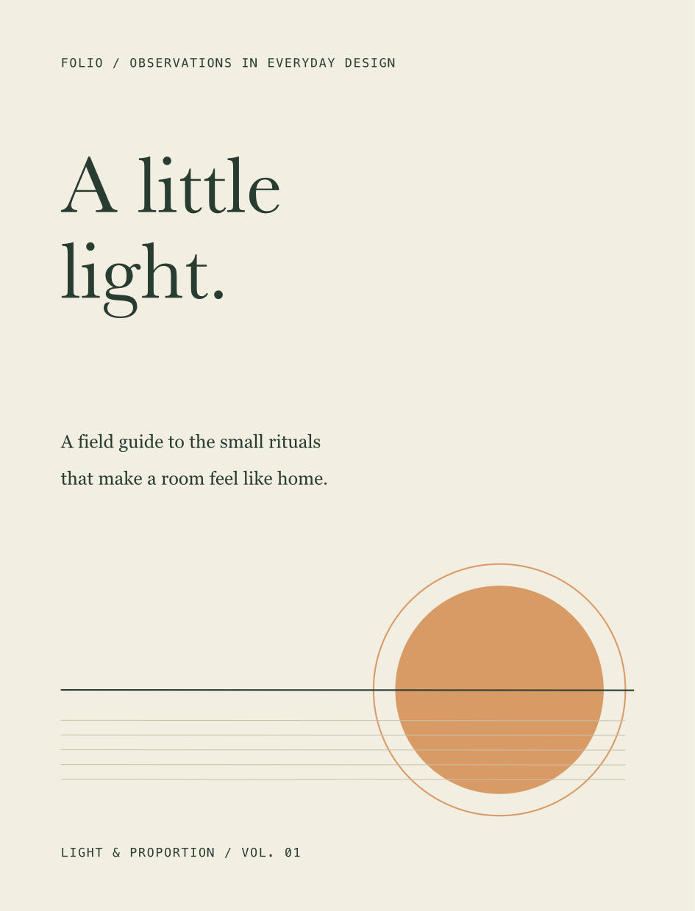
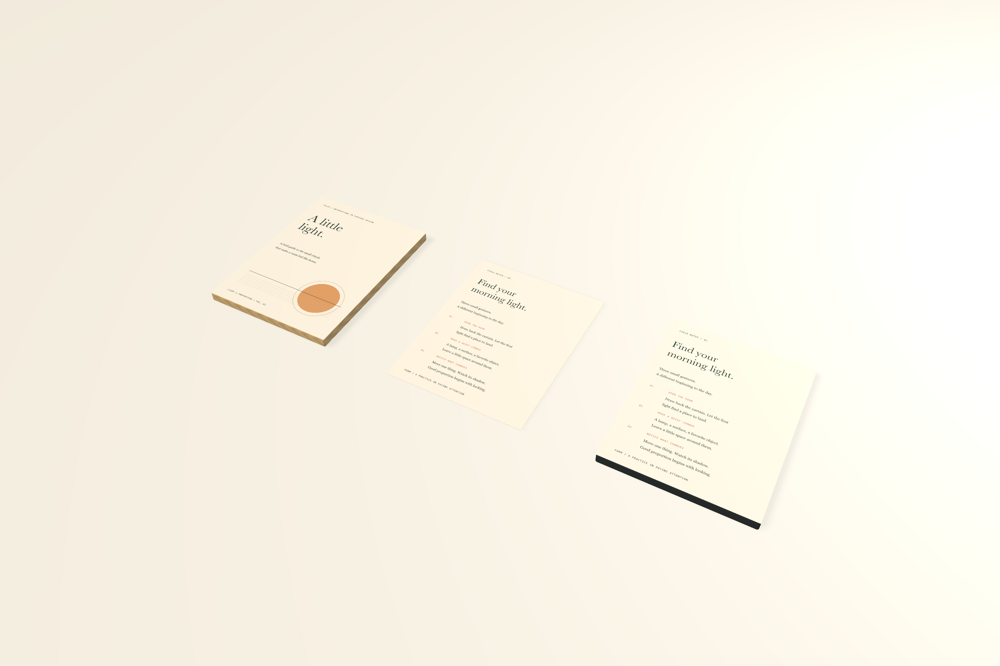
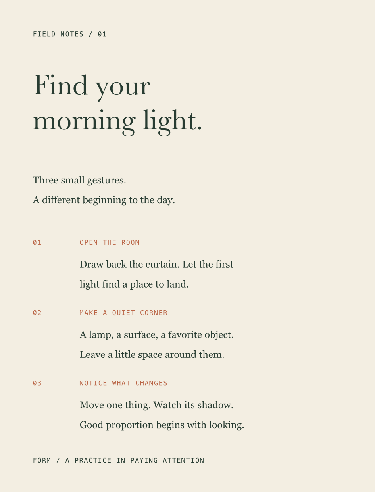

# Reusable text styles and FOLIO

Project text styles share typography across artwork frames, component sources, and linked physical surfaces. Formatting stays editable, and local changes survive later style updates.



## Native editing

Open **Text styles** in the Artwork toolbar. The native sheet previews each face and provides name, size, leading, Apply, Redefine from selection, and Delete. Select text, enter a name, and choose **Create from selection** to capture and apply its formatting in one Undo step. A selected character range is retained when opening the sheet.

The typography inspector's style menu applies a style, resets local overrides, detaches, redefines, or opens the sheet. A local change displays **+ overrides**. **Reset** follows the style again. **Redefine from selection** updates all users and clears the selected user's overrides in one Undo step. Delete and detach retain the current appearance; Undo restores the links.

A whole-object assignment includes character and paragraph formatting. Applying Caption to a word changes its characters while retaining its existing Body paragraph relationship. The inspector displays **Paragraph · Body**. Future Body leading, alignment, and paragraph-spacing changes still reach that word; Caption font and size remain independent. Native paragraph controls apply to the containing paragraphs, while the character selection stays intact.

Reset clears both character and independent paragraph overrides. Native reset applies paragraph attributes across the containing paragraph so AppKit cannot retain stale spacing. MCP reset with a `style_id` clears only references to that style.

Colors and shared swatches, content, object geometry, frame behavior, vertical alignment, and manual pair positions stay independent. Style size and spacing use points. Native text round trips retain assigned font aliases, variable axes, feature settings, style references, and the distinction between tracking, word spacing, and manual pair deltas. Native Undo back to the initial text also restores the original stored representation.

## Local MCP

`form_text_style` supports `list`, `create`, `update`, `assign`, `reset`, `detach`, and `delete`. For example:

```json
{"command":"create","name":"Body","font_size":12,
 "typography":{"fontName":"Georgia","leading":17,"paragraphAfter":7}}
```

Use the returned style ID to assign or update:

```json
{"command":"assign","style_id":"STYLE_UUID","object_id":"OBJECT_UUID",
 "element_ids":["TEXT_UUID"]}
```

```json
{"command":"update","style_id":"STYLE_UUID","typography":{"leading":19}}
```

Create/update accepts partial `typography` properties; omitted properties retain their values on update. `null` clears an optional property. Create may also include the object/element IDs to apply immediately. Update with `reset_selection:true` and object/element IDs resets the matching selected users in the same edit. Reset may include `style_id` to target that style only.

Assign/reset/detach and immediate create may include integer `location` and `length` in UTF-16 units. Ranges must be nonempty and cannot split a surrogate pair. Partial assignments retain an independent paragraph reference. Selected groups reach visible unlocked text descendants. Locked targets, invalid ranges, missing styles, unknown properties, and invalid typography reject the entire edit. Mutations participate in `form_batch` and Undo. Read-only `list` preserves native drafts and focus.

Names are unique without regard to case, contain 1–100 characters, and are limited to 256 styles per project. The model stores each definition's `id`, `name`, `fontSize`, and `typography`. Elements and rich spans use `textStyle` and optional independent `paragraphStyle` references with `styleID` and explicit `overrides`. Partial character references use `characterOnly:true`. Explicit overrides remain overrides even when a later style temporarily matches their values.

## Persistence and propagation

Inherited formatting is materialized in ordinary text values, keeping renderers and exports independent of style lookup. Updates rewrite affected source artwork resources. Linked physical consumers and component instances keep their immutable files; they resolve the updated source. Renaming a style changes project metadata only.

Styles and references require **schema 12**. Schemas 1–11 remain readable; older readers explicitly reject schema 12. Validation rejects missing references or inherited values that differ without recorded overrides. Generic artwork replacement records local differences automatically.

## FOLIO and validation

**FOLIO · A guide to light** contains two independent **160 × 210 mm** frames and linked oak/graphite product faces. Heading, Body, and Caption demonstrate shared typography; the cover keeps a deliberate local display-size override. Each frame exports independently to physical SVG/PDF and DPI-controlled PNG/JPEG.





Run `python3 scripts/smoke_text_styles.py` with an isolated `FORM_LIBRARY_PATH`. It checks selective source persistence, independent paragraph links, explicit overrides, rename/reset, pixel-identical detach/delete, batch rollback, recoverable outlines, schema-12 reopen, and saved edits across 200 text objects. The final local run measured **99.50 ms median / 118.26 ms p95**, including bridge and persistence, with a **2.33 ms** sampled canvas draw. These are local samples rather than sustained gesture-FPS measurements. Native sheet, range, redefine, Undo, draft handoff, and camera checks are recorded in [validation](validation.md).

The expanded goal remains active. Sequential publication documents, linked text frames, tabs/lists, alternate-glyph selection, complete direction/hyphenation controls, cross-project transfer of named resources/assets, and explicit automatic font-pair kerning control still require work.
