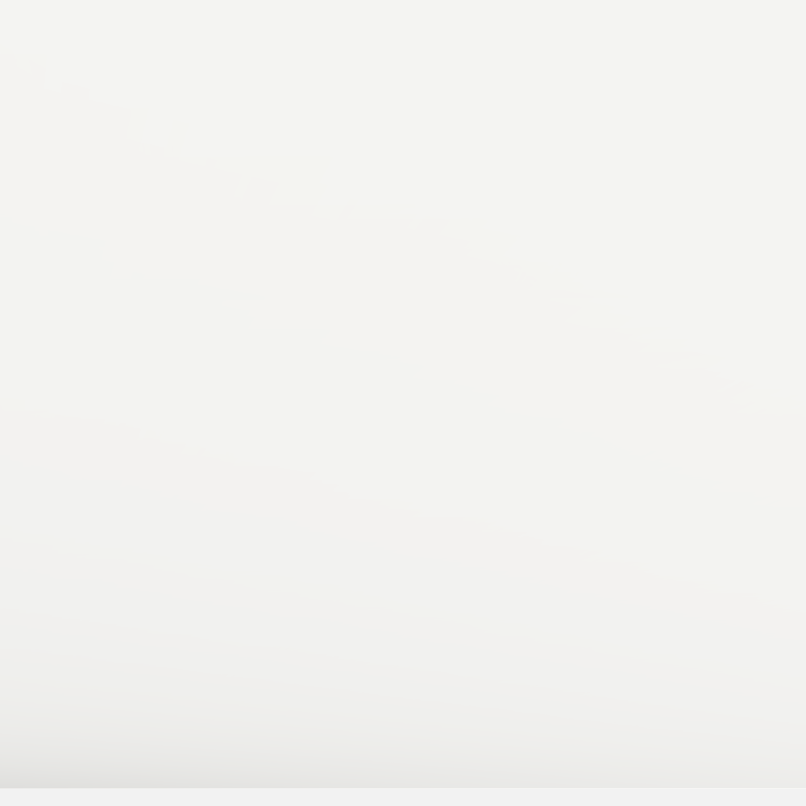
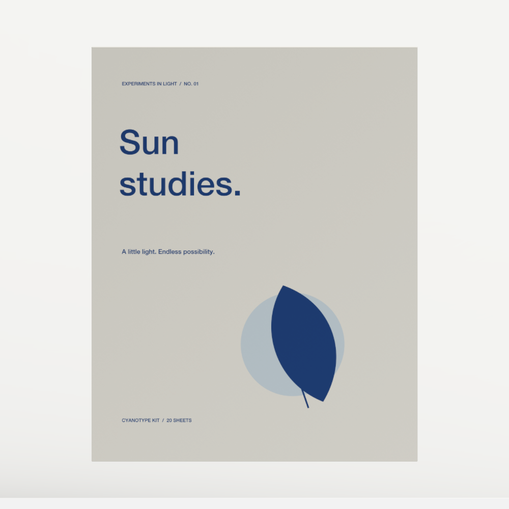
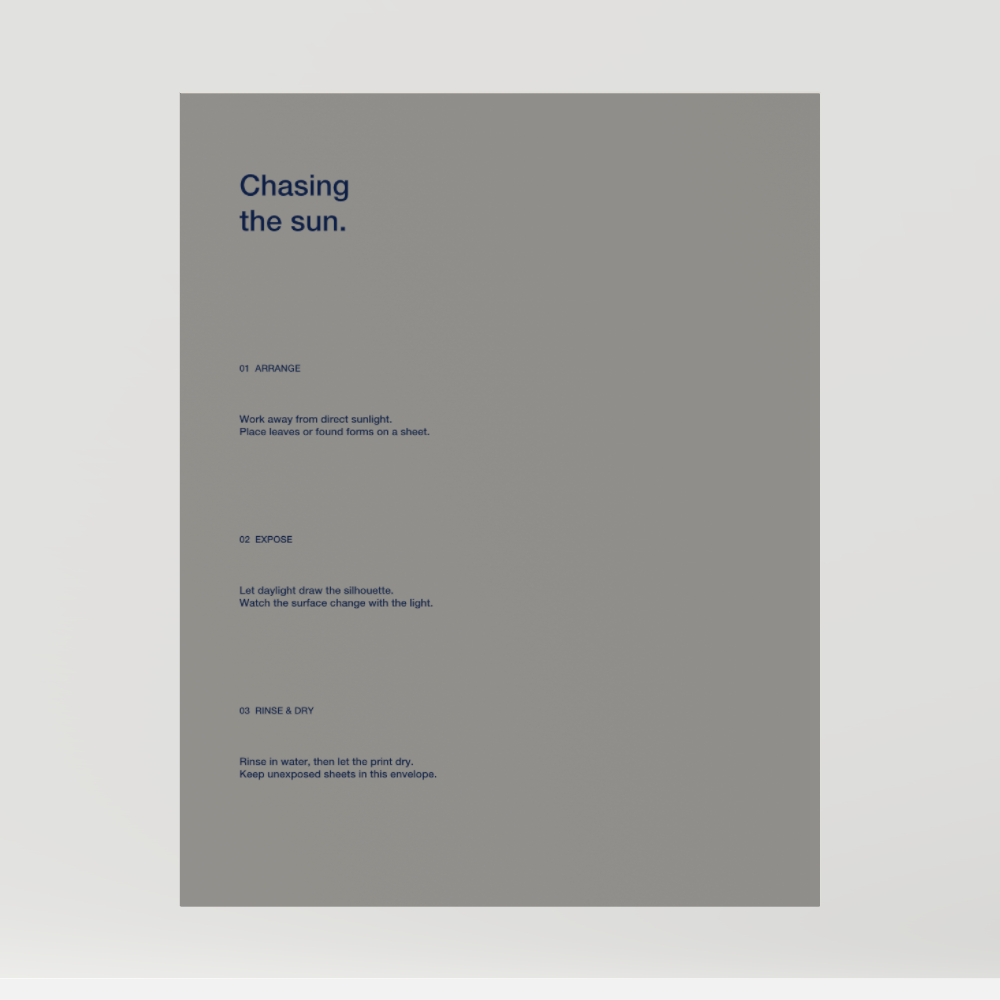
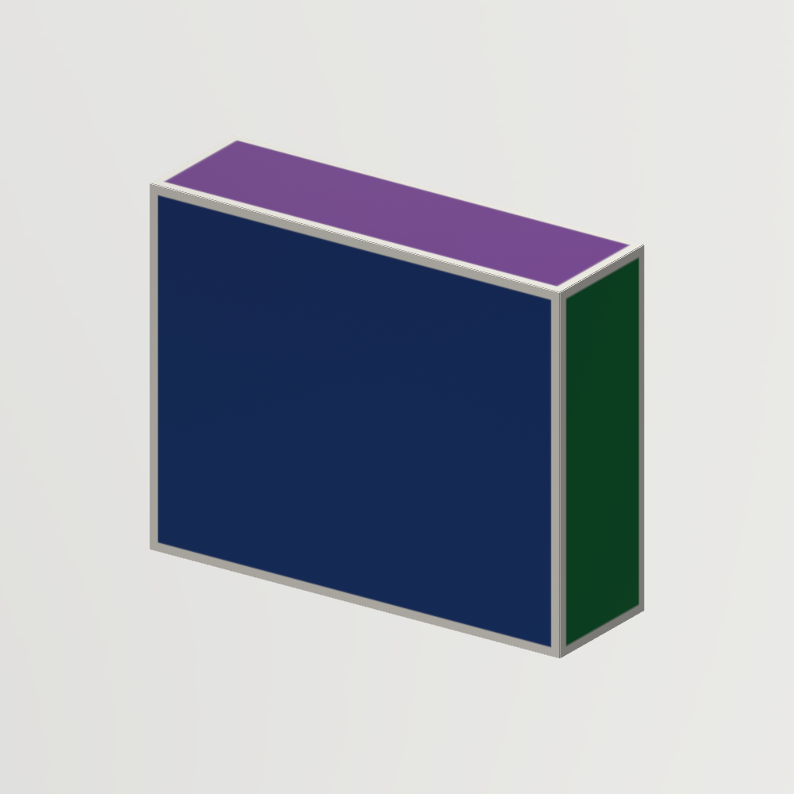

# Native sample artwork validation

The missing cyanotype envelope was reproduced and fixed. The old renderer
selected paper geometry using only the two built-in recipe identifiers. An
explicitly converted or newly authored construction had a different recipe ID
and produced an empty 3D root. Its source artwork remained intact.

## Actual native regression evidence

These are unretouched captures through the public Studio capture/export tools.
The original and converted objects use identical cameras and artwork.

| Converted envelope before fix | Converted envelope after fix |
| --- | --- |
|  |  |

The baseline package executable was
`0153ebb0e3b827da59e9d7dab544beb24e3a641cb466da08ca9726fef062b227`.
The fixed package was
`dff597455bb86ead46045541392c99e14f2208c710d29e0b60710821975fb259`.

| Native 1000 × 1000 capture | Baseline blue pixels | Fixed blue pixels |
| --- | ---: | ---: |
| Pristine cyanotype front | 27,336 | 27,336 |
| Pristine cyanotype back | 3,381 | 3,381 |
| Converted front | 0 | 27,336 |
| Converted back | 0 | 3,381 |
| Retained converted envelope, isolated front | 0 | 27,336 |
| Retained converted envelope, isolated back | 0 | 3,381 |

The fixed original/converted blue masks have **IoU 1.000 on both sides**. The
source artwork, physical placement and rotation are preserved. This verifies
actual lettering/leaf placement, not just successful file creation.

| Restored back instructions | New unregistered four-panel source |
| --- | --- |
|  |  |

The copied retained project contains four physical objects and one internal
unframed Canvas workspace. A separate large tote-pattern artboard is visible as
a white plane, but removing it from the fixed capture leaves the envelope's blue
pixel count unchanged at 348 with the reported distant camera. It did not cause
the absent envelope. No live review project or normal library was modified.

## Detailed sides and source checks

Native captures also cover the full unfolded outside net, the initially blank
inside, an explicit inside-only orange marker, the opened construction, and a
new arbitrary four-panel source. All four outside panel colors render; the
inside renders orange independently. Adding inside artwork leaves the outside
artwork dictionary and outside blue mask unchanged.

The first audited package exposed a separate inside-authoring defect: its raw
front-registered `INSIDE R` marker read reflected from the physical inside.
The subsequent generic-frame correction preserves canonical registration and
the existing global mesh UVs, while applying the reverse physical view for
authoring and its inverse when saving. Existing saved artwork is preserved.

| Outside physical face | Inside physical face |
| --- | --- |
|  |  |

These are actual 640×640 Metal captures from the final native regression host.
Both faces show an upright asymmetric `R`, red upper-left, blue upper-right and
green lower-right. Tests also check unchanged registered SVG output, reflected
Canvas cut clipping/guides, ordinary and whole-net insertion/path editing, three
separate Undos, and grouping repeated node movement within one explicit gesture.
The focused run passes 104 methods in 9.097 seconds. A fresh packaged repeat also passes on executable
`3a056e34961e046e27b779f53a963fb3e273bbd7f1c587b0a8e3d39281f66bfc`: 21 captures cover all 12 overviews, unchanged conversion masks and the
inside-frame registered-source/readable-view roundtrip. A separate nine-capture
repeat uses the reverse-face camera orientation and visibly reads `INSIDE R`
upright. Reports are in `.local/validation/sample-physical-frame-debug-r2`
and `.local/validation/sample-physical-frame-debug-camera`.

## Shipped example sweep

All twelve templates in `Sources/FormCore/StudyTemplates.swift` were created in
an isolated native app, captured at 1200 × 900, and visually inspected:

| Template | Observed native content |
| --- | --- |
| affinities | Four original/alternate/material editions retain type and masked landscape. |
| clothLab | NASA/grid drape, seam-panel print and attached label. |
| merchandise | Printed tee, cap and tote, with their independent source frames. |
| fieldGuide | Illustrated cover and both flowed-text pages. |
| flightJacket | Two jacket colorways with patches, tape and labels. |
| clock | Two physical dials with numerals/hands and the shared source. |
| cyanotype | Printed envelope, paper stack and separate booklet. |
| cosmetics | Printed STILL carton, bottle and inside source frame. |
| lamps | Three colored hollow shades, stems and bases. |
| forms | Hollow clay vessel, wood block and metal cylinder. |
| giftShop | Seven intentionally unprinted merchandise blanks. |
| pouchAssembly | Printed pouch rest-state assembly and independent pattern source. |

This is overview coverage of every shipped template plus detailed paper
regressions. It does not establish every backside, parameter combination,
material property or fabrication setting. Full native images, source snapshots
and per-template observations are under
`.local/validation/sample-visual-audit-fixed/sample-sweep.json`; the fresh
packaged repeat is `.local/validation/sample-physical-frame-debug-r2/report.json`.

The final binding/source debug package (`57661a707a36a905c332c5d61919731818fab920b3bfdfa9d54e1174062638f5`) repeats all 21 captures successfully. All 12 overview images are pixel-identical to the personally reviewed prior sweep; all nine detailed views are pixel-identical to the corrected-camera proof, including upright inside lettering. Raw reports and independent image comparisons are in `.local/validation/sample-binding-source-final`.

## Reproduce

Use Python with Pillow and a packaged Mac app in a logged-in graphical session:

```sh
python3 scripts/verify_sample_visuals.py \
  --app build/LAB.app \
  --output .local/validation/sample-visuals-new
```

The runner defaults to a fresh private library/socket and closes only the app it
launches. It asserts original/converted artwork pixels and placement, separate
inside/outside channels, arbitrary-construction colors, and captures the whole
sample registry. It retains images for explicit layout and orientation review;
it never treats a PNG's existence as complete visual acceptance. The `--session`
option attaches only to an explicitly supplied validation session. It never
contacts hardware or runs a cloth simulation.
