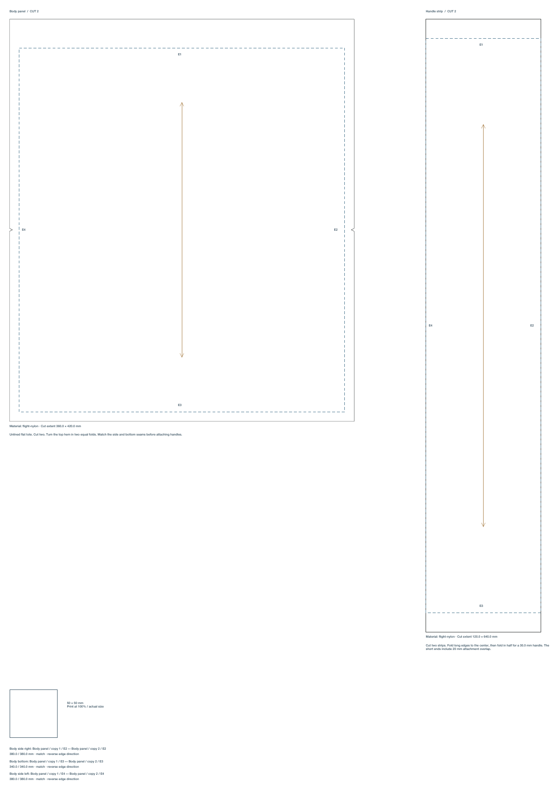

# Editable sewing pattern pieces

Canvas shapes can be annotated as sewing pattern pieces. The editable shape is the finished stitch outline; FORM derives the outward cut contour from its current physical geometry. Straight per-edge allowances support sharp rectangles, regular polygons, and closed convex paths with straight edges. The later [general sewing geometry](curved-sewing-patterns.md) adds bounded curved/concave contours and holes with explicit topology and allowance limits.



Select one supported shape in Canvas and open **Sewing pattern piece → Use as pattern piece**. The existing width, height, position, rotation, grouping, and direct manipulation controls continue to edit its source geometry. Allowances are measured in world millimeters after those transforms, so rotating, mirroring, or stretching a piece does not scale a declared 10 mm seam allowance into another size.

Each piece stores a name, default seam allowance, per-edge overrides, fabric material, cut quantity, grain direction, optional cut-on-fold edge, notches, and construction notes. Edge numbers follow the local contour order and stay attached to the source as it moves or rotates. A rectangle starts with its top edge E1, then right E2, bottom E3, and left E4. Regular polygons start at their top vertex. Remove topology-dependent annotations before changing a contour's edge structure.

The per-edge controls show the actual stitch-edge lengths and physical allowances. **Use default allowance** removes an edge override. A notch has an edge, fractional position, width, and depth; its depth must remain inside the seam allowance, away from the stitch line and corners. Generated cut contours include the actual V notch. A cut-on-fold edge receives zero allowance and is omitted from the cutting pass; its guide remains visible.

**Pair seam edges** connects two piece edges and numbered cut copies. Two identical panels can therefore use one template with quantity two and join copy 1 to copy 2. A join stores its name, endpoint pieces/edges/copies, matching direction, and millimeter tolerance. The inspector reports actual edge-length matches and mismatches. Joining unequal edges records the mismatch; it does not stretch the fabric or silently change either shape. The exported seam schedule identifies both endpoints, lengths, direction, and mismatch status.

Source shapes and seam records remain independent from generated manufacturing paths. **Preview cutting pattern** rebuilds cut, stitch, grain/fold guides, notches, labels, quantities, material notes, construction notes, a seam schedule, and a 50 mm calibration square. Generation does not persist flattened copies over the editable source. Deleting a piece removes its joins; duplicating both joined endpoints duplicates their join; grouping and ungrouping preserve references. Moving paired pieces between Canvas and frames preserves their joins and remaps colliding identities. Move both sides together, or remove the join first.

## The tote cutting study

**Add tote cutting study** creates an independent editable frame with a flat unlined tote body and a four-fold handle strip. Default finished body dimensions are 340 × 380 mm. It declares two body panels, 10 mm side/bottom allowances, and a 30 mm double-turn top hem, giving each body cut extent of 360 × 420 mm. Midpoint side notches and three matched copy-to-copy body seams are included.

The handle template is a 120 × 600 mm strip, folded to a 30 mm handle, with 20 mm short-end attachment overlap. Its cut extent is 120 × 640 mm and its quantity is two. Grainlines run lengthwise. The labels and notes explain the cutting/folding intent. This is a flat tote pattern study, not a graded garment block, boxed-bottom bag, cloth simulation, verified fit, or automatic sewing assembly.

## Physical export

The cutting preview exports **SVG**, **PDF**, and **PNG**; MCP also supports JPEG. SVG retains separate named cut, stitch, and guide layers and machine-readable piece/seam metadata. PDF combines the drawing and instructions on one actual-size sheet. Text is portable in SVG; PDF retains vector geometry and embedded typography. Raster output uses the chosen DPI with the existing 100 megapixel/16000 pixel limits. Print at actual size and verify the 50 mm calibration square. The app does not send these files to equipment.

Cut quantity is an instruction for making that many physical copies. FORM draws one template per annotated source piece; it does not yet duplicate quantities into an optimized roll layout. The [material cutting layout](cutting-layouts.md) expands declared quantities into editable stock placements. [Tiled sewing PDFs](tiled-sewing-patterns.md) preserve this complete source page across A4, Letter or custom sheets at 100%. [General curved geometry](curved-sewing-patterns.md) and the bounded [cloth foundation](cloth-simulation-foundation.md) have separate contracts. Darts/pleats, graded sizing, and a fully connected garment-construction workflow remain open under the [textile product specification](textiles-apparel-merchandise-spec.md).

## MCP

No additional tool is required. Existing `form_edit_artwork` commands share the same native Undo and validation:

```python
call("form_edit_artwork", {
    "object_id": canvas_id,
    "command": "pattern_template",
    "template": "tote",
    "pattern_parameters": {
        "width": 340, "height": 380,
        "handle_length": 600, "handle_width": 30,
        "seam_allowance": 10, "top_hem": 30,
        "material_id": "flight-nylon"
    }
})
call("form_edit_artwork", {
    "object_id": canvas_id,
    "command": "pattern_piece",
    "element_ids": [panel_id],
    "piece": {
        "name": "Body panel", "cutQuantity": 2,
        "seamAllowance": 10, "edgeAllowances": {"0": 30},
        "grainAngle": 90, "materialID": "flight-nylon"
    }
})
call("form_export_artwork", {
    "object_id": canvas_id, "pattern_pieces": True,
    "format": "pdf", "path": "/absolute/path/tote-pattern.pdf"
})
```

`pattern_piece` replaces the selected shapes' complete metadata; pass `piece: null` to remove annotations and their joins. `seam_pair` accepts a complete seam definition with optional saved UUID, `first` and `second` endpoints `{elementID, edge, copy}`, `name`, `reversed`, and `tolerance`. Edges are zero-based in the API; cut copies are one-based. Pass `seam: null` and `seam_id` to remove a pair. `pattern_template` appends source shapes to the current document; use the unbounded Canvas or create an approximately 800 × 750 mm frame first.

`pattern_pieces: true` exports all annotated pieces by default, including loose Canvas pieces. Optional `element_ids` scopes the output. The returned result includes physical sheet dimensions, individual cut extents, actual edge lengths/allowances, quantities, notches, and seam diagnostics. This selector is exclusive with generic role export, fabric yardage, and embroidery output. Invalid geometry, allowances, notches, references, or locked edits fail atomically. Saved sewing annotations and seam records require schema 24; unrelated newer features may raise the project's minimum schema.
