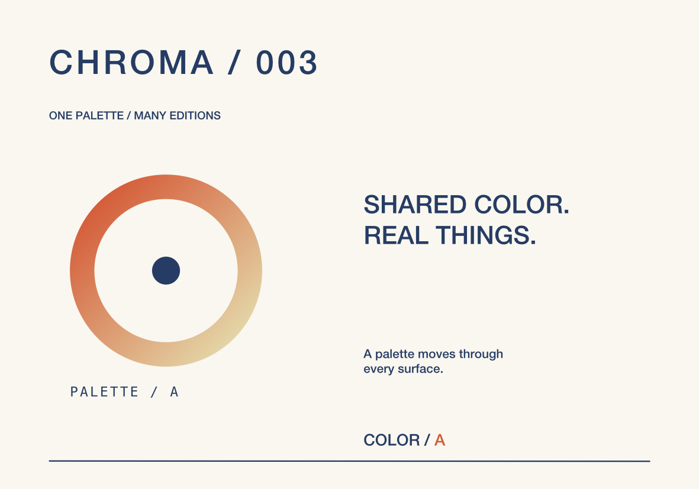
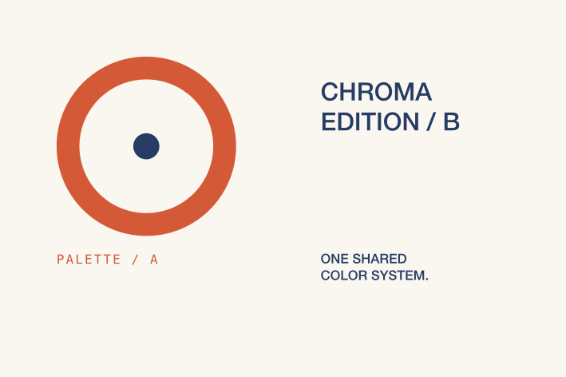

# Shared colors and the CHROMA collection

Named project colors keep a collection's artwork and physical products in sync. Changing a swatch updates every linked fill, stroke, shadow, gradient stop, text span, background, and component override. Native controls and `form_swatch` use the same validated command engine and Undo history.



## Native workflow

Open an artwork workspace and click **Palette** in the toolbar. Create a named color with HEX input or edit an existing entry with the native macOS color picker, name, and HEX fields. An empty palette offers six studio colors as one undoable action. Palette values are explicitly **sRGB**.

Select artwork and choose **Apply fill**, or use the swatch menu beside a fill, stroke, shadow, gradient stop, frame background, or component override. A group applies fill to its visible paint leaves; masks and hidden descendants retain their own colors. A live boolean result and a component instance receive one paint override. Mixed selections report mixed color sources. Choose **Local color · detach** to freeze the current value and remove its link. Editing a property's color directly also removes that property's link.

While editing native text, select characters before choosing a fill swatch. The selected range retains its own color link through font and size changes; converting the text to outlines retains the links on the resulting glyph paths. Leaving text creates one document Undo step, while character editing retains native Undo behavior.

Deleting a used swatch freezes its current color throughout the project, including hidden and locked artwork. Its appearance is preserved; Undo restores the palette entry and links. Detaching a component or physical artwork source preserves shared palette references, so those colors still respond to subsequent palette edits.

Read-only MCP inspection leaves active native drafts and focus intact. An agent mutation commits pending text and palette-field drafts before applying its own edit.

## MCP

There are 45 tools. `form_swatch` supports `list`, `create`, `update`, `assign`, `detach`, and `delete`. Create returns `{"swatch": {...}}`; list returns `{"swatches": [...]}`. Use the returned UUIDs in subsequent calls.

```json
{"name":"form_swatch","arguments":{"command":"create","name":"Accent","color":"#D45A37"}}
{"name":"form_swatch","arguments":{"command":"assign","object_id":"<frame or linked product UUID>","element_ids":["<element UUID>"],"swatch_id":"<swatch UUID>"}}
{"name":"form_swatch","arguments":{"command":"update","swatch_id":"<swatch UUID>","color":"#849381"}}
{"name":"form_swatch","arguments":{"command":"assign","object_id":"<frame UUID>","element_ids":["<text UUID>"],"target":"text_range","location":9,"length":3,"swatch_id":"<swatch UUID>"}}
{"name":"form_swatch","arguments":{"command":"detach","object_id":"<frame UUID>","element_ids":["<element UUID>"],"target":"fill"}}
```

`target` defaults to `fill`. Other targets are `stroke`, `shadow`, `gradient_stop` with `stop_id`, `background` with no element selection, `component_part` with `part_id`, and `text_range` with a nonempty UTF-16 `location`/`length`. Text ranges cannot split a surrogate pair. Inspect raw artwork for element, stop, and part UUIDs. A linked product resolves to its canonical artwork source.

`update` accepts a new name, color, or both. Swatches support unique case-insensitive names of 1–100 characters, six-digit HEX values, and a maximum of 256 entries per project. Invalid edits and failed batches leave the project unchanged. All mutations support `form_batch` and shared Undo/Redo. `form_get_artwork` with `resolved: true` returns current colors with component references expanded, suitable for inspection and output rather than replacing the live definition.

## CHROMA demonstration

The **200 × 140 mm** collection sheet and **120 × 80 mm** edition card share a reusable seal and six colors. A gradient uses Accent and Sand; typography and the line use Ink; both backgrounds use Paper. The card has an independent Accent component override and an Ink center override. The final signature contains outlined glyphs with separate Ink and Accent links. Clay and chalk physical products reference the layouts.



Run against a separate local library:

```sh
FORM_LIBRARY_PATH="$PWD/.local/SwatchLibrary" build/FORM.app/Contents/MacOS/FORM
python3 scripts/smoke_swatches.py
```

The script creates the demonstration, verifies source-only persistence and linked output, compares byte-identical PNGs after swatch deletion, checks Undo and batch rollback, exports physical SVG/PDF/PNG/JPEG, reopens schema 7, and measures 20 distinct palette changes in a 600-element document. See [validation](validation.md) for native checks and measured results.

## Persistence and current boundary

Palette data and optional paint references use **schema 7**; readers retain schemas 1–6. A palette-only edit changes the project manifest while leaving immutable object resources intact. Resolution provides current RGB values to the canvas, linked 3D faces, and exports. Component caches track reachable color values, so unused swatch changes do not invalidate them.

This is a project sRGB palette. ICC/output-profile selection, ColorSync production conversions, CMYK and named spot-color separations, and mappings to physical ink/thread/material catalogs remain requirements for later stages. Editable shadows, blur, opacity, and blending are covered by the [UMBRA appearance workflow](artwork-appearance.md). The broader production-color requirements remain in the [full implementation goal](implementation-goal.md).
