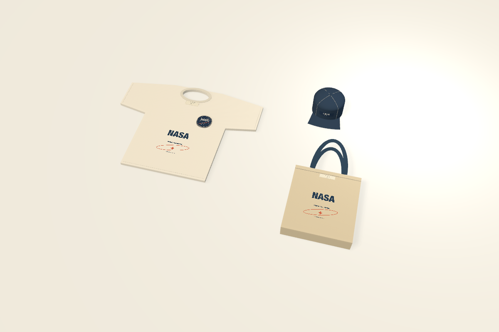
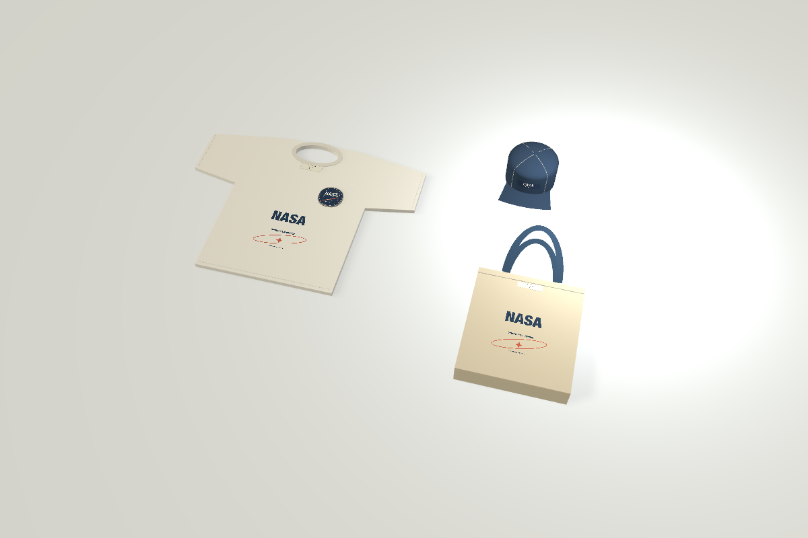
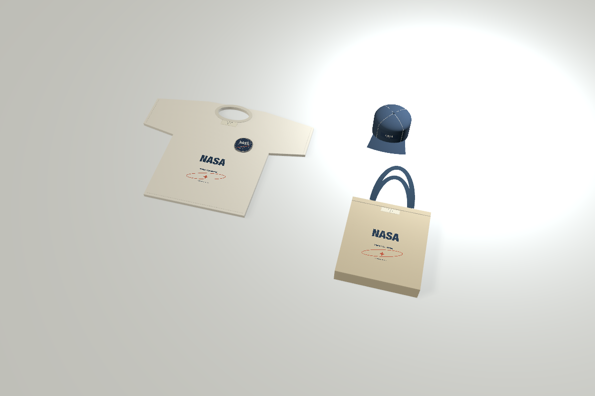
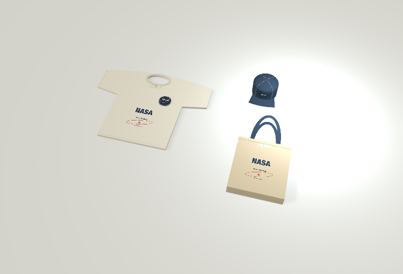

# Saved Studio shots

Studio can save a named camera composition with its lighting, surface, explicit subjects and output pixels. Shot definitions are project data with stable IDs; their product geometry, source artwork, materials and cloth states remain independent.

The first presets are **Classic**, which preserves the existing Studio rig, **Soft side**, and **Rim**. Daylight, Warm paper and Graphite remain the surface/background choices. These are controlled presentation options, not calibrated lighting or a photorealism claim.

## Compose, capture and recall

Use the aperture icon beside Form / Function / Fabricate, or **Studio → Show Studio**. Studio is a separate environment outside the three primary tabs. Returning to a primary environment restores the previous surface arrangement.

Open Studio and use the existing camera controls. Choose Whole project or Selected objects; selected visibility means exactly those object IDs, so select applied details as well. Choose lighting, surface and Width × Height in pixels, then **Capture shot**. Capture creates one Undo step and selects the new definition, so an immediate Update edits that new shot. The original full-size Table/Studio viewport remains in use until you explicitly recall a saved shot.

Recall from the Shots menu. Studio displays a labeled reference frame at the captured aspect, with neutral gutters outside it. Resizing a window scales this frame without refitting, recentering or changing the saved camera. Moving the camera produces a working draft. Capturing another definition preserves an independently active reference frame. **Update** saves the current view/options as one Undo. Rename and Delete are in More; New shot saves an independent shot from the recalled working view. Leaving the frame or using an existing named camera view leaves shot review; the existing Perspective, Top and Front behavior and mouse/keyboard controls are unchanged.

**Preview output** shows the entire output composition. Its displayed raster is limited to 1600 pixels on its longest edge and two million pixels in total; it uses the same projection as the requested export, even when integer preview dimensions round. Actual bitmaps are normalized independently of display backing scale. Preview images clear when source, camera or output options change; regenerate before reviewing the next composition. Native fields are committed before Capture, Update or Export reads them. Invalid values remain editable and never silently clamp. Shared Undo updates clean displayed options; independent raw drafts survive. Reconciliation waits while a native field editor is active, retaining its text/caret, then merges clean fields after editing ends. Metadata history never recalls or fits the camera.

Output aspect can differ from the reference frame. The existing contain rule preserves the full captured view: a wider output shows extra horizontal area; a narrower output shows extra vertical area. No source crop, stretching or automatic object tracking is applied. A 3:2 reference exported at 3000 × 2000 has factor 1; at 2000 × 3000 its vertical extent expands by 2.25. Inspect the output preview when changing aspect. Deliberate detail compositions may crop a subject; the record reports bounding boxes extending beyond the output/clip range without automatically fitting them.

Subject choices are explicit. Whole project includes current physical objects; exact-object shots do not silently add unrelated new objects. Internal Canvas containers are excluded. Ordinary source deletion remains possible, but a shot referring to a missing object reports a conflict until its visibility is repaired. Object duplication does not retarget an existing shot. The panel reports current/resolved subject counts. A definition whose Recall fails remains selected for Rename, Delete or explicit visibility repair; its camera is not applied and its reference frame is not activated.

## PNG and its render record

**Export shot folder (PNG + record)** creates a new `.render` folder with a named PNG and `render.json`. The UI/operation result identifies the actual PNG inside it. Existing destinations are rejected and never overwritten. Both files are staged, verified and sync-requested before a single exclusive directory rename exposes the pair. Validation, partial-file, write/rename failures and destination races preserve existing content and remove only this operation's staging directory. Atomic pair visibility is distinct from any hardware power-loss durability guarantee.

PNG dimensions are integer pixels: 64–8192 per axis, at most 16,777,216 pixels total and aspect 1:8–8:1. This is an output pixel cap, **not a total memory cap**. Image/Metal/antialiasing/encoding buffers and framework caches require additional memory. Pixel dimensions do not declare a physical print width, DPI, textile fit or production calibration.

The record includes project/shot IDs, shot revision, committed design SHA256, exact included IDs, camera/reference frame/effective projection, versioned lighting, output pixels, application/renderer version and OS version, source-resource/font identities and hashes, export time, framing warnings and PNG SHA256. Font records contain portable resolved face IDs and digests, never absolute user font paths or proprietary font bytes. The PNG also embeds a short design digest/software description. Camera distances/targets and orthographic scale use existing scene units (100 mm per scene unit); image dimensions remain pixels. The design hash excludes navigation, history and shot metadata; resource hashes separately identify actual asset/font bytes. This identifies the input version but does **not** archive or reconstruct its editable source.

Shots render current committed source. Source edits affect the next render and its record; choosing a camera does not revert a design. Unpersisted cloth motion/preparation is explicitly rejected for affected subjects: the operation never silently resets or advances physics or substitutes a rest pose. Archiveable runtime-pose rendering remains separate work.

The existing current-view PNG export still produces exactly **3000 × 2000**, preserving its original camera/viewport-expansion behavior. It never silently switches to a selected saved shot. Other artwork/production exports are unchanged.

## Shared native/MCP operations

The existing `form_set_view` tool accepts `view:"studio"` plus `studio_command`:

- `list` / `get`: inspect definitions without opening Studio, ending native editing or writing history.
- `capture`: create a saved shot; optional explicit camera requires its truthful reference frame.
- `update`, `rename`, `delete`: edit the named `shot_id`, each as one Undo.
- `recall`: restore the saved working view and reference frame without a history entry.

Bare `view:"studio"` retains its existing behavior. No new top-level tool, navigation alias or shortcut was added.

```json
{"view":"studio","studio_command":"capture","name":"Collection hero","reference_aspect":1.5,"lighting":"soft-side-v1","surface":"Daylight","visibility":{"mode":"project","objectIDs":[]},"width":3000,"height":2000}
```

`form_export` with `format:"png"` and `shot_id` exports the saved composition. Optional `width`/`height` must be provided together. `path` names a new absolute `.render` folder; without it, a fresh unique folder is created under project Exports. Mixing `object_id` with `shot_id`, invalid pixel values and existing destinations is rejected.

Saved shots require schema 43; old absent metadata retains old behavior. A project supports 64 shots and a render supports 1–4096 exact physical subjects. Missing source references remain diagnosable rather than preventing ordinary object deletion. One serial presentation renderer is owned by the current project. Preview caching is bounded to eight entries / 32 MiB; project changes and deleted shots purge retained state, stale source/project jobs cannot publish, and camera/lighting changes reuse product geometry.

## Verification and limits

Focused tests exercise real offscreen native mouse Capture/Export with a scalar field still focused, saved-reference resizing, no-history recall, exact source preservation, actual large preview/output product bounds, decoded legacy pixels, explicit visibility, runtime-cloth rejection, cache/dependency invalidation, stale jobs, one Undo/reopen and injected exclusive-folder failure/race/partial-file cases. The unchanged camera framing/navigation test suites remain part of regression validation.

`scripts/smoke_studio_shots.py` is the guarded packaged-bridge workflow for a disposable repository `.local` library. `scripts/verify_studio_shots.py` independently parses PNG IHDR/chunks/CRCs and verifies record hashes, pixel limits and source IDs. Neither script contacts hardware or external AI services. Native installed-app acceptance remains a separate release check.

Measured render time and process high-water RSS are reported in validation evidence after actual test runs. RSS includes the entire test process and existing framework allocations; it is not an incremental per-render allocation estimate. No performance guarantee is inferred from the pixel cap.

This is presentation framing and reproducible settings, not an offline path tracer, material calibration, simulation archive, print color-management workflow, automated comparison-grid generator or completion of the broader rendering/textile vision.

Apple primary references: [snapshot pixel sizing](https://developer.apple.com/documentation/scenekit/scnrenderer/snapshot(attime:with:antialiasingmode:)), [projection direction](https://developer.apple.com/documentation/scenekit/scncamera/projectiondirection), [camera node/projection](https://developer.apple.com/documentation/scenekit/scncamera), [light intensity](https://developer.apple.com/documentation/scenekit/scnlight/intensity), [Image I/O destinations](https://developer.apple.com/documentation/imageio/cgimagedestination), [PNG metadata](https://developer.apple.com/documentation/imageio/png-image-properties).

The optimized isolated suite passes **786 tests (534 core/graphics/IPC and 252 native)**, including 19 new Studio tests. The [independent record/PNG checks](evidence/studio-shots-independent.json) and [measured costs](evidence/studio-shots-cost.json) accompany these actual source renders:

| Classic compatibility rig | Soft side | Rim |
| --- | --- | --- |
|  |  |  |


The integrated source passes **835 optimized tests: 564 core/graphics/IPC and 271 native app**, zero failures/skips. Parent native review added strict Recall argument rejection, Capture→Update identity selection, clean-field Undo synchronization, active-editor draft preservation and independent reference-frame lifetime regressions. The signed packaged workflow and actual installed native controls pass. Native Capture 813 × 555 immediately selects the new definition; Update 909 changes that ID only, and Undo restores both model and displayed 813. Raw invalid 3.5 survives an independent Rename/Undo. Read-only list/get preserve active selected text, and the native save dialog exports an 816 × 555 temporary draft while the saved 813 definition and whole project remain exact. Actual four-direction camera input performs no geometry/program/texture rebuilds; Perspective frames all 17 objects identically with/without selection. Actual quit/relaunch/native Home reopen and explicit saved-shot recall restore exact records and source. All five ordinary projects and Studio/font preferences remain exact. See [native evidence](evidence/studio-shots-native.json).


## Actual native-dialog output



This PNG and its byte-identical [render record](images/studio-shots/native-final.render/render.json) were exported through the installed app’s native Save panel, independently decoded and visually reviewed. The saved shot remains 813 × 555; export used a focused 816-pixel draft.
