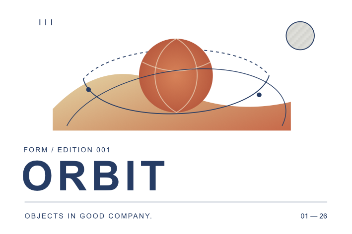

# Editable SVG import

Use **File → Import SVG Artwork…** (`⇧⌘I`) or the import button in Artwork. A native review shows the converted artwork, physical dimensions, element counts, destination, and any fidelity differences. Import creates a new physical frame by default. When an artwork frame or supported product face is selected, **Add to…** centers the imported layers in its existing artwork at their original physical size.

Paths, groups, text, gradients, and embedded images become ordinary FORM artwork. Direct selection edits imported nodes; native text entry edits imported words. Group opacity and clipping remain editable. The complete insertion is one document Undo step. Adding to a linked product resolves to its canonical artwork source, so the other consumers update together.

## Supported conversion

| SVG content | Native result |
| --- | --- |
| Physical width/height, `viewBox`, `preserveAspectRatio` | Millimeter frame and affine viewport mapping; CSS pixels use 96 pixels per inch |
| `g`, nested `svg`, local `use`/`symbol` | Editable groups with composed transforms and viewport clips; instances expand into independent groups |
| Rectangles, rounded corners, circles, ellipses, lines, polygons, polylines | Editable native paths |
| Absolute/relative `M L H V C S Q T A Z` | Contours, cubic nodes/handles, reflected controls, quadratic conversion, and elliptical arcs converted to cubic segments of at most 45 degrees |
| Presentation attributes, inline CSS, common class/ID/tag/compound/descendant rules | Native appearance with inheritance, specificity, and important declarations |
| Named/hex/RGB/HSL colors, `currentColor`, fill/stroke opacity | Solid colors and independent alpha; group opacity composites the group |
| Linear/radial gradients and local gradient inheritance | Editable stops, stop alpha, object/user-space coordinates, and affine gradient transforms |
| Stroke width, caps, joins, miter, dashes, dash offset | Native stroke and editable phase |
| Shape/group clipping, local references, object-bounding-box clips | Native editable vector masks, including compound holes |
| Ordinary text and rich/positioned `tspan` content | Installed native fonts, UTF-16 rich spans, physical point sizes, anchors, baseline positioning, inherited font kerning, tracking, and decorations; positioned chunks become separate text objects |
| Embedded PNG/JPEG data images | Original decoded image bytes, placement, crop, and editable masks |

The [ORBIT fixture](../Tests/Fixtures/orbit-mark.svg) is an original 120 × 80 mm illustration with curved orbital paths, linear/radial gradients, dashed strokes, four text objects, reusable registration marks, and a clipped embedded material sample. `python3 scripts/smoke_svg.py` imports it and links the independent source to oak and graphite product editions. Its physical type sizes remain unchanged on the larger product faces.



## Fidelity review and limits

This is a supported SVG conversion subset. Filters, raster masks, patterns, markers, gradient strokes, blend effects, non-scaling strokes, repeat/reflect gradient spread, off-center radial focal points, animation, scripts, advanced SVG text positioning/layout, embedded fonts, and external resources are omitted or approximated with warnings. Missing fonts retain their requested assignment and are reported. CSS at-rules cause that stylesheet to be omitted with a warning. Invalid XML, unsupported numeric/color syntax, malformed geometry, and excessive input fail with an error.

Warnings disable the native **Import artwork** button until **Import with these differences** is selected. Informational messages describe conversions such as expanding a local `use`. The original file and the report remain available in the saved project. No scripts execute and no external images, stylesheets, fonts, or entity resources are loaded.

Current bounds are 10 MB per SVG, 64 XML levels, 10,000 XML nodes, 5,000 resulting artwork elements, bounded reference expansion, and 1–1000 mm frame edges. Embedded images are limited to PNG/JPEG, 8 MB decoded file data, 40 million pixels, and 16,000 pixels per edge. Input near these limits needs further responsiveness measurements; the recorded benchmark covers 700 elements.

Native rendering and outlined SVG/PDF exports share FORM's geometry and text shaping. Optional live-text SVG still depends on the receiving app's fonts and shaping; review it there before production. Full SVG 2 fidelity, color-managed production, and the remaining professional 2D requirements stay open.

## Local MCP workflow

Discover the exact schema through `tools/list`. Preflight needs no open project and preserves native editing focus. Actual import requires an open project.

```json
{"name":"form_import_svg","arguments":{"path":"/absolute/path/mark.svg","dry_run":true}}
{"name":"form_import_svg","arguments":{"path":"/absolute/path/mark.svg","name":"Mark artwork"}}
{"name":"form_import_svg","arguments":{"path":"/absolute/path/mark.svg","object_id":"<frame or product UUID>","allow_unsupported":true}}
```

Preflight returns `width_mm`, `height_mm`, `elements`, `paths`, `text_objects`, `embedded_images`, `requires_review`, and structured `issues`. Actual import also returns the canonical `object_id`, `original_asset`, and `selected_elements`. Set `allow_unsupported` only after reviewing the reported differences. A linked consumer ID imports into its source; it does not detach the consumer.

Conversion and candidate-document validation happen before project asset writes. Originals are named by SHA-256 and retained byte for byte; embedded images receive independent asset names. Existing files are compared before reuse. Failed insertion cleans up newly written assets. Undo removes the inserted artwork while retained source assets remain available for Redo and recovery. Import provenance and extended opacity/gradient/dash appearance require schema 4. Newly imported text retains explicit font kerning and therefore requires schema 13. Existing schemas 1–12 remain readable.

## Validation and references

The [validation record](validation.md) covers native file selection/review/import/undo/redo, native text entry, original preservation, real MCP transport, linked surfaces, physical exports, save/reopen, and measured preflight latency. Tests include a pixel comparison against macOS's SVG renderer on a trusted fixture.

The conversion follows the W3C definitions for [coordinates and viewport mapping](https://www.w3.org/TR/SVG/coords.html), [elliptical arc conversion](https://www.w3.org/TR/SVG/implnote.html), and [CSS colors](https://www.w3.org/TR/css-color-3/). These references describe the standards; the table and limitations above describe this implementation.
