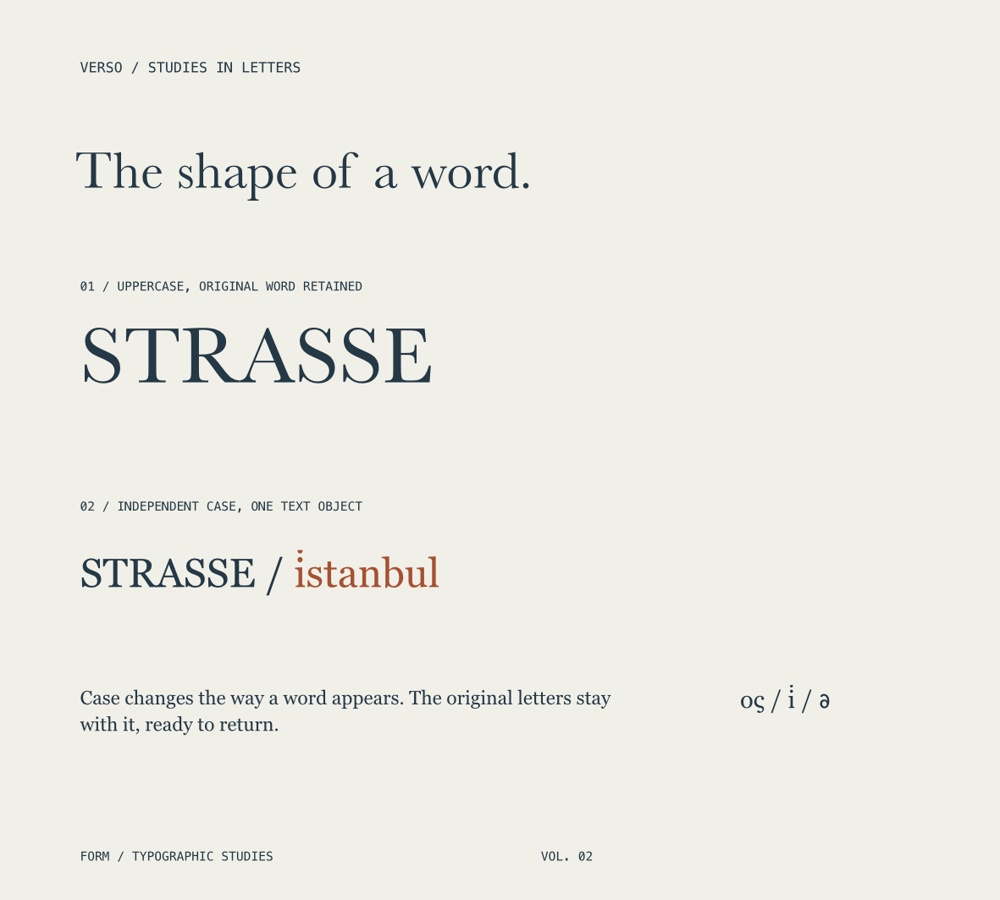
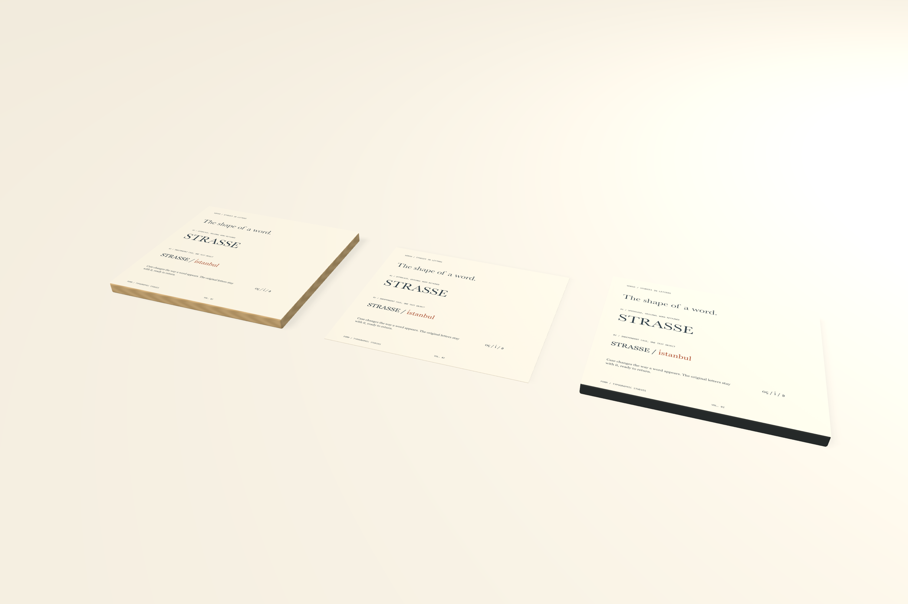

# Non-destructive text case and VERSO

Case treatment changes displayed text while retaining its source words. **Original**, **Uppercase**, and **Lowercase** work independently on whole objects and rich character ranges, alongside fonts, sizes, colors, styles, spacing, and linked product faces.





## Native editing

In the typography inspector, expand **Paragraph & character** and choose the case treatment. A selected range changes only those source characters. With an insertion caret, the setting applies to subsequent typing. A whole-object selection changes all its text.

The native editor shows the composed case, including Unicode expansions such as **Straße → STRASSE** and **İ → i̇**. Selecting either displayed S from an expanded ß targets the complete source character for FORM's formatting controls. Paragraph and style operations use the original UTF-16 character positions, so following words retain correct targets after an expansion. Returning to Original restores the original letters.

Typing retains exactly the newly entered source, including its original case. Deleting or replacing part of an expansion changes that edited source character; unrelated words retain their originals. Formatting different halves of an expanded character outside FORM's controls materializes those displayed letters so both formats can be retained. Native input composition stays untouched while text is marked and retains its original replacement range through commit. Undo/Redo preserves source text and formatting.

## Shared rendering and source mapping

`TypographyEngine` first builds source attributes with each rich span's own case setting. Unicode case conversion preserves surrounding context within a contiguous case treatment, even across font/color boundaries. Shaping, outlines, linked textures, and exports consume the composed result.

Native attributed text carries one shared ephemeral source/display record. Its ranges map original UTF-16 positions to displayed positions; AppKit’s actual text-storage edit ranges preserve untouched source even when differently typed words display identically. A shared value across the whole buffer avoids fragmenting ligatures or kerning runs. Production shaping uses composed characters directly; uniform formatting has a dedicated fast path. It never enters the saved project model.

Case normalization that changes only derived metadata adds no Undo step. Caret-arrow key releases retain the document text interaction, allowing cancelled edits to remove transient history. Textual normalization shares native editing Undo, and replay does not rewrite intermediate text snapshots. Original source and typography remain the persistence boundary. These are corrections to the existing `caseTreatment` field; there is no additional document field or format version.

## MCP

`Typography.caseTreatment` accepts `original`, `uppercase`, or `lowercase`. Use `form_edit_artwork command: "replace"` with the complete text element, or create/update/assign a reusable text style. Rich `textRuns` use source UTF-16 offsets. All changes share native validation, source-only linked persistence, atomic batches, and Undo.

```json
{
  "command": "replace",
  "object_id": "FRAME_UUID",
  "elements": [{
    "id": "TEXT_UUID", "kind": "text",
    "x": 16, "y": 62, "width": 168, "height": 25,
    "text": "Straße", "fontSize": 46, "color": "#243846",
    "typography": {
      "fontName": "Baskerville", "kerningMode": "metrics",
      "caseTreatment": "uppercase"
    }
  }]
}
```

The saved text remains `Straße`; shaping displays `STRASSE`. SVG/PDF/raster output uses the same composed letters. Default SVG outlines retain portable glyph geometry; optional live SVG still needs receiving-font/shaping review.

## VERSO validation

`python3 scripts/smoke_case.py` builds **VERSO · The shape of a word**, a **200 × 180 mm** specimen and linked oak/graphite faces. It compares a case-treated word against an explicit uppercase equivalent, exercises rich Unicode case, recoverable glyph conversion, physical exports, reopen, and saved style updates across 200 text objects.

Automated checks cover source/display range mapping, mixed font/color, dotted I, combining marks, supplementary letters, contextual case, manual pairs after expansions, partial deletion, Original restoration, glyph counts/positions with native provenance, invalid ephemeral records, real native insertion, whole/range replacement, case-formatting Undo, and marked-text commit. The final 200-text saved style-update run measured **59.27 ms median / 70.58 ms p95**, including MCP and persistence. A **0.61 ms** sampled canvas draw may cull offscreen elements; it is not a sustained all-visible FPS claim. Continuous rendering stays disabled. Native PNG is **1181 × 1063 px at 150 DPI**, and PDF is **566.929 × 510.236 pt**, confirmed and visually reviewed with Poppler. Native case restoration, selected-character formatting, rich Mixed indication, exact typed source, full-project Undo, and real mouse camera checks are recorded in [validation](validation.md).

Small caps, alternate-glyph selection, locale-specific document casing, advanced composition/publication, and the remaining [implementation goal](implementation-goal.md) stay in scope.
