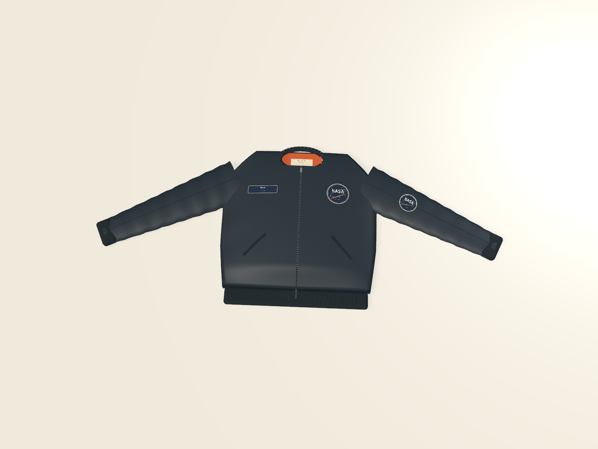

# Textile blanks and the ORBITAL flight study

The textile brief is now in active implementation. This first foundation creates a dimensioned flight-bomber blank, independent linked patches and sewn labels, physical fabric specifications, and native editing controls. The complete [textile specification](textiles-apparel-merchandise-spec.md) remains the governing scope; this milestone does not complete garment construction or embroidery manufacturing.



## Start and edit

Choose **Flight bomber** from the starting studies, or create the `flightJacket` project template through MCP. **ORBITAL / Flight systems** contains two bomber colorways, eight attached decoration components, two standalone patch/label samples, and three shared artwork documents. The NASA-inspired artwork is authored from editable vectors and installed typography.

The bomber is a shaped flat-lay presentation blank at millimeter scale. Body width/length, sleeve length/angle, body loft, cuffs, waistband, and neck opening are native parameters. Its body and sleeves use curved meshes, with ribbing, an orange neck lining, zipper, welt pockets, and seam details. These are generic concept measurements; they are not supplier geometry, cutting patterns, simulated drape, or verified fit.

Select a patch or label independently on the Table. Its textile inspector exposes process intent, border/backing/attachment notes, fabric, garment, region, exact across/down offsets, and angle. Regions include both chest positions, both sleeves, inside collar, and back. Attachments follow garment movement, rotation, and parameter changes. Detaching makes the component independent; deleting its garment preserves the component and linked artwork. Undo restores the relationship.

**Edit artwork** opens the same native typography/vector editor used elsewhere in FORM. Attached and standalone components reference shared artwork sheets; changing the mission emblem updates its uses. Source-only persistence keeps garment and component definitions independent from the graphic resource. SVG/PDF and DPI-controlled PNG/JPEG export use the existing physical artwork engine.

## Fabric library

Project-scoped [fabric repeat designs](fabric-patterns.md) now extend the stock library with editable linked motif tiles, four repeat modes, physical scale, independent colorways, a yardage preview, actual-size outputs, and bomber cloth mapping. Stock specifications stay reusable across projects; the artwork links stay with their project.

Open **Studio Library → Fabrics & textile materials**. Six initial generic nylon, lining, rib-knit, patch-twill, and label materials provide editable composition, woven/knit/nonwoven/thread structure, GSM, usable width, studio inventory in meters, supplier, SKU, care notes, color, and verification state. Unknown measurements remain empty. Save validates finite physical ranges and persists the library separately from projects. Modified specifications are captured in a project's material definitions.

The generic presets are assumptions. Setting the verification flag records a user's declaration; FORM does not independently test a fabric or simulate its physical behavior.

## Model and MCP

Textile recipes are `bomberJacket`, `textilePatch`, and `textileLabel`. `form_list_recipes` returns their dimensions/ranges. Existing `form_add_object` and `form_update_object` accept optional `textile` metadata; no extra MCP tool is required. `form_get_project` returns complete specifications and relationships.

`ProductObject.textile` stores kind/process, blank identity and size, measurement verification, lining/trim materials, border/backing/attachment intent, thread colors, notes, and an optional `TextileAttachment`. Attachments reference an existing garment UUID, named region, millimeter offset, angle, and surface clearance. Fabric specifications live in optional `Material.fabric` values. These fields and textile recipes require schema 17; later unrelated features may raise a project's minimum schema. Older projects retain their defaults.

A placement edit can use the complete current metadata:

```python
project = call("form_get_project")
patch = next(o for o in project["objects"]
             if o["name"] == "Mission patch / left chest")
spec = patch["textile"]
spec["attachment"]["offset"] = {"x": 18, "y": 24}
call("form_update_object", {
    "object_id": patch["id"], "textile": spec
})
```

MCP and native edits share validation, atomic batches, persistence, and Undo. An attachment must reference a supported garment in the same project. Source artwork uses existing artwork links; arbitrary artwork is not flattened into a monolithic garment mesh. Rendering omits nonvisual notes and attachment coordinates from geometry signatures, allowing placement updates to reuse geometry.

## Manufacturing boundary and validation

The initial process fields record manufacturing intent. Embroidery and embroidered-patch previews are explicitly **appearance studies**. There is no generated stitch program, stitch-count estimate, DST/PES/JEF output, machine validation, cutting pattern, cloth simulation, production packet, or device command in this foundation. Textile presentation objects are excluded from FDM mesh preparation; supported physical artwork exports remain available.

`scripts/smoke_textiles.py` passes against the packaged local MCP bridge for shared resources, placement metadata, batch rollback, garment deletion/detachment, Undo, saved reopen, and physical patch/label outputs. The foundation's **13 scoped tests pass**: six core, three geometry, and four native movement tests cover library round trips, schemas, source preservation, shaped geometry, surface normals, geometry reuse, actual patch picking, and parent/child movement once in either object order. Native computer use also verifies the fitted bomber, physical dimensions and Undo, Studio inventory capture, and Save while a field remains active. A 1600 × 1200 offscreen render and physical raster exports were visually reviewed. The patch PDF measures 90 × 90 mm. Details and remaining scope are in [validation notes](validation.md).
