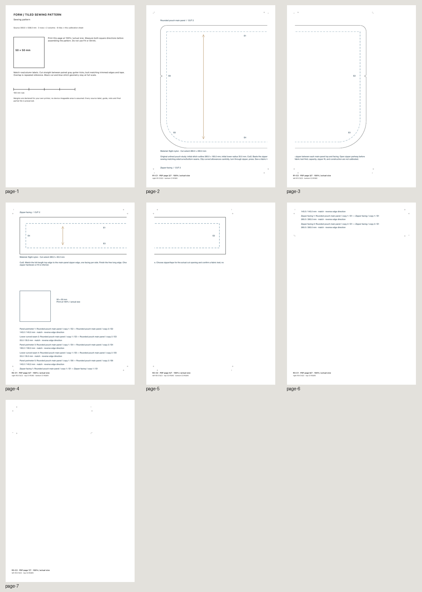
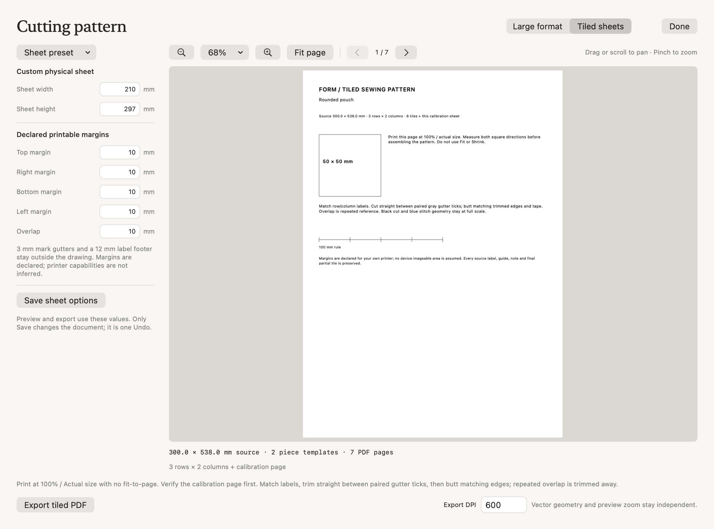

# Tiled sewing patterns

**Preview cutting pattern → Tiled sheets** divides the authoritative technical pattern page into home-printer sheets at exactly 100% physical scale. A4, Letter, their landscape orientations, and custom physical sheet sizes are supported. The existing large-format PDF, SVG and raster outputs remain available under **Large format**.

FORM exports files. It does not open a printer dialog, discover a printer, send a job, or infer a device's printable area.



The [seven-page A4 PDF](images/sewing-tiles/rounded-pouch-a4-tiled.pdf) contains a calibration/instruction cover followed by a three-row, two-column grid. It preserves the complete [300 × 538 mm authoritative source page](images/sewing-tiles/rounded-pouch-authoritative.pdf), including construction notes, seam schedule and the source calibration square. The final partial tile is retained even where its source region is blank.

## Physical contract

All settings are in millimeters. A4 is 210 × 297 mm; Letter is 215.9 × 279.4 mm. Width and height are explicit, so landscape swaps those dimensions. These dimensions agree with the primary [PWG media-size standard](https://ftp.pwg.org/pub/pwg/candidates/cs-pwgmsn21-20230915-5101.1.pdf). PDF coordinates use 72 points per inch as documented by [Adobe](https://opensource.adobe.com/dc-acrobat-sdk-docs/library/interapp/IAC_API_CoordinateSystems.html).

The defaults declare 10 mm on all four paper edges, 10 mm repeated overlap, a 3 mm blank mark gutter on every side of each tile, and a separate 12 mm label footer below the design area. The A4 source area is therefore 184 × 259 mm. No source drawing is placed in the gutters or footer, and no assembly mark crosses the drawing. Custom sheets accept 100–1000 mm per edge, margins 0–50 mm and overlap 0–40 mm, with at least 100 × 140 mm of usable design area. These values describe the requested PDF, not measured printer capabilities. Choose margins that your printer can actually reproduce.

Each tile is a translated, clipped view of the same vector source PDF. It is never fitted, shrunk, reflowed or redrawn at another scale. Source cut contours, stitch contours, holes, notches, grain/fold guides and labels retain their physical positions. PDF MediaBox and CropBox cover the full declared sheet; TrimBox identifies the tile's owned assembly rectangle. The implementation uses public [Quartz PDF creation and drawing APIs](https://developer.apple.com/library/archive/documentation/GraphicsImaging/Conceptual/drawingwithquartz2d/dq_pdf/dq_pdf.html) and the [PDF page-box definitions](https://developer.apple.com/documentation/coregraphics/cgpdfbox).

The calibration cover has an actual 50 × 50 mm square and 100 mm rule. Print at **100% / Actual size**, with Fit, Shrink and application poster scaling disabled. Measure both square directions and the rule before cutting. FORM cannot certify the scaling of an external PDF viewer, driver or printer.

## Assembly

Tiles are ordered by row, then column: R1-C1, R1-C2, R2-C1, and so on. Print the calibration cover separately, then the required tile pages. First match the footer row/column and join labels. Paired gray ticks in the blank gutters locate each of the four paper trim lines: cut straight between the two ticks on opposite sides of the drawing. The associated gutter crosshairs align matching edges of neighboring sheets. **Butt the matching trimmed edges**, then tape. The repeated overlap is alignment reference and is trimmed away; do not stack the retained regions on top of each other.

Internal trim lines fall halfway through the repeated overlap. The retained rectangles partition the entire authoritative source page without gaps or duplicated area. Outer trim lines follow the actual source edges, so final partial tiles may have smaller trim rectangles. All ticks, crosshairs and footer labels remain outside the source drawing and are trimmed away. There is no visible trim rectangle through the artwork; the actual retained rectangle is recorded in PDF TrimBox. This deliberately fixes one assembly behavior; it does not reproduce a PDF viewer's separate poster-scaling controls. Adobe's primary [large-document printing guide](https://helpx.adobe.com/sg/acrobat/desktop/print-documents/set-up-and-print-pdfs/large-documents.html) describes the general roles of overlap, cut marks and labels.

## Native review and saved options



This image shows the hosted native proof. The packaged app also passes actual computer-use acceptance in a disposable library: focused-field Save, exact Undo, vector review, export, and process relaunch/reopen.

Change the sheet preset or edit physical dimensions, four margins and overlap. The existing vector PDF viewer exposes Fit, zoom, drag/scroll pan and previous/next page controls. Large-format and tiled review each retain their own session viewport. Changing export DPI preserves the review PDF, selected page, scale and position; technical paths stay vector.

Draft settings affect preview and one-shot export without changing the document. **Save sheet options** stores the complete settings through the existing artwork command, schedules normal autosave, and adds one Undo. **Clear saved options** is also one Undo. Reopening a source with saved options restores them and starts in tiled mode. Invalid drafts hide the stale proof and block export; they are not clamped to plausible values. Locked artwork cannot save options.

Saved options require project schema 40. They participate in persisted equality/Undo but are excluded from artwork rendering and 3D geometry signatures. Source paths, edge identities, seams and annotations remain editable and unchanged. The original material cutting-layout canvas and its large-format proof are unchanged; this milestone tiles **sewing pattern templates**, not stock layouts, artwork editions or embroidery programs.

## MCP

Use the existing `form_edit_artwork` and `form_export_artwork` routes. No top-level tool was added. A complete options object is required; no missing margin is guessed.

```python
sheet = {
    "sheetSize": {"x": 210, "y": 297},
    "margins": {"top": 10, "right": 10, "bottom": 10, "left": 10},
    "overlap": 10,
}
call("form_edit_artwork", {
    "object_id": source_id, "command": "pattern_tiles", "tile_options": sheet,
})
call("form_export_artwork", {
    "object_id": source_id, "pattern_pieces": True,
    "pattern_tiles": True, "format": "preflight",
})
call("form_export_artwork", {
    "object_id": source_id, "pattern_pieces": True,
    "pattern_tiles": True, "format": "pdf",
    "path": "/absolute/path/pouch-a4-tiled.pdf",
})
```

`pattern_tiles: true` uses saved options, or defaults when no settings are saved. An options object supplies a temporary complete override. Omit the selector or pass `false` for the existing large-format output. `tile_options: null` clears saved options. `pattern_tiles` requires `pattern_pieces: true`; tiled output accepts PDF or metadata-only `format: "preflight"`. Generic role, ink, fabric, cutting-layout and embroidery selectors are rejected together with sewing-template output.

The returned `tiled` metadata contains sheet/source dimensions, rows/columns, ordered page IDs, repeated source rectangles, nonoverlapping retained source rectangles, sheet-space content/trim rectangles, paired gutter registration points, page count and calibration/assembly information. The default tiled filename includes `-sewing-pattern-tiled.pdf`, preserving a previously exported default large-format file.

## Bounds and verification

Planning rejects more than 200 total pages including calibration before allocating a tile grid. Export separately caps repeated vector work, source PDF bytes at 32 MiB, and output at 128 MiB. It reports failure without writing over an existing output file. A larger sheet or the existing large-format output is the alternative; scale is never silently reduced.

Seven core, four graphics and six native/export regressions cover physical A4/Letter/custom/landscape page boxes, exact boundary cases, first/last rows and columns, overlap and trim partitions, matching registration points, vector ink continuity, invalid input/page caps, source immutability, schema/Undo/reopen/autosave, a real native Save mouse press while 13.75 mm remains focused, and PDFKit page/viewport preservation independent of export DPI.

The independent [verification report](evidence/sewing-tiles-independent.json) uses pypdf 6.10.0 and Poppler to parse actual page boxes/calibration paths and compare every source-region raster pixel, including overlaps. It verifies that all 104 gray mark segments and all six footer labels are outside the source drawing. The exhaustive 2,767,680-pixel comparison has mean RGB error 0.002677 on a 0–1 scale; an additional 43,090-point comparison has mean error 0.000069, including 907 real-ink samples and 36 overlap ink samples. Raster comparisons allow antialiasing differences between PDF renderings; physical page/trim/coverage geometry is checked separately to 0.002 mm. All seven pages were rendered and visually reviewed. This is file/geometry validation; it is not a physical printer calibration or a claim of tested garment fit.

Run `scripts/smoke_sewing_tiles.py` against a packaged app using a disposable `FORM_LIBRARY_PATH` below the repository's `.local` directory. It exercises saved/temporary options, physical exports, preflight, invalid rollback, existing-file preservation, Undo/Redo/clear and reopen. `scripts/verify_sewing_tiles.py tiled.pdf metadata.json source.pdf --report result.json` performs the independent read-only check; it needs pypdf, Pillow and Poppler on the host. Neither script performs equipment operations.

The integrated release passes **697 tests** (485 core/graphics/IPC and 212 native), with no failures or skips. The packaged workflow produces seven-page A4 and Letter files and a four-page custom landscape file. Actual native Save stores a focused left margin of **13.75 mm** before any bridge read, changing only that option and one history entry; one native Undo restores the complete project exactly. On interior page 4, actual mouse panning in all four directions returns both scroll positions exactly. Export DPI 150→600 leaves 400% zoom, page and position unchanged; closing/reopening the proof retains its viewport. A native Save dialog exports the same seven-page physical PDF, independently verified against all 3,048,360 source-region pixels with mean RGB error 0.000491 and all assembly marks outside the drawing. Actual app quit/relaunch and native Home reopen retain the source, saved options, history and camera exactly. All five ordinary projects and the Studio library remain unchanged. See [packaged/native evidence](evidence/sewing-tiles-native.json).
