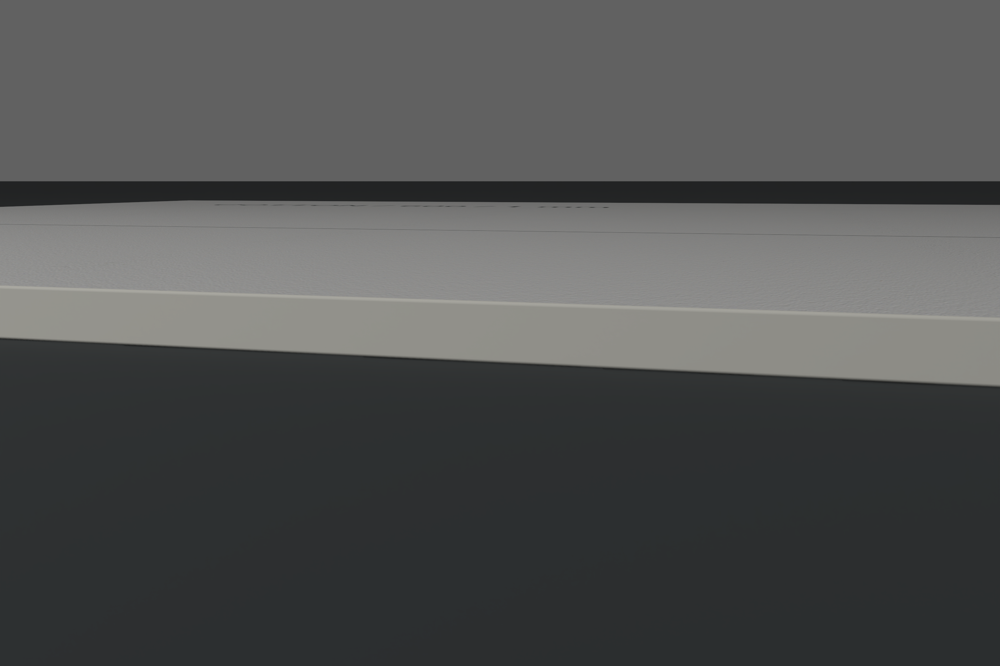
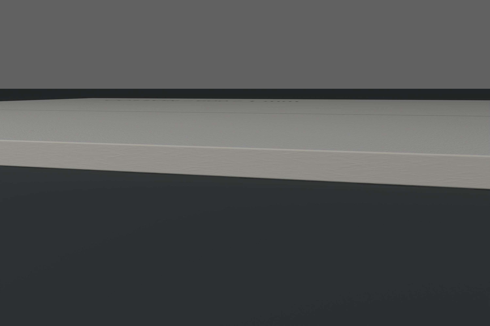
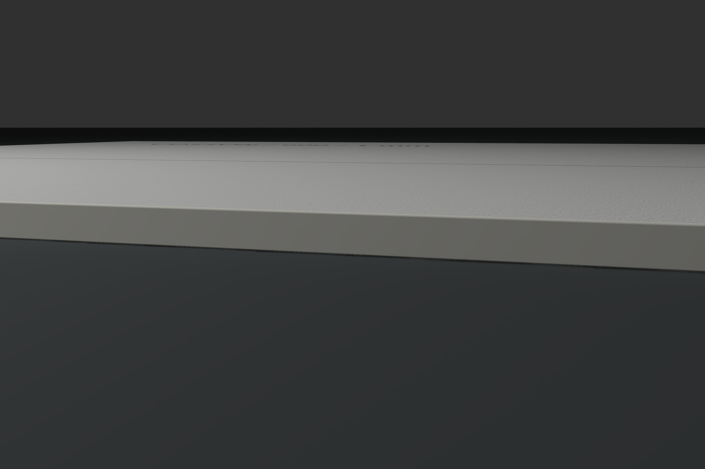
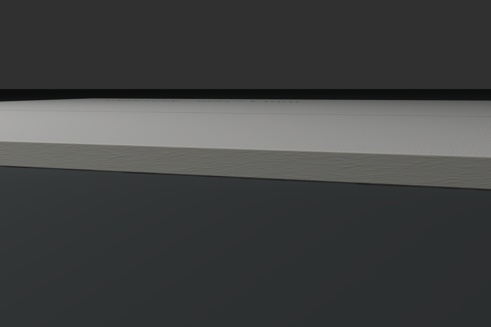
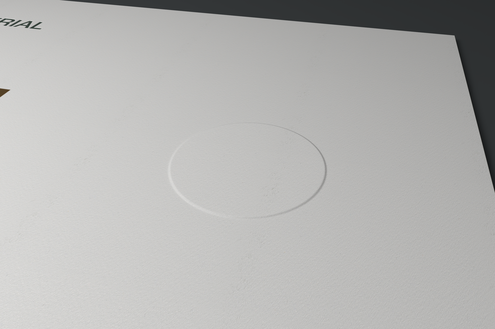

# Physical materiality follow-up

The paper-and-finishes study below was reviewed on clean source `2477730`.
[Its installation evidence](installation.json) retains that exact binary identity.
The current app also integrates the independent-stock construction work from
`main`; its final build, installation and unchanged-shot checks are recorded
separately below.

The native appearance editor shows the source map, encoding and physical repeat
size. Cancel preserves the definition; Apply changes only the intended edge
strength, and one Undo/Redo restores the exact before/after definition. The
shoulder control changes only its radius. Converting preset lights retains the
two original lights and ambient response, and Undo restores the preset. The
two edited comparison objects save/reopen unchanged; the 39-object Table finishes at 64 samples
on Metal and resumes after zoom. [Native interaction evidence](native-interactions.json)
includes unaltered app screenshots and exact readback comparisons.

The 40-object study completed its native Table preview at 64 samples on Metal
before integration. [That native and budget evidence](final-study.json) retains
its preceding build identity. The current integrated transfer measurement is
1,067,292,452 bytes of the unchanged 1 GiB limit, with 6,449,372 bytes remaining;
no textures were downsampled. See [current regression evidence](main-integration.json).

## Paper and finish visual review

This pass retained **27 actual paper renders**, including failed and inconclusive
iterations, plus one unchanged satin control. The study contains four new
physical comparison copies and 64 saved views. The original specimens remain
unchanged. Current values, immutable before definitions, camera/light settings,
PNG/scene-linear EXR exports and render records live in the ordinary project's
`Exports/paper-materiality` and `Exports/Cycles-*.render` directories.
[The portable review manifest](paper-visual-review.json) identifies every attempt
and its artifact hashes. All images below are unchanged LAB outputs.

| Comparison | Before | Selected revision |
| --- | --- | --- |
| Cut-edge macro, same camera/light |  |  |
| Cut-edge raking light |  |  |
| Blind relief, same camera/light |  |  |

The initial edge normal strength of 0.25 was too quiet under broad light. A true
macro confirmed the weakness; increasing it to 1 reveals short, layered fiber
modulation while preserving the face tooth and straight caliper silhouette.
The 8 × 2 mm maps use independent edge coordinates and zero displacement. At
[whole-card distance](paper-whole-after.png), the detail remains restrained.
The first whole-card captures clipped a corner: they remain recorded as failures.
Increasing only camera distance by 25% produced the accepted framing.

The first 0.08 mm finish shoulder gave only a modest improvement. At 0.16 mm,
the blind rim is visibly broader and softer while ink coverage stays crisp.
Letterpress depth and blind relief magnitude remain 0.12 mm; smooth foil remains
0.02 mm high. A negative companion reverses the positive rim's highlight/shadow
at the same view. Reversing the key light reverses both consistently. The
[whole positive/negative comparison](paper-emboss-deboss.png) preserves stock
caliper, artwork and foil. These controls change construction and material
response rather than painting a dark outline.

Reference review used the original [Gmund Cotton stock](https://www.gmund.com/shop/en_int/gmund-cotton-max-white.html),
[printing guide](https://www.gmund.com/shop/media/pdf/instructions/Gmund_Cotton_Printing_Tips_engl.pdf),
[letterpress](https://www.gmund.com/en_int/printing-techniques/letterpress/),
[blind embossing](https://www.gmund.com/en_int/printing-techniques/blind-embossing/)
and [foil](https://www.gmund.com/en_int/printing-techniques/hot-foil-stamping/)
references. Manufacturer photographs stay linked/private. The guide describes
600 gsm stock as approximately 1 mm thick; the 300 gsm / 0.5 mm variant is an
authored estimate. Edge maps, optical parameters and finish dimensions are
artist estimates, not measured scans or pressure/compression simulations.
The edge detail changes shading, not frayed-fiber silhouette. The reference's
depressed circle motivated the deboss companion; this is a construction study,
not a duplicate of the manufacturer's card graphics.

The unchanged satin-front shot confirms the installed mesh shader path still
renders its directional highlight. It does not renew visual acceptance of all
eight cases. Cloth folds and thread contact/filament work remain explicit
follow-on items in the [to-do list](../../../cycles-materiality-followup.md).

## Authored anisotropy direction

The native helper now binds mesh anisotropy to the authored UV chart. Previously,
the implicit Cycles tangent used generated coordinates and ignored UV direction.
Changing UV0 by 90 degrees therefore left the highlight unchanged. Triangle-order
checks already passed in that old helper; this evidence does not claim otherwise.

These are actual helper PNGs, copied without editing. The fixture uses a constant
anisotropy-strength texel and an unclipped area light to isolate direction.

| Helper | Original UV0 | UV0 rotated 90° | Independent scalar quarter-turn reference |
| --- | --- | --- | --- |
| Before |  |  |  |
| Corrected |  |  |  |

[Summary and hashes](anisotropy-summary.json) records the exact helper and verifier
identities. The old helper fails 9 of 17 comparisons. The corrected CPU and Metal
runs pass all 17 with zero byte error in their checked regions. No checked render
clips a color channel; maximum RGB is 187/255. The checks cover UV0, UV1, 90°
material rotation, nonuniform and negative texture scales, mirrored UVs/repeats,
rectangular/skewed chart metrics, triangle permutations, missing-UV fallback and
its axis pole, unchanged isotropic behavior, and longitudinal curve direction.
The old/new isotropic and curve control images also match pixel-for-pixel.

The implementation uses Cycles' `TangentNode` in UV-map mode. For a rotated
anisotropy texture, a derived affine UV chart lets upstream MikkTSpace retain the
physical metric instead of rotating an orthonormal frame incorrectly. Charts are
deduplicated, allocated only on meshes using the corresponding material, checked
for cancellation, and limited to 128 MiB of additional UV/tangent/sign storage per
job. UV0 is the default; an anisotropy texture owns its selected UV set and affine
mapping. Curves retain their longitudinal tangent. Full semantics are in
[the helper protocol](../../../../Native/LabCycles/PROTOCOL.md).

Reproduce with the pinned helper after `bash scripts/install-cycles.sh`:

```sh
python3 scripts/verify_cycles_anisotropy.py \
  --helper .local/engines/cycles-3eb35f85996b/lab-cycles-render \
  --output .local/cycles/anisotropy-check-cpu --device cpu
python3 scripts/verify_cycles_anisotropy.py \
  --helper .local/engines/cycles-3eb35f85996b/lab-cycles-render \
  --output .local/cycles/anisotropy-check-metal --device metal
```

Output directories must not already exist. Metal requires actual GPU access.
The existing `verify_cycles_mesh_normals.py` and `verify_cycles_curves.py` also
passed on CPU and Metal; their reports are retained alongside the main reports.
Raw scenes, EXRs and event streams are under `.local/cycles/validation-anisotropy-*`.

This is direction correctness evidence, not a measured BRDF match. The ordinary
LAB application was not replaced for these helper checks. The installed-app
paper review above and its runtime identities are recorded separately.

## Paper, finishes and lighting regression

The final source-stable release suite executed **2,624 tests: 2,621 passed,
3 optional performance fixtures skipped, and 0 failed**, in 663.79 seconds. All
1,085 captured source files remained unchanged. Real helper integration and the
saved full Table/attached-program diagnostics were enabled: all 1,214 strands
and 21,786 keys were retained, and the 36-object Table stayed within the existing
1 GiB transfer budget without downsampling. Python client checks passed all
30 tests. [Regression evidence](regression.json) records source, helper and log
hashes, exact target counts, retained failed attempts and the recovery-schema
budget check.

The three analytic cut-edge maps and their provenance reproduced byte-for-byte:

```sh
python3 scripts/prepare_cycles_paper_edges.py \
  --output .local/cycles-materiality-followup/reproduced-edge-assets
```

These maps are authored estimates, not measured manufacturer data. Subsequent
client safeguards preserve immutable before definitions when comparison copies
or camera slots are explicitly reused, and reject historical labels whose live
object has changed. All **38 Python checks** pass after those additions:

```sh
python3 -m unittest discover -s scripts -p 'test_*cycles*.py' -v
```

The source used for these captures remained unchanged from that release suite.
The later main integration has its own source-stable verification below. Authoring
commands default to dry-run; `--apply` performs generic MCP edits. For example,
with the delivered local study state:

```sh
python3 scripts/author_cycles_paper_followup.py --stage edge-review --normal-strength 1
python3 scripts/author_cycles_paper_followup.py --stage final \
  --control shoulder-0.16/blind-relief
```

Add `--apply` only to author/capture. Final-stage capture refuses a control whose
live object no longer matches its recorded definition. Revisions require
`--revision-from` and the complete `--expected-object-sha256`; prior definitions
and reused camera slots are archived before mutation. The final study already
uses all 64 shot slots, so new variants must explicitly reuse suitable slots.

## Current construction integration

The final merged release suite executed **2,744 tests: 2,741 passed, 3 optional
performance fixtures skipped, and zero failed**. All 1,155 source files remained
unchanged. The 28 focused integration checks also passed.
[The complete record](main-integration.json) includes actual CPU/Metal helper
coverage, full-Table preparation, command/environment details, source/log hashes
and the retained first failed run.

The merge preserves independent component stocks/finishes, texture sampling,
Studio assembly poses and both prior rendering contracts. Construction and paper
poses keep schema 66, Cycles fields use 67, and cut edges/shoulders use 68. Older
local Cycles projects decode without losing their source and upgrade their
minimum schema on save. Disabled components still contribute saved material
requirements.

The first merged run exposed an invalid compatibility fixture and a physical
render-identity regression. The fixture now registers its actual authored
recipe and valid finish artwork. The production fix removes detached Canvas
placement only from the derived paper hash; moving artwork in the editor no
longer refreshes physical views, while real ink/finish edits still do. Both the
original regression and warm/rebuilt-cache checks pass.

## Final installed app

The ordinary app is now the exact signed candidate built from `20f27b83`, with
its preceding installation retained for rollback. Relocated CPU and Metal
renders passed with fresh LAB shader caches, network denied and development paths
unavailable. The full bundle stayed unchanged and its signature verified before
and after the gates. [Installation evidence](main-installation.json) records
the binary, source, dependency and display-transform identities.

Packaging initially stopped because the authoritative offline MCP catalog's
pretty-printed JSON exceeded its existing 1 MiB limit. Compact serialization
retains all 71 tools and every parsed value, reducing 1,642,856 bytes to 452,650;
the schema fingerprint is unchanged. The limit still applies to real oversized
catalogs. All **43 Python checks** pass (38 Cycles clients and 5 packaging checks).
No native source changed after the final release suite.

```sh
python3 -m unittest discover -s scripts -p 'test_*cycles*.py' -v
python3 -m unittest discover -s scripts -p 'test_package_mcp.py' -v
```

Five existing controls were replayed without changing objects, materials,
cameras, lights or settings: cut-edge macro, blind shoulder, whole card, linen
macro and linen grazing. Each finished at **3000 × 2000 and 512 actual samples**,
with PNG/EXR hashes and installed runtime identities verified. The paper edge
and softer rim remain visible, the complete card retains its tooth and caliper,
and linen's weave follows its smooth folds without a new visible discontinuity.
[The replay record](main-replays.json) retains all five results and specific
review notes. Two unchanged final-app outputs are available here:
[paper edge](main-edge-macro.png) and [linen grazing](main-linen-grazing.png).
These are qualitative integration checks, not pixel-identical output claims or
renewed reference acceptance of all eight cases. Linen remains simplified cloth;
fiber silhouettes and contact flattening remain follow-on work.

The current app's **40-object Table preview completed at 64 samples on Metal**.
Native Command-S followed by reopening preserved all eleven compared study
fields, including complete objects, materials, shots and camera. The original
project was then restored with all eleven protected fields and its Canvas
artboard unchanged. [Native evidence](main-native.json) includes the unaltered
[Table screenshot](main-table-rendered.png). Historical controls and failed
iterations above retain their original source and runtime identities.
