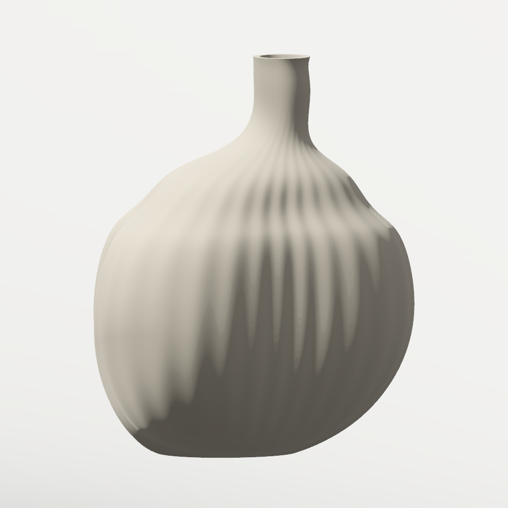
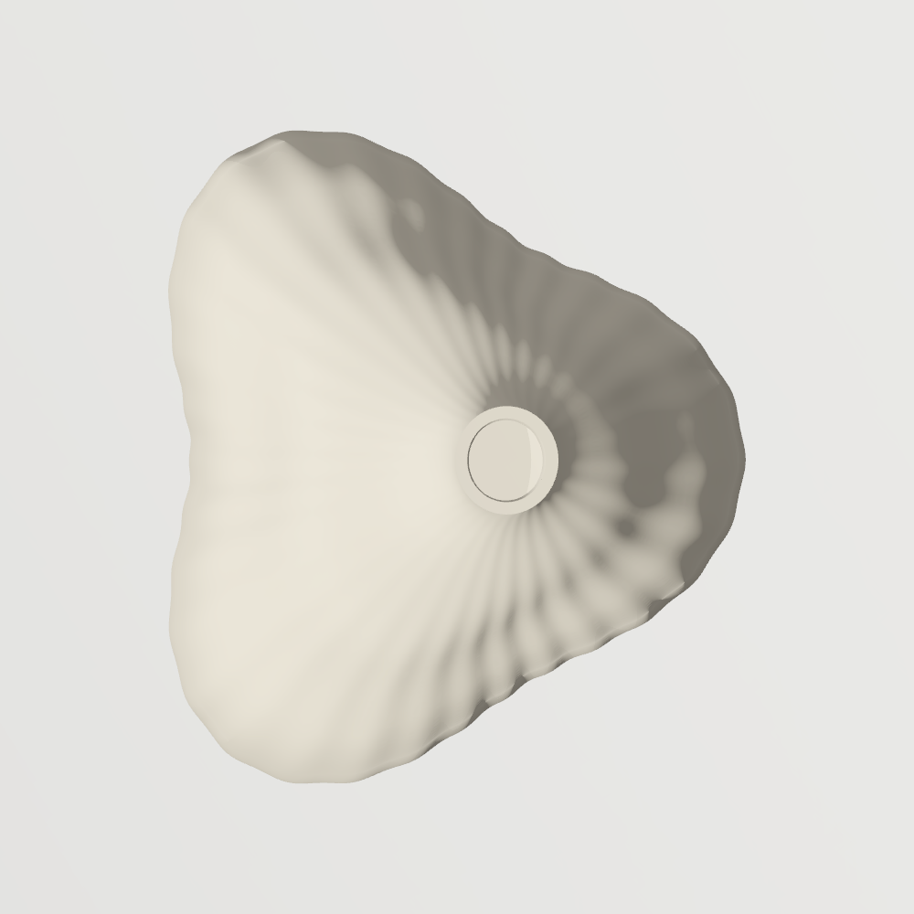
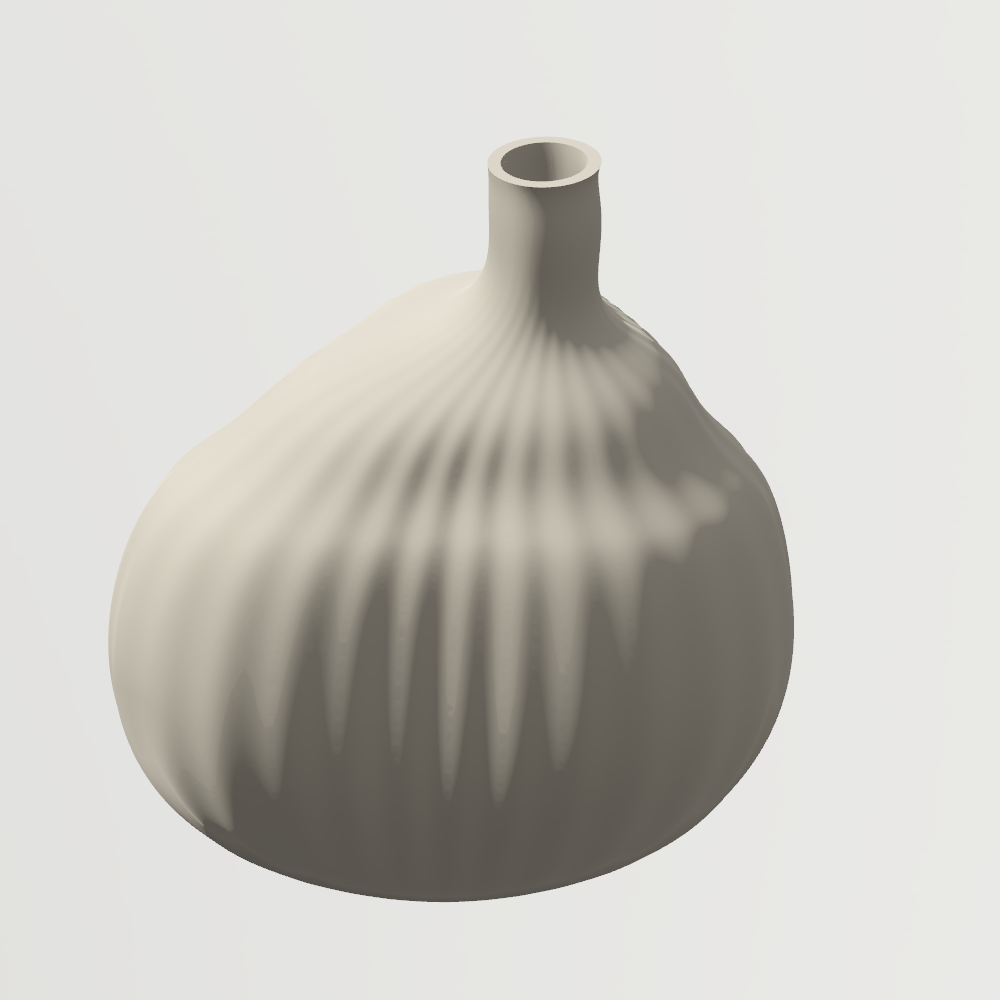
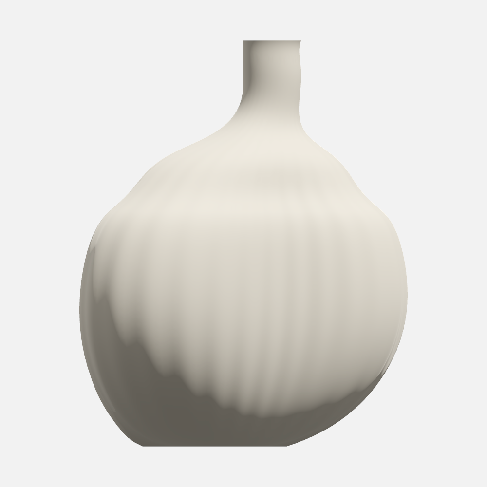
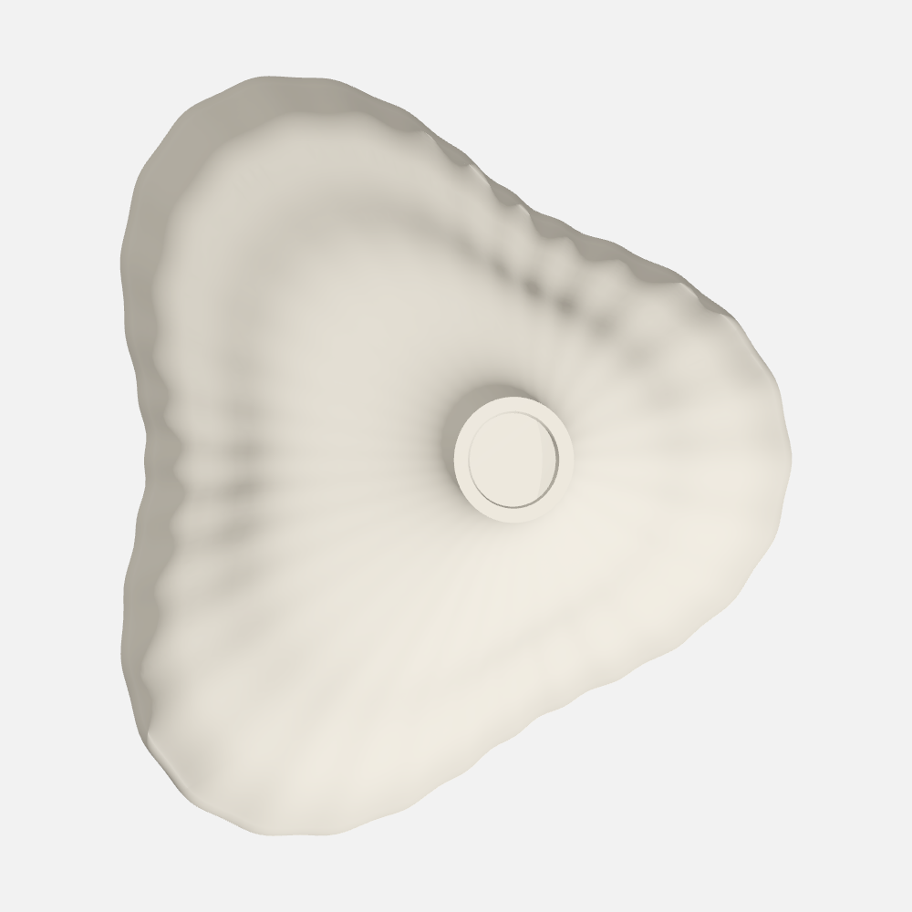

# Organic reference acceptance

**Result: valid nominal geometry; visual reference not accepted.**

This unfamiliar sculptural object was authored as model document data through the
installed app's general curve-profile, loft and shell operations. The model
required no application-code changes, product registration or external modeling
application. The retained model and actual renders make the remaining quality
gaps reviewable.

## Frozen design reference

`ai-generated-reference.png` is an **AI-generated independent design reference**,
created before any model was authored. The exact prompt, freeze time and unchanged
SHA-256 are recorded in `reference-prompt.txt` and `reference-manifest.json`. It
was never regenerated or edited to fit the model.


The brief calls for a matte ceramic, softly asymmetric three-lobed bud vase with
an offset hollow neck, a continuous belly/shoulder blend and fine shallow physical
fluting. These are visual requirements, including silhouette, proportions and
surface fairness. A closed solid alone does not satisfy them.

The AI sheet is not a calibrated drawing. The top neck appears larger relative
to the belly than the front neck, and the nominal front view shows some mouth
interior. These inconsistencies limit precise multi-view reconstruction.

## Actual packaged-app captures

These are unretouched 1000-pixel native captures of the same accepted model with
fabrication tessellation and the existing `soft-side-v1` Studio preset. The views
use orthographic cameras: front elevation 0.08 radians, top elevation π/2, and
three-quarter azimuth 0.55/elevation 0.45. Complete cameras and image hashes are in
`validation-report.json`.

| Front | Top | Three-quarter |
| --- | --- | --- |
|  |  |  |

| Requirement | Observed result |
| --- | --- |
| Broad asymmetric three-lobed body | Recognizable, with unequal lobes; the foot remains wider/softer and the depth and neck placement differ from the reference. |
| Smooth belly/shoulder | The major waist and horizontal bands of the early source were improved. Broad local shoulder/base undulations remain visible. Section-curve C2 continuity does not prove axial loft fairness. |
| Fine shallow fluting | Thirty-two physical flutes are present and visible under side light. They read coarser and less even than the reference's fine grooves. |
| Hollow offset neck | A real inward normal shell succeeds. The side-lit three-quarter image shows the opening; default review/top lighting makes its interior misleadingly pale. |
| Visual fidelity | **Failed.** Better lighting reveals existing geometry but does not repair the silhouette, groove scale or surface fairness. |

The default review image initially concealed much of the relief. These inspection
captures preserve that observation:

| Default front | Default top |
| --- | --- |
|  |  |

Increasing tessellation from **441,260 to 792,606 triangles**, while reusing all
exact features, did not materially fix the broad shading or weak default relief.
Changing only the existing Studio lighting made the grooves and neck clearer;
source model and exact representation were checked unchanged. Thus the missing
contrast has a rendering component. The visible foot outline is a shape mismatch.
The precise contribution of surface fairness versus rendering normals to the
remaining broad shoulder/base shading was not independently isolated.

## Retained model and measured evidence

`model.json` is the single chosen source. `author_model.py` reproduces it
byte-for-byte with its default arguments. It emits thirteen closed section
profiles, one smooth loft and one inward shell with a 3 mm nominal wall. Each
section encodes a periodic uniform cubic B-spline as 192 ordinary cubic Bézier
segments, with six control samples per flute. This uses the existing model
operations. It adds no model-specific runtime type.

The document exposes height, belly/base/neck radii, neck offset, shoulder height,
depth ratio, lobe strength, flute depth and wall thickness. **Only their nominal
configuration was evaluated. No parameter-envelope pass is claimed.**

The packaged evaluation measured one valid closed material solid, 387 faces,
213,766.624 mm³ material volume and bounds of **145.588 × 180.007 × 164.678 mm**
(width × height × depth). The declared single-solid and height checks passed.
`source-proof.json` separately records all 2,496 section joins, numeric C2 errors
and the source-compaction bound. These proofs do not establish visual fidelity
or manufacturing suitability.

This dense organic model took **317.78 seconds to reach its first ready state**.
Reported exact evaluation was 271.60 seconds, including **19.79 seconds for loft
and 241.86 seconds for shell**. The initial evaluate/evidence/commit loop took
346.45 seconds. This is evidence of a slow general offset/topology path for this
source, rather than a fast organic editing loop. The faster mechanical-fixture
benchmark does not describe this workload.

## Recorded source iterations

Large intermediate sources and raw native logs remain in ignored
`.local/validation/organic-vase-*` directories. The selected source and comparison
images above are retained in the repository.

| Iteration | Actual result |
| --- | --- |
| V1: 13 × 96 Hermite edges, 32 flutes | Loft failed after 204.51 seconds; shell and images were not reached. The original diagnostic did not identify a kernel status, so its exact cause is unproven. |
| V2: 12-edge unfluted body isolate | Loft and shell succeeded in 6.51 seconds; the authored 0.02 mm height envelope rejected conservative 180.1293 mm bounds. |
| V3: 0.2 mm reference height envelope | Valid, but visually failed: waisted foot, horizontal bands, rounded-triangle footprint and missing flutes. The geometry was unchanged from V2. |
| V4: source-only radius/lobe/neck repair | Valid in 6.79 seconds; much fuller clover body, with required fluting still absent. |
| V5: periodic C2 section representation | The verbose 2,386,341-byte canonical document was rejected before evaluation by the existing 2 MiB source limit. |
| V5b: selected compact C2 source | Accepted at 2,002,474 canonical bytes. Compaction changed evaluated coordinates by at most 3.81 × 10⁻¹² mm. Geometry succeeded; visual acceptance still failed. |

The accepted result shows that familiar curve, loft and shell operations can
construct this unfamiliar hollow body. It also exposes practical limits: dense
section data approaches the document limit, the shell dominates evaluation, and
successful topology does not guarantee a fair or reference-faithful surface.

## Reproduce

From a normal logged-in macOS graphical session after building the packaged app:

```sh
python3 examples/agent-modeling/organic-bud-vase/author_model.py
python3 scripts/validate_organic_reference.py \
  --quality fabrication \
  --output .local/validation/organic-reference-new
```

The validator defaults to `build/LAB.app` and this final `model.json`. Use `--app`
to select another package. It creates a fresh private library and socket, checks
the frozen reference hash, evaluates and commits the source, obtains default
front/top/perspective evidence, exports matched side-lit Studio shots, and checks
that presentation changes preserve model source and representation. The run
report includes package/helper/source hashes and leaves visual acceptance
pending an explicit comparison. It does not automatically declare a visual pass.

`validation-report.json` records this completed bounded exercise and its failed
visual verdict. Its native measurements came from `build/LAB-engine-final.app`;
the recorded executable hash identifies that package precisely.
