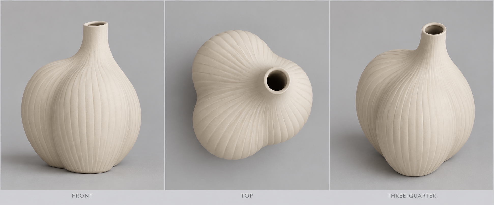

# Organic bud vase reference study

This is an agent-authored model, not a registered app product. Its source uses ordinary curve profiles, affine transforms, profile refinement, a loft, and a true inward normal shell. Twelve exposed parameters control its dimensions, shape, relief and wall.

The independent [AI-generated design reference](ai-generated-reference.png) was frozen before modeling. The selected source passes visual **geometry** review for silhouette and proportions, the shoulder/neck blend, continuous readable modeled flutes, and the hollow opening in oblique views. Photographic finish, illumination and cavity brightness remain unmatched. The native images are unretouched; neither photoreal equivalence nor appearance under every light is claimed.

The exact selected source is `df7937f1b5917027be9ecd678d6a5713aaf5c5504e67b47ab024459d1e9c3e12` (SHA-256 of `model.json`). Its source metadata is retained exactly as evaluated.



## Native views

The saved views use the same physical geometry, material and cameras under the shipped Rim and Soft side presets. The strong grazing-light bands are retained in the images.

| View | Rim | Soft side |
| --- | --- | --- |
| Front | [Native PNG](render-front.png) | [Native PNG](render-front-soft-side.png) |
| Top | [Native PNG](render-top.png) | [Native PNG](render-top-soft-side.png) |
| Three-quarter | [Native PNG](render-three-quarter.png) | [Native PNG](render-three-quarter-soft-side.png) |

The reference is an uncalibrated design image. Its cameras and real-world dimensions are unavailable. Actual capture camera values, lighting IDs, source hashes and app/kernel versions are recorded in `validation-report.json`; image outline scores describe the comparison and do not determine physical or visual acceptance alone.

## Source and controls

Twenty planar sections share a periodic C2 cubic curve correspondence. A small sixth harmonic softens the three-lobed contour. Each section explicitly refines its tangent Bezier spans into one spline edge before placement and lofting; refinement preserves the modeled relief. A normal shell creates the cavity and 3 mm nominal wall. The 48 flutes are physical geometry, with relief fading toward the thin neck.

| Parameter | Nominal | Declared bounds | Unit |
| --- | ---: | --- | --- |
| height | 180 | 150–210 | mm |
| bellyHeight | 84.6 | 72–96 | mm |
| bellyRadius | 73 | 62–76 | mm |
| baseRadius | 30 | 26–34 | mm |
| neckRadius | 14.5 | 12.5–16 | mm |
| bellyOffset | −10 | −12–0 | mm |
| neckOffset | 16 | 16–30 | mm |
| neckDepthOffset | −17 | −22–−12 | mm |
| depthScale | 1.015 | 0.94–1.04 | ratio |
| lobeAmount | 0.12 | 0.10–0.27 | ratio |
| fluteDepth | 0.25 | 0–0.25 | mm radial amplitude |
| wall | 3 | 2.5–3.5 | mm |

The bounds are conditional on the saved `neck-wall` and conservative `detail-curvature-margin` requirements. They do not promise that every combination in a rectangular parameter box is admissible. Native checks also require one valid material solid, the declared height within the unchanged 0.2 mm tolerance, and bounded material volume. A rejected declared margin is not a proof of physical impossibility.

At nominal values, the evaluated material solid is approximately 146.427 × 180.000 × 156.659 mm, with volume 215,977.698 mm³ and five faces. Its saved fabrication display mesh has 498,536 triangles. Exact geometry and display tessellation remain separate.

## Validation evidence

The final finite parameter campaign is recorded in `validation-report.json`. All 30 named cases are retained: 27 passed native geometry checks and 3 were rejected by the expected authored conservative curvature requirement. There were no unexpected final failures. Two endpoint aliases are explicitly covered by the nominal case. See [full measured cases](parameter-validation.json), [case matrix](parameter-cases.csv), and the [original shared-budget interruption](original-shared-budget-attempt.json). Finite cases are evidence for those values, not a continuous range proof.

A fresh private app process loaded the saved source and assets without changing source, representation, placement, history or object-file bytes. Exact and display asset hashes were verified; all three saved native Rim views were pixel-identical after reopen. Saved numeric metadata identifies the current patched kernel build and was not silently recomputed on load.

A three-case request exhausted its shared 300-second budget after the two neck-radius endpoints passed in 118.690 and 111.087 seconds. Its third case retained a real `budget_exceeded` outcome, and the request returned at 353.624 seconds because native adaptive mass integration does not poll cancellation internally. Interrupted or unrun exact values were retried as separate requests with the same 300-second ceiling, source, checks and geometry quality; the original outcomes are retained. This is a cooperative deadline with a demonstrated native-call overrun, not a hard wall-clock bound.

Source iteration was checked rather than accepted on solid validity alone:

- The earlier contour had roughly twice the reference's top-view third-harmonic amplitude. The corrected native top outline is about 0.97 IoU after translation and uniform scale, with no local warp.
- A denser initial section distribution failed the unchanged height requirement at 180.5276 mm. The failure remained repairable; no result was published and no tolerance was relaxed.
- Explicit cylindrical-neck stations repaired that source. On the final 0.25 mm relief model, 15,791 sampled outer vertices differ from the intended continuous axial design by 0.0648 mm at the 95th percentile (sampled maximum 0.1372 mm); sampled normal deviation is 0.643° at the 95th percentile. This measures loft fit to the author's continuous intent, not CAD tolerance or a global surface error bound.
- Separate models and real Undo/Redo preserved the earlier source, BRep, placement, design ownership and prior history.

Controlled shadow on/off/repeat and finer-mesh diagnostics did not remove the broad grazing response. Vertex normals matched the analytic BRep, and an independent Lambert calculation reproduced that broad field. These results do not support calling it renderer or normal corruption. The photographic material and lighting differences remain visible.

## Reproduce

Regenerate the exact frozen model with standard Python:

```sh
python3 examples/agent-modeling/organic-bud-vase/author_model.py
shasum -a 256 examples/agent-modeling/organic-bud-vase/model.json
```

The generator defaults reproduce the selected source byte-for-byte. `--body-only` is a diagnostic option and does not represent acceptance of a hollow vessel.

After building the app, run the isolated native fixture:

```sh
python3 scripts/validate_organic_reference.py \
  --quality fabrication --lighting rim-v1 \
  --output .local/validation/organic-reference-fresh
```

The runner defaults to `build/LAB.app`, uses a new private library/socket and closes only its own app process. Record the actual build configuration with `--build-configuration`; the app executable hash and public kernel capabilities are captured automatically. Rendering a valid solid does not automatically declare visual acceptance.
