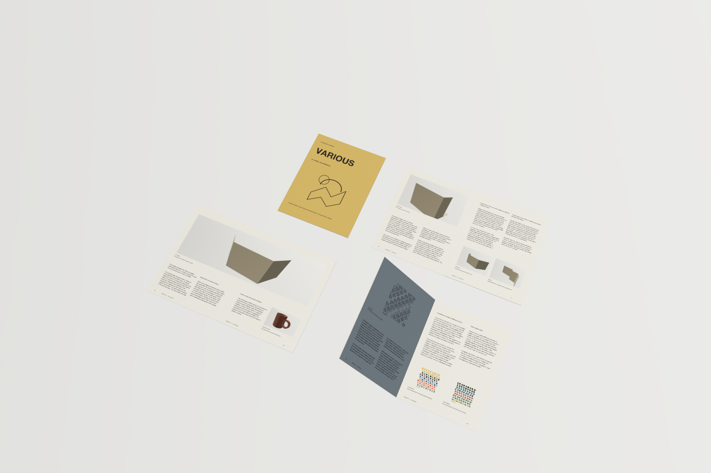
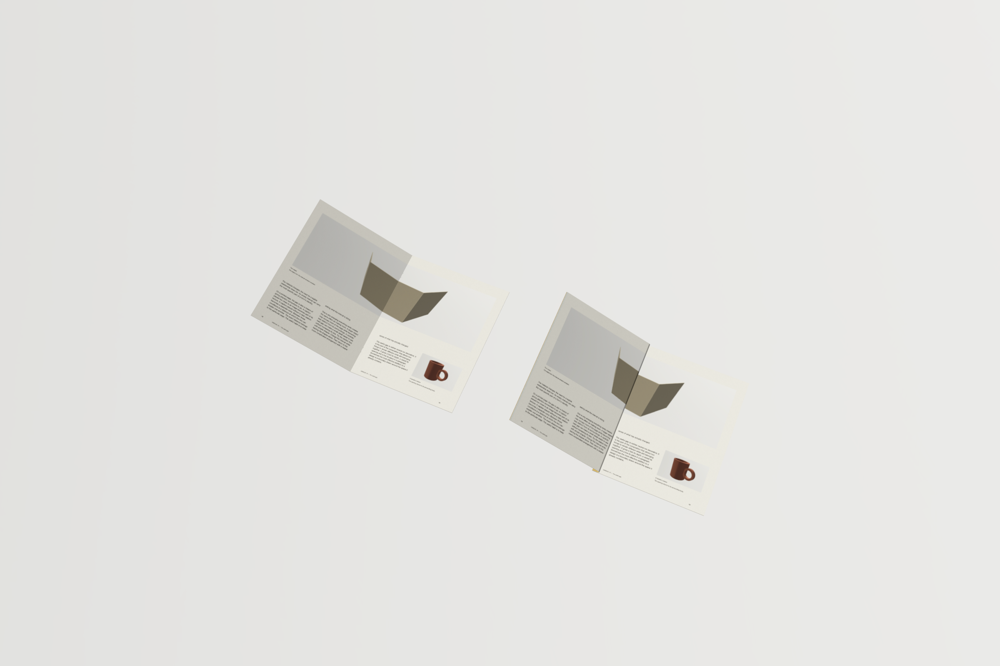
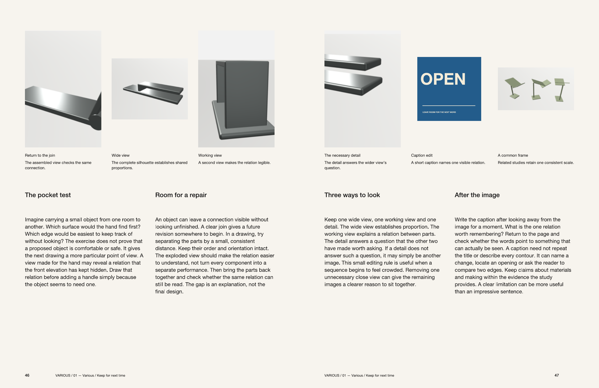

# Native validation / VARIOUS 01

The authored issue was accepted in the ordinary LAB app after repeated native layout/render reviews and bounded source-preserving repairs. The accepted source has **52 logical pages, 48 interior folios plus four covers, 6,542 editorial words, 110 visual placements, 26 linked rich stories and 13 physical parent sheets**. The reproducible structure and opening instructions are in [README.md](README.md); [validation.json](validation.json) records the exact source/app/output identities.

The accepted canonical editorial/scene source SHA256 is:

```
6bec16a32ce73173fe8043f90e8e3462c06bd68cd09ff8053a8879d977e1ea02
```

This is the authoring runner's canonical hash over the declared project/source fields, not a hash of the serialized package Manifest. The delivery copy certificates separately identify the exact Manifest, current immutable object files and asset bytes.

## Actual native results

| Check | Recorded result |
| --- | --- |
| Page order and native PDF | 52 physical reader pages, correct trim and source order |
| Facing output | 27 reader views; each inspected individually, with the earlier cross-gutter hero kept as one canonical image |
| Printer arrangement | 26 imposed sides for 13 exact 431.8 × 279.4 mm parent sheets, zero added bleed |
| Native publication preflight | Pages, spreads and booklet each report **zero issues** on the accepted source |
| Colored stocks | All 16 corresponding logical faces retain editable declared process-K content and transparent artwork backgrounds |
| Actual imposed PDF paints | All eight K-only sides **1, 2, 9, 10, 17, 18, 25, 26** pass recursive paint-operator inspection; every painted C/M/Y component is exactly zero |
| Color profile and boxes | The final booklet embeds the selected portable Generic CMYK profile, with matching SHA256 and exact media/trim/bleed boxes |
| Studio | Both actual 2400 × 1600 native scene renders completed: four shared-source reader poses and saddle/side-staple comparison |
| Source editing/history | Shared story/master ownership, exact source-preserving repair Undo/Redo and reopening were checked through the public native workflow |

The final exports are retained under `.local/validation/publications/various-accepted-exports/`. Its `magazine-report.json` records the native requests, public source checkpoint, output counts and hashes. Its `actual-print-ink-and-boxes.json` is the actual final booklet audit, not an inference from a screenshot or source swatch.

| Final output | SHA256 |
| --- | --- |
| `exports/various-pages.pdf` | `b6f00869fbc3e2043ccc05e74d7a9fe8571392b4a10e06b976ff5cec832d62c4` |
| `exports/various-spreads.pdf` | `7da4fab1416cf732a091982bd21934b5f27cde4d9154f3429b60736e92b59cd1` |
| `exports/various-booklet.pdf` | `45aec5625a5d248bc1286e32ca2a0e63b9413d9670135b8a832799d4e8804c3e` |

Both scene PNG paths and hashes are in [validation.json](validation.json). The selected embedded ICC profile SHA256 is `0c8a584b288a306eac9e1d3f1e68bc1b64331c717ceb051420e6257f17b3509a`.

## Provided packages and native interaction

Both provided `.form` packages were byte-verified and then opened with **File → Open in the same ordinary LAB app**:

| Package | Exact Manifest SHA256 | Content |
| --- | --- | --- |
| `VARIOUS-Issue-01.form` | `3fbf2ff9da76fcb5a11f70179a750bf45dea5dec4b6a9009fe1b5a667c2da0a9` | 55 objects, 55 asset files; 111 files / 41,934,735 bytes |
| `VARIOUS-Source-Portfolio.form` | `8b0dcc19128cfe7b5d72ab2c471bb095edb52f5bbe643c4d1907344de0faa76f` | 58 objects, 10 CAD asset files; 69 files / 5,670,703 bytes |

The magazine imported under UUID `86AC8896-5DA6-4477-936B-9E6D973F1886` because its original UUID already existed in the normal library. Public native source readback matches the accepted `6bec16…` canonical hash after normalizing **only the imported project ID** back to the original `D61FBFF9-F110-45FD-BF93-903CFB346567`. Its 55 objects, one publication, 26 stories and two saved scenes are retained. The portfolio opened under its original `CF4EEC12-77FF-4AB9-9714-A41FF0F8A5F2` UUID with 58 objects; it has no stored Studio scenes.

A separate native Studio interaction selected the cross-gutter copy and changed its opening from **180° to 135°**, then changed its reader position from **18–19 to 14–15**. Only that copy's actual geometry/artwork changed. Two native Undo actions restored 180°/18–19 and the clean draft. Public source readback remained exactly `6bec16…`; the 146 pre-existing original user object records also passed the byte-preservation check. The local import/control receipts and package certificates are named in [validation.json](validation.json).

## Retained visual proofs

These are byte-identical copies of the accepted native render/export files. They have not been cropped, recolored or recomposed. Full source paths and SHA256 values are in [validation.json](validation.json).







## Revisions included in acceptance

The review found and corrected actual issues rather than accepting file validity alone:

- Native vector placement masks now contain enlarged type/repeat artwork within its intended editorial frame; original source children and rich stories were retained.
- Explicit editorial aliases match the depicted subjects and captions. Colored-stock alternatives use source-derived CAD sections, orthographic views, nominal part wireframes and native folded-stock corners.
- Whole/multiple-view images are fitted inside their unchanged editorial boxes where a fill crop cut through the objects. The last Round8 correction adjusted one whole-view image frame; it kept the image asset, caption, all editorial words and all other source unchanged.
- Seven native compositor diagnoses on two long technical annotations were repaired by reducing only their font size/leading. Their words, element identities, frames and process-K declarations remain unchanged.
- Ancestor-clipped vector motifs no longer produce false bleed-overflow warnings. Focused tests retain warnings for actual unmasked, escaping, stroke and ancestor-effect overflow.
- New Studio generator entries supersede pending scene capture while preserving composing settings. An already-running local provider job retains its frozen input and completed history, then automatically captures the latest explicit entry; focused regressions cover both paths.

The unchanged original PNGs and model definitions remain traceable to the 70-original source portfolio. Retained earlier rounds, including rejected crops, annotation diagnostics and the source-preserving before/after/Undo/Redo records, remain under `.local/validation/publications/`; the accepted export folder is the final source/output checkpoint.

## Scope of the result

This establishes native visual, source and output acceptance for the documented issue and exercised generic publication workflows. It does not claim every maximum-size document has been stress-tested, or that generic paper/binding geometry predicts a manufactured object. No printer, heating or fabrication command was sent; there is no calibrated press, adhesive, binding-strength or physical stock proof.

The supporting 12-page booklet and 64-page case-cover workflows are exercised by [verify_publication_workflows.py](../../../scripts/verify_publication_workflows.py) and [publication_physical_examples.py](../../../scripts/publication_physical_examples.py). The generic source/geometry contracts and their explicit limits are documented in [Publications](../../../docs/publications.md). Package bytes, actual native imports and the visual/output review were verified separately; none substitutes for the others.

[Native Canvas spread](proofs/native-canvas-spread.png) shows the editable facing-page workspace and publication navigator.
