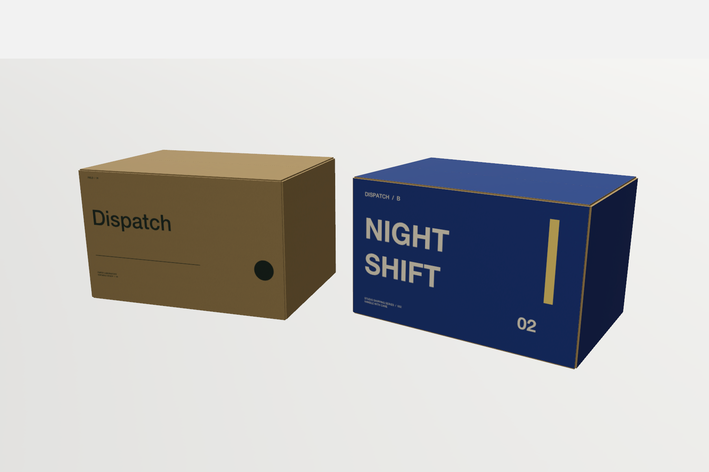

# Dispatch / Studio compositions

Open `Dispatch — Studio compositions.form` in LAB, then choose **Studio**. The first saved scene is the five-box Dispatch A stack. The project contains two independent original constructions and five saved compositions; repeated scene occurrences do not add design objects or create revision variants.

Click an instance to show its X/Y/Z movement arrows and vertical rotation ring. Drag a handle directly in either Orbit or Move; use the inspector for exact dimensions. Saved scene names are listed in the left sidebar. [Studio composition controls](../../docs/studio-compositions.md) explain placement, duplication, Undo and export.

Design A retains the original kraft Dispatch artwork, stock and authored construction from `../paper-packaging/Field — Twelve paper studies.form`. Design B uses the same construction with independent editable blue/off-white **NIGHT SHIFT** artwork, a gold vertical graphic, a large index and a different type layout. Editing B was exercised through the public artwork API; A remained exact, and one Undo restored B.



| Saved scene | Arrangement | Native image |
| --- | --- | --- |
| 01 / Dispatch A / Five aligned | Five occurrences of the same A source, identical orientation and aligned X/Z | [PNG](renders/01-aligned-a.render/01-aligned-a.png) |
| 02 / Dispatch A / Reverse view | The same five occurrences, viewed from the other side | [PNG](renders/02-reverse-a.render/02-reverse-a.png) |
| 03 / Dispatch B / Five aligned | Five occurrences of the same independent B source | [PNG](renders/03-aligned-b.render/03-aligned-b.png) |
| 04 / Dispatch A / Offset cluster | Five A occurrences with scene-local offsets and yaw rotations | [PNG](renders/04-offset-cluster.render/04-offset-cluster.png) |
| 05 / Dispatch A and B / Design pair | The two editable designs, with B turned slightly | [PNG](renders/05-design-pair.render/05-design-pair.png) |

The nominal carton controls are 260 × 180 × 160 mm with 3.2 mm stock. Fresh native folded poses and stock-slab corners give physical bounds of **263.2 × 183.2 × 163.2 mm**. The aligned stacks use a **163.2 mm** vertical pitch; they do not use the nominal 160 mm height. Horizontal layers touch at their nominal slab extents. This is a saved presentation arrangement, without load, crushing or friction simulation.

All five 1800 × 1200 PNGs are direct native RealityKit exports. Each adjacent `render.json` contains the complete saved scene and image hash. The run verified PNG dimensions/chunk CRCs/hashes, distinct outputs, no framing warnings, unchanged source objects and Table camera through scene edits/exports, and exact saved objects/scenes/camera after a private-app restart and public reopen. [Validation and provenance](validation.json) include the package file hashes. Ad-hoc signing the isolated bundle changes its executable signature bytes; both the original and private executable hashes are recorded.

Reproduce into a **new** output and disposable work directory:

```sh
python3 scripts/create_dispatch_studio_examples.py \
  --app build/LAB.app \
  --output .local/validation/dispatch-replay-output \
  --work .local/validation/dispatch-replay-work

python3 scripts/test_dispatch_studio_examples.py
```

The script creates a separately identified app copy, uses a unique socket and private library, and calls `form_construction`, `form_set_artwork`, `form_paper`, `form_edit_artwork`, `form_studio_scene` and `form_export`. It never edits project JSON behind the app or accesses the normal library. Existing output directories are rejected. The `.form` package is copied from the app-authored private library only after save/reopen verification and process cleanup. Four pure-data tests cover occurrence identity/contact, scene-local transforms, independent artwork composition and caliper-aware grounding.
